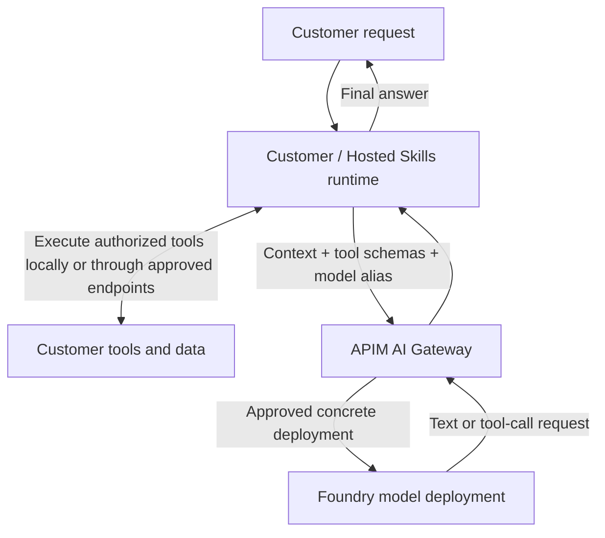

# POC 08: Stateless inference through AI Gateway

**Status:** Design only; no implementation, deployment, or live validation.
**Date:** 2026-11-04.
**Comparison:** [POC 09: automatic model routing](../09-stateless-model-router/README.md).

## 1. Goal and agreed boundary

Serve customer-provided context and function-tool definitions through a shared
model API. The customer selects an approved model alias. The customer or
Hosted Skills runtime owns the agent loop, executes tools, and sends tool
results back in a subsequent inference request.

There is **no 24-hour pinning requirement**. No session creation API, binding
table, second conversation history, or dedicated deployment per customer is
required by this design. POC 07 and the older customer-model-service document
describe a separate session-affinity experiment, not this contract.

These are proposed POC requirements, not claims about existing deployed behavior.

## 2. Do we need a component to handle the call flow?

**Yes: an agent runtime must handle the model/tool loop. That component is on
the customer side of the inference boundary, not a new model-service backend.**

| Component | Responsibility | Does not do |
| --- | --- | --- |
| Customer / Hosted Skills runtime, such as MAF or Copilot SDK | Assemble context and tool schemas; call the model; validate and execute tool calls; append results; repeat until completion | Expose provider credentials to users |
| APIM AI Gateway | Authenticate callers; enforce configured access and traffic policies; resolve aliases; authenticate to and forward to model backends | Execute arbitrary customer functions or own an agent conversation |
| Named model deployment | Generate text or structured tool-call requests | Execute the customer's function implementation |
| Operator configuration | Map customer identities and approved aliases to backends and policies | Store prompts or conversation history |

APIM can also govern MCP endpoints, but that does not make it the agent loop.
Function schemas describe callable operations; they are not executable code.
Actual tool code, tool credentials, and tool network access stay with the runtime.

## 3. Architecture



One shared APIM resource can serve multiple authenticated customers. Shared
inference is not dedicated compute isolation. Backends may be shared or
customer-specific according to onboarding requirements.

### Complete tool round trip

```mermaid
sequenceDiagram
    participant R as Customer / Hosted Skills runtime
    participant G as APIM AI Gateway
    participant M as Selected model
    participant T as Customer tool
    R->>G: 1. Context, messages, tool schemas, explicit model alias
    G->>G: 2. Authenticate, authorize alias, apply limits
    G->>M: 3. Rewrite alias to deployment; use provider authentication
    M-->>G: 4. Assistant message containing tool_calls
    G-->>R: 5. Preserve tool-call IDs, names, and argument strings
    R->>R: 6. Validate name, arguments, user authorization, and approval
    R->>T: 7. Execute authorized tool
    T-->>R: 8. Tool result
    R->>G: 9. Original context + assistant tool_calls + matching tool results
    G->>M: 10. Another independently authenticated inference request
    M-->>G: 11. Final response or further tool calls
    G-->>R: 12. Return response
```

The runtime repeats the loop when necessary. Proposed pilot limits are five
inference turns per user request, a 30-second tool timeout, and a 120-second
overall runtime deadline. These are runtime guardrails, not APIM defaults.
Each inference request has a separately configured backend timeout. On a
limit or timeout, surface an explicit incomplete/error outcome.

## 4. Inference API and routing

Propose `POST /llm/v1/chat/completions`, using OpenAI Chat Completions JSON.
This is a chosen gateway path, not a claim that APIM creates it without setup.
See the [shared request and response examples](contract-examples.md).

- `model` is an operator-configured public alias, for example `explicit-standard`.
- `messages` carries all context required for that inference request, including
  prior assistant tool calls and corresponding tool results.
- `tools` carries function schemas, not code, callback credentials, or arbitrary
  backend URLs. The runtime keeps the schemas consistent across the tool loop.
- `stream` selects JSON or SSE. Preserve the upstream protocol and usage when
  reported. Do not invent usage when it is absent.
- Enforce `store: false` where supported and qualify its behavior. This does
  not override provider abuse monitoring or contractual retention policies.
- No custom `customer_id`, `session_id`, or session-binding API is needed.
  A correlation ID is optional telemetry, not identity or an idempotency key.

### Operator-owned route configuration

| Public alias | Backend selection | Policy |
| --- | --- | --- |
| `explicit-standard` | A chosen, tool-capable named deployment | Only authenticated customers allowed by configured access policy |
| `explicit-reasoning` | Another qualified named deployment | Optional alias; enable only after protocol/capability qualification |

These aliases are illustrative configuration, not actual model names or
existing deployments. Select the concrete models, supported parameters,
region, deployment type, and capacity before implementation.

Resolve the authenticated gateway subscription or validated workload identity
to the SaaS customer through an onboarding mapping. An Entra directory ID or
caller-supplied tenant header alone is not the SaaS authorization boundary.
Apply limits using this verified customer identity.

The gateway selects the backend and rewrites the model alias through configured
policies, rather than trusting a caller URL or provider credential. The model
backend must reject unauthorized direct calls; use scoped gateway identity and
network controls as required. Customer gateway credentials never become model
provider or tool credentials.

No automatic cross-model fallback in this baseline. Any equivalent-deployment
failover must be explicitly configured and qualified. The alias is resolved on
each request, not pinned; avoid changing its target during an acceptance run.

## 5. Statelessness and protocol compatibility

Any gateway instance can process an inference request without a conversation
lookup. The runtime stores/restores its own history if needed. Operator route
configuration, credential references, rate counters, and redacted telemetry
still exist; stateless serving is not a claim of zero storage everywhere.

Use an ordinary imported OpenAI-compatible API and APIM policies as the baseline.
The [unified model API](https://learn.microsoft.com/en-us/azure/api-management/unified-model-api)
is an optional preview convenience, not a dependency. Its documented client
interface is Chat Completions, with OpenAI Chat Completions and Anthropic
Messages backends.

The current Hosted Skills Copilot provider uses Responses API. Do not assume
that client works unchanged with the proposed Chat Completions interface.
Implementation must qualify the exact pinned MAF/Copilot SDK provider path:
either use a supported Chat Completions configuration or expose and qualify a
separate Responses passthrough route. Responses tool items and Chat Completions
messages are different contracts; translating them is explicit adapter work.
Do not silently substitute provider-managed conversations for runtime-owned
context.

For SSE, use a supported APIM tier, disable response buffering/body logging/
response caching, and verify incremental delivery. Accumulate complete tool-call
arguments before validation or execution. A truncated stream is not a completed
tool call or successful response. No prompt or semantic response cache is enabled
in this POC.

## 6. Errors, safety, and ownership

- Gateway policy errors use an OpenAI-shaped `error` object: 401 for missing/
  invalid credentials, 403 for denied access, 400 for an unknown model alias,
  413 for a configured payload-size limit, and 429 for a gateway traffic limit.
  Set a proposed initial body limit of 1 MiB; token/context limits are separate.
- Preserve provider error statuses and safe error details rather than returning
  success. Configure explicit timeout handling; timeouts are not empty answers.
- Do not automatically replay inference after partial output. Caller/SDK retry
  behavior must be configured and recorded; retries can incur additional cost.
- Model output and tool arguments are untrusted. The runtime checks schemas,
  per-user resource access, approvals, and tool-call IDs before execution.
- Side-effecting tools need caller-owned deduplication/idempotency and audit.
  A model request ID does not make a tool operation idempotent.
- Tool errors become structured runtime-owned tool results or explicit terminal
  failures. Never invent a successful tool result.
- Never share message buffers, tool ledgers, or results between customers.
  Disable body and secret-header logging; retain only authorized metadata.
- A tool-call response ends the inference request. No gateway connection waits
  for the customer's tool to finish, and no service-side job queue is required.

## 7. Proposed POC and acceptance plan

Use a synthetic, read-only `lookup_stock` tool. Customer A has seven units of
SKU A-101 and customer B has two. Both contexts reserve two units; the expected
shippable amounts are five and zero. These are future fixture values, not results.

| Case | Required evidence |
| --- | --- |
| Tool round trip | Valid requested tool name/arguments, matching call ID, real fixture execution, and answer grounded in the returned stock |
| Context ownership | A second call includes the complete authorized transcript; no inference-side history retrieval |
| Customer isolation | Interleave A/B loops and verify each tool receives only its authorized scope; neither answer contains the other's canary |
| Stateless restart | A fresh client/worker can continue using caller-supplied messages without recreating a binding |
| Direct model choice | Each approved alias resolves to its configured deployment; unknown/denied aliases fail explicitly |
| No tool required | A context-only question completes without executing a tool |
| Invalid tool output | Unknown tool name, malformed arguments, mismatched call ID, or unauthorized SKU causes no unauthorized execution |
| Failures and limits | Cover 401/403/413/429, provider errors, deadlines, tool failure, and loop exhaustion with no silent fallback |
| Streaming | Observe incremental text and tool-argument fragments; execute no partial tool call; interrupted streams are marked incomplete |
| Observability | Record verified customer, request ID, requested alias, backend/served model when available, timings, errors, and reported usage without prompt bodies |

First implement a deterministic provider double and caller-owned tool fixture.
Passing that proves contract wiring only, not APIM policy execution or LLM quality.
Then, with separate approval for provisioning and paid calls, qualify real APIM,
the exact SDK, and an approved model. Test forced tool selection only where the
selected model supports it; test natural tool selection separately.

For streaming qualification, a synthetic backend should emit events 500 ms apart;
propose a maximum additional inter-hop event delay of 250 ms on an unloaded
test path and report actual measurements. Live LLM token timing is not a
substitute for this forwarding test. Agree load and latency targets separately.

No code, APIM policy, Azure resource, paid call, or acceptance result is delivered
by this design-only POC.

## 8. Recommendation and sources

Use this as the baseline: **customer runtime + APIM + named model deployment**.
A new custom orchestration service would duplicate the agreed runtime boundary.
Add one only if requirements later include service-owned tool execution, custom
admission policy not practical in APIM, or protocol adaptation.

- [APIM AI Gateway capabilities](https://learn.microsoft.com/en-us/azure/api-management/genai-gateway-capabilities)
- [Function calling: the application executes functions](https://learn.microsoft.com/en-us/azure/foundry/openai/how-to/function-calling)
- [APIM SSE requirements](https://learn.microsoft.com/en-us/azure/api-management/how-to-server-sent-events)
- [POC 09: managed automatic routing](../09-stateless-model-router/README.md)
