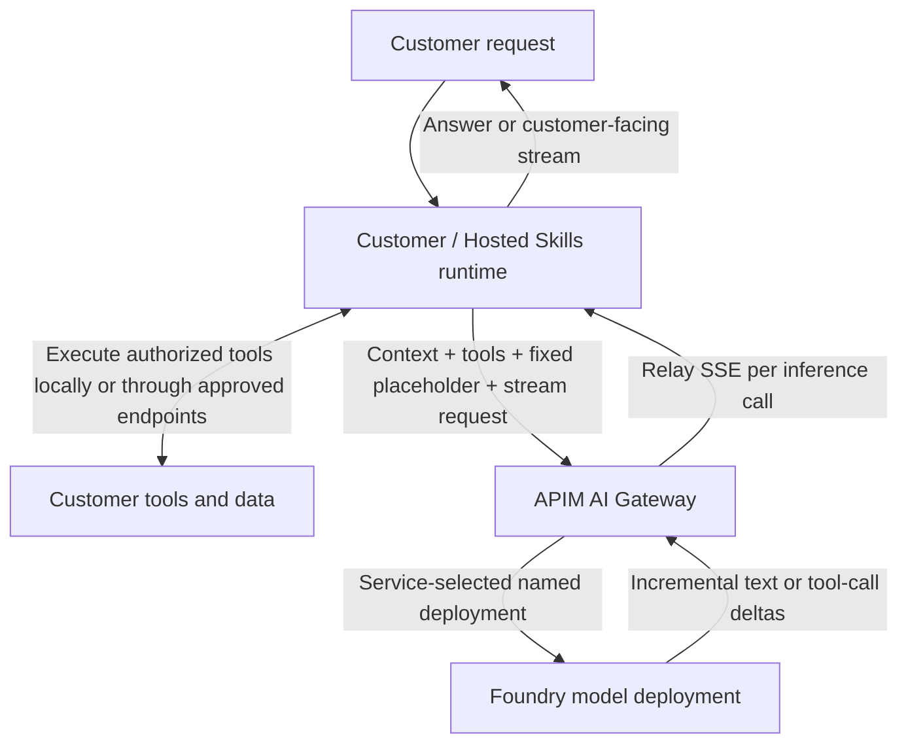

# POC 08: Stateless inference through AI Gateway

**Status:** Design only; streaming is not implemented or validated on this path.
No implementation, deployment, or live acceptance result exists for this POC.
**Date:** 2026-11-04.
**Comparison:** [POC 09: automatic model routing](../09-stateless-model-router/README.md).

## 1. Goal and agreed boundary

Serve customer-provided context and function-tool definitions through a shared
model API. The service, not the customer, selects the model deployment. The
customer or Hosted Skills runtime owns the agent loop, executes tools, and sends
tool results back in a subsequent inference request.

**Incremental streaming is mandatory for each inference call.** The contract
also supports non-streaming JSON. The runtime owns any customer-facing experience
that combines output across multiple inference calls and tool executions.

There is **no 24-hour pinning requirement**. No session creation API, binding
table, second conversation history, or dedicated deployment per customer is
required by this design. POC 07 and the older customer-model-service document
describe a separate session-affinity experiment, not this contract.

These are proposed POC requirements, not claims about existing deployed behavior.

## 2. Do we need a component to handle the call flow?

**Yes: an agent runtime must handle the model/tool loop. That component is on
the customer side of the inference boundary, not a new model-service backend.**

| Component | Responsibility | Does not do |
| --- | --- | --- |
| Customer / Hosted Skills runtime, such as MAF or Copilot SDK | Assemble context and tool schemas; call the model; validate and execute tool calls; append results; repeat until completion | Expose provider credentials to users |
| APIM AI Gateway | Authenticate callers; enforce access and traffic policies; select an operator-approved backend; relay model output | Execute arbitrary customer functions or own an agent conversation |
| Named model deployment | Generate text or structured tool-call requests | Execute the customer's function implementation |
| Operator configuration | Map verified customer identities to approved backends and policies | Store prompts or conversation history |

APIM can also govern MCP endpoints, but that does not make it the agent loop.
Function schemas describe callable operations; they are not executable code.
Actual tool code, tool credentials, and tool network access stay with the runtime.

## 3. Architecture



One shared APIM resource can serve multiple authenticated customers. Shared
inference is not dedicated compute isolation. Backends may be shared or
customer-specific according to onboarding requirements.

### Complete tool round trip

```mermaid
sequenceDiagram
    participant R as Customer / Hosted Skills runtime
    participant G as APIM AI Gateway
    participant M as Selected model
    participant T as Customer tool
    R->>G: 1. Context, tool schemas, fixed placeholder, stream=true
    G->>G: 2. Authenticate, authorize customer, select approved deployment
    G->>M: 3. Rewrite placeholder; use provider authentication
    M-->>G: 4. Incremental text or tool-call deltas
    G-->>R: 5. Relay SSE deltas as they arrive
    R->>R: 6. Complete stream; assemble and validate authorized tool calls
    R->>T: 7. Execute authorized tool
    T-->>R: 8. Tool result
    R->>G: 9. Original context + assistant tool_calls + matching tool results
    G->>M: 10. Another independently authenticated inference request
    M-->>G: 11. Stream final response or further tool-call deltas
    G-->>R: 12. Relay SSE; runtime continues or finishes
```

The runtime repeats the loop when necessary. Proposed pilot limits are five
inference turns per user request, a 30-second tool timeout, and a 120-second
overall runtime deadline. These are runtime guardrails, not APIM defaults.
Configure inference deadlines and connection timeouts separately. The APIM
`forward-request` timeout waits for backend response headers; it is not a
deadline for the entire stream. On a limit or timeout, surface an explicit
incomplete/error outcome.

## 4. Inference API and routing

Propose `POST /llm/v1/chat/completions`, using OpenAI Chat Completions JSON.
This is a chosen gateway path, not a claim that APIM creates it without setup.
See the [shared request and response examples](contract-examples.md).

- `model` is the fixed protocol placeholder `service-default` for both POCs.
  It does not let the caller select a model, deployment, or routing profile.
  Reject any other value before inference.
- `messages` carries all context required for that inference request, including
  prior assistant tool calls and corresponding tool results.
- `tools` carries function schemas, not code, callback credentials, or arbitrary
  backend URLs. The runtime keeps the schemas consistent across the tool loop.
- `stream: true` requests incremental SSE; `stream: false` requests a JSON
  response. Both modes are required. Preserve the selected protocol and usage
  when reported; do not invent usage when it is absent.
- Enforce `store: false` where supported and qualify its behavior. This does
  not override provider abuse monitoring or contractual retention policies.
- No custom `customer_id`, `session_id`, or session-binding API is needed.
  A correlation ID is optional telemetry, not identity or an idempotency key.

### Operator-owned route configuration

| Trusted input | Service-controlled route | Policy |
| --- | --- | --- |
| Verified customer mapped to an eligible policy | An approved, tool-capable named deployment | Apply that customer's access, region, capacity, and traffic rules |
| Another verified customer | The same or another approved named deployment | Deny before inference if no eligible route is configured |

This is illustrative configuration, not a claim that deployments already exist.
The operator chooses concrete models, supported parameters, region, deployment
type, and capacity before implementation. Customers always send the same fixed
placeholder, regardless of which deployment the service selects.

Resolve the authenticated gateway subscription or validated workload identity
to the SaaS customer through an onboarding mapping. An Entra directory ID or
caller-supplied tenant header alone is not the SaaS authorization boundary.
Apply limits using this verified customer identity. For the POC, a configured
APIM subscription key can identify a mapped workload; a validated Entra
workload identity is a production option. Neither a subscription key nor a
workload identity by itself authorizes individual end-user tool actions.

The gateway validates the fixed placeholder, selects the backend using the
trusted mapping, and rewrites the backend model field through configured
policies. Reject caller-supplied deployment identifiers and routing overrides;
do not expose a bypass route that accepts a caller URL or provider credential.
The model backend must reject unauthorized direct calls; use a scoped gateway
managed identity and network controls as required. Customer gateway credentials
never become model provider or tool credentials. A provider-reported model name
in a response is metadata, not permission to select or call that model.

No automatic cross-model fallback in this baseline. Any equivalent-deployment
failover must be explicitly configured and qualified. The route is selected on
each request, not pinned; keep operator configuration stable during a comparison
run and qualify continuation across any permitted change.

## 5. Statelessness and protocol compatibility

Any gateway instance can process an inference request without a conversation
lookup. The runtime stores/restores its own history if needed. Operator route
configuration, credential references, rate counters, redacted telemetry, and
active streaming connections still exist; stateless serving is not a claim of
zero state everywhere.

Use an ordinary imported OpenAI-compatible API and APIM policies as the baseline.
The [unified model API](https://learn.microsoft.com/en-us/azure/api-management/unified-model-api)
is an optional preview convenience, not a dependency. Its documented client
interface is Chat Completions, with OpenAI Chat Completions and Anthropic
Messages backends.

The current Hosted Skills Copilot provider uses Responses API. Do not assume
that client works unchanged with the proposed Chat Completions interface.
Implementation must qualify the exact pinned MAF/Copilot SDK provider path:
either use a supported Chat Completions configuration or expose and qualify a
separate Responses passthrough route. Responses tool items and Chat Completions
messages are different contracts; translating them is explicit adapter work.
Do not silently substitute provider-managed conversations for runtime-owned
context.

### Mandatory per-inference streaming

- For `stream: true`, return `text/event-stream` incrementally as the backend
  emits events, not a completed response split into chunks afterward. Preserve
  Chat Completions choice and tool-call indexes, IDs, argument fragments,
  finish reasons, and the `[DONE]` marker. The runtime assembles each call and
  waits for a complete `tool_calls` finish and `[DONE]` before validating and
  executing it. A truncated, filtered, or length-limited result is not a
  complete executable tool call.
- Each inference call has its own stream. A tool call terminates that model
  response; the runtime executes the tool and starts a new inference call.
  Joining these into one customer-facing stream is the runtime's responsibility,
  not a capability assumed of APIM or the model service.
- Use an APIM tier supporting long-running HTTP connections; Consumption does
  not. Set `forward-request buffer-response="false"` and avoid other
  response-buffering policies. Disable request and response body logging for
  Azure Monitor, Application Insights, and Event Hubs, including inherited
  diagnostics, and disable gateway response and semantic caching.
- Configure and test idle keepalive, deadlines, concurrency, and bounded
  tool-argument buffering. APIM's infrastructure has a four-minute idle timeout;
  use an appropriate supported keepalive strategy for longer idle periods.
  Verify whether client cancellation reaches the backend; do not assume it
  stops inference or billing immediately.
- Preserve supported error events after streaming starts, or treat an unexpected
  termination as incomplete. HTTP status cannot be changed after headers are
  sent. Do not automatically replay an inference after partial output.

Gateway caching being disabled does not establish zero provider retention or
disable provider-side prompt caching. Qualify those separately. See the
[shared SSE and JSON examples](contract-examples.md) and
[APIM SSE configuration guidance](https://learn.microsoft.com/en-us/azure/api-management/how-to-server-sent-events).

## 6. Errors, safety, and ownership

- Before response headers, gateway policy errors use an OpenAI-shaped `error`
  object: 401 for missing/invalid credentials, 403 for denied customer access,
  400 for an invalid model placeholder, 413 for a configured payload-size limit,
  and 429 for a gateway traffic limit. Set a proposed initial body limit of
  1 MiB; token/context limits are separate. Missing eligible routes fail closed.
- Before headers, preserve provider error statuses and safe details rather than
  returning success. After headers, follow the streaming error rules above.
  Timeouts and disconnects are not empty successful answers.
- Do not automatically replay inference after partial output. Caller/SDK retry
  behavior must be configured and recorded; retries can incur additional cost.
- Model output and tool arguments are untrusted. The runtime checks schemas,
  per-user resource access, approvals, and tool-call IDs before execution.
- Side-effecting tools need caller-owned deduplication/idempotency and audit.
  A model request ID does not make a tool operation idempotent.
- Tool errors become structured runtime-owned tool results or explicit terminal
  failures. Never invent a successful tool result.
- Never share message buffers, tool ledgers, or results between customers.
  Disable body and secret-header logging; retain only authorized metadata.
- A tool-call response ends the inference request. No gateway connection waits
  for the customer's tool to finish, and no service-side job queue is required.

## 7. Proposed POC and acceptance plan

Use a synthetic, read-only `lookup_stock` tool. Customer A has seven units of
SKU A-101 and customer B has two. Both contexts reserve two units; the expected
shippable amounts are five and zero. These are future fixture values, not results.

| Case | Required evidence |
| --- | --- |
| Tool round trip | Valid requested tool name/arguments, matching call ID, real fixture execution, and answer grounded in the returned stock |
| Context ownership | A second call includes the complete authorized transcript; no inference-side history retrieval |
| Customer isolation | Interleave A/B loops and verify each tool receives only its authorized scope; neither answer contains the other's canary |
| Stateless restart | A fresh client/worker can continue using caller-supplied messages without recreating a binding |
| Service-owned model selection | The same fixed placeholder selects each verified customer's configured deployment; caller-supplied models, route overrides, unauthorized mappings, and bypass paths fail before inference |
| No tool required | A context-only question completes without executing a tool |
| Invalid tool output | Unknown tool name, malformed arguments, mismatched call ID, or unauthorized SKU causes no unauthorized execution |
| Failures and limits | Cover 401/403/413/429, provider errors, deadlines, tool failure, and loop exhaustion with no silent fallback |
| Incremental SSE | `stream: true` returns SSE before inference completes; preserve text deltas, choice/tool indexes, IDs, finish reason, and `[DONE]` |
| Streamed tools | Assemble fragmented and interleaved tool calls correctly; execute only complete, schema-valid, authorized calls after stream completion |
| Streaming isolation | Interleave A and B streams through both the synthetic fixture and the live gateway/model path; no event or tool argument contains the other customer's canary |
| Stream failures | Exercise pre-header errors, post-header failure, missing `[DONE]`, cancellation, and deadlines; report incomplete results and never replay partial output or execute partial calls |
| JSON compatibility | `stream: false` returns the corresponding JSON text and tool-call shapes, with the same routing and authorization rules |
| Real integration | Qualify incremental streaming and tool handling through the actual APIM tier, named deployment, and pinned runtime/SDK; a synthetic double is not cloud evidence |
| Observability | Record verified customer, request ID, selected backend/served model when available, time to first event, terminal status, errors, and reported usage without prompt bodies |

First implement a deterministic provider double and caller-owned tool fixture.
Passing that proves contract wiring only, not APIM policy execution or LLM quality.
Then, with separate approval for provisioning and paid calls, qualify real APIM,
the exact SDK, and an approved model. Test forced tool selection only where the
selected model supports it; test natural tool selection separately.

For streaming qualification, a synthetic backend should emit at least five
events 500 ms apart. On an unloaded test path, the proposed gate is that each
event reaches the client within 250 ms of its backend emission, and the first
arrives before the last is emitted. Measure with a shared monotonic clock or
document and account for clock skew. Record every emission and arrival; this is
an unmeasured POC target, not a service-level agreement. Run it through the
actual configured gateway as well as locally. Live LLM token timing is not a
substitute for the forwarding test. Agree load and latency targets separately.

No code, APIM policy, Azure resource, paid call, or acceptance result is delivered
by this design-only POC.

## 8. Recommendation and sources

Use this as the baseline: **customer runtime + APIM + named model deployment**.
A new custom orchestration service would duplicate the agreed runtime boundary.
Add one only if requirements later include service-owned tool execution, custom
admission policy not practical in APIM, or protocol adaptation.

- [APIM AI Gateway capabilities](https://learn.microsoft.com/en-us/azure/api-management/genai-gateway-capabilities)
- [Function calling: the application executes functions](https://learn.microsoft.com/en-us/azure/foundry/openai/how-to/function-calling)
- [APIM SSE requirements](https://learn.microsoft.com/en-us/azure/api-management/how-to-server-sent-events)
- [POC 09: managed automatic routing](../09-stateless-model-router/README.md)
