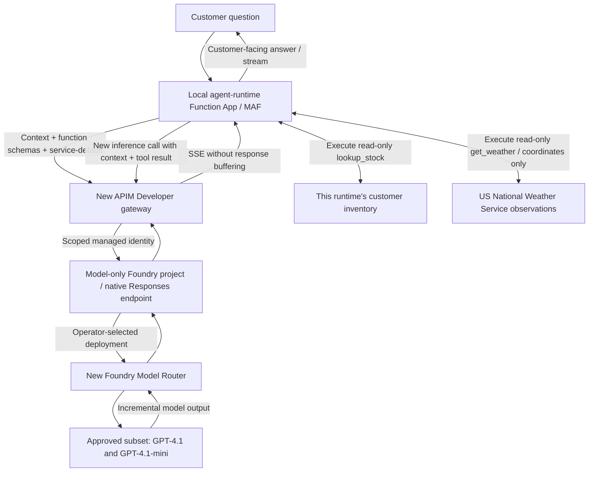

# POC 09: Inventory and weather with the real MAF agent-runtime app

**Status:** The isolated gateway, Model Router, and approved model-only Foundry
project are deployed. **All four live checks pass: customer A and B, each with
JSON and SSE, real tool execution, the correct answer/source, and terminal
`done`.** Each stream delivered 12 text deltas across 16 runtime events.
A paced rerun passed after an earlier burst hit the router's
10-model-requests/minute limit; incomplete streams are rejected, not counted as
success. Those figures describe the original inventory qualification.
The new **mixed-capability live run also passes all four checks**: inventory
JSON/SSE for A and real NWS weather JSON/SSE for B. Inventory streamed 12 text
deltas; weather streamed 30; both executed the correct tool and ended with
`done`. 116 local tests pass against the actual runtime
checkout and pinned MAF packages using synthetic HTTP transport. During live
testing, both native Functions apps ran locally on ports 7071/7072; the chat UI
was configured for localhost without exposing an APIM key. Start your own
local apps using the instructions below.

This is the runnable companion to [POC 09's design](../09-stateless-model-router/README.md).
It neither modifies the external agent-runtime checkout nor changes POC 06.
To run the runtime repository's original **basic-chat** sample rather than the
inventory/weather app, use [the native basic-chat launch profile](#6-run-the-original-basic-chat-sample).
For the runtime's multi-agent report sample, use the
[native daily Azure report profile](daily-azure-report/README.md):
synthetic read-only inventory, no email, and automatic timer execution disabled.

## Flow



The service owns model selection. Every caller uses `service-default`; APIM
rewrites it to `poc09-router`. There is no gateway transcript, session registry,
24-hour pinning, tool execution service, or custom proxy backend.

## Capabilities and customer tool execution

The existing `/agents/inventory/`, `/chat`, and `/chatstream` routes are retained
for compatibility; the agent is now **Inventory and Weather Assistant**.

| Capability | Registered runtime tool | Data and behavior |
| --- | --- | --- |
| Inventory | `lookup_stock(sku)` | Trusted A/B fixture; the runtime calculates the two-unit reserve |
| Weather | `get_weather(latitude, longitude)` | Real recent nearby-station observations from `api.weather.gov` |

Ask **"How is the weather in Seattle?"** or
**"How many units of A-101 can ship today?"** in the same standalone chat.
Start a new chat session after updating from the inventory-only version so old
refusal messages do not form part of the conversation history.

There is **no city allowlist**. NWS coverage is limited to supported US areas.
The tool accepts finite WGS84 coordinates, not arbitrary URLs or credentials.
For unambiguous cities the agent can use known approximate city-centre
coordinates; Seattle's coordinates are included in its instructions. There is
no geocoding service: ambiguous or unknown locations require clarification or
coordinates from the user. An observation at a nearby station is not a precise
measurement at the user's address. Unsupported locations are reported as
unavailable, not answered using model memory.

The runtime makes at most three NWS reads per weather tool invocation:
point-to-grid lookup, nearby stations, then the first station's latest
quality-controlled observation. It uses fixed HTTPS provider URLs, does not
follow redirects or provider-supplied URLs, sends no APIM key or chat history,
and creates no new Azure resources. The only location data sent to NWS is the
requested coordinates and the derived public grid/station identifiers.
Each HTTP request has an eight-second timeout; the whole lookup has a
20-second deadline. There are no automatic provider retries or fallback
providers.

### Weather results and explicit failures

A successful result contains `status: "ok"`, Celsius temperature, optional
conditions, station name/ID/coordinates, observation timestamp with timezone,
and the NWS source URL. Observations over two hours old are rejected rather
than presented as current. NWS observations can already be delayed by
quality-control processing; the answer must show the observation timestamp.

| Condition | Tool result |
| --- | --- |
| Unsupported NWS point | `unavailable / outside_coverage` |
| No nearby station or latest observation | `unavailable / no_station` or `no_observation` |
| Observation over two hours old or temperature missing | `unavailable / stale_observation` or `missing_temperature` |
| Provider HTTP 429 or 5xx | `unavailable / provider_rate_limited` or `provider_unavailable` |
| Timeout, connection failure, rejected request, malformed data | `error` with an explicit reason code |

Failure results contain an `error` object, not a temperature or invented
conditions. They are logged by code without provider response bodies. The
pinned runtime marks these JSON tool calls unsuccessful. For SSE, inspect the
correlated `tool_end.result` status: a final `done` can mean the agent completed
an honest failure explanation, not that weather was obtained. Positive weather
smoke checks require an actual `ok` result and an answer matching its values.
Missing optional conditions remain unknown, not "clear skies".

The model sees tool schemas and results; it never receives tool implementation
code or provider credentials. Customer-owned tools should be registered by
trusted runtime configuration, with their own scoped connections and
authorization. This sample demonstrates local Python handlers, not arbitrary
code upload or a remote HTTP/MCP connector. If a capability has no registered
tool, the agent must explain that limitation rather than pretend to execute it.

### Important: the actual MAF protocol

The checked-out runtime pins `agent-framework-core==1.13.0`,
`agent-framework-openai==1.10.2`, and `agent-framework-foundry==1.10.3`.
Its `OpenAIChatClient` sends **Responses API** requests. This was observed in
the native tests, not assumed from the class name.

The gateway therefore exposes a separate Responses passthrough in addition to
the [shared Chat Completions contract](../08-stateless-ai-gateway/contract-examples.md):

| Route under gateway `/llm` | Purpose | Backend |
| --- | --- | --- |
| `/openai/v1/responses` | Actual MAF runtime client | Foundry project `/api/projects/poc09-runtime/openai/v1/responses` |
| `/openai/deployments/service-default/chat/completions` | Azure OpenAI Chat Completions SDK compatibility | Router deployment Chat Completions API |
| `/v1/chat/completions` | Shared inference JSON contract | Router deployment Chat Completions API |

There is no Responses-to-Chat translation. Responses uses function-call items,
argument delta events, and `response.completed`; Chat Completions uses message
deltas, `finish_reason`, and `[DONE]`. APIM must preserve the native protocol.

**Authentication adapter:** this sample configures the APIM subscription-key
header as `api-key`, because the runtime's Azure OpenAI SDK sends that header.
Its value is an **APIM subscription key**, never a provider key. This differs
from the illustrative `Ocp-Apim-Subscription-Key` header in the shared document.
The gateway validates subscription IDs `poc09-a`/`poc09-b`, derives customer
scope from them, removes caller credentials, and uses managed identity to Foundry.

## Approved resources and deployment status

The user approved provisioning and the bounded initial paid smoke test on
2026-11-05 UTC in a dedicated subscription. A **new**
`rg-poc09-router-runtime` was created; ARM deployment `poc09-runtime`
succeeded. The signed-in operator's contact email was used as the publisher
contact. No existing resource group or gateway was reused. Subscription IDs,
deployment-specific hostnames, and credentials are not published in this
runbook.
Gateway readiness, installed unbuffered policy, account-scoped managed identity
role, and the exact router version/subset/capacity were verified. Gateway tests
rejected missing keys, invalid input, spoofed customers, and model overrides,
while accepting both pilot keys. These checks did not request provider generation.
The user subsequently approved a model-only project and minimum permissions in
this same account/group. Project `poc09-runtime` is deployed; project-based native
Responses inference now works. Resource creation alone is not live acceptance.

### Live qualification findings

- Corrected [Load-Keys.ps1](Load-Keys.ps1) to use ARM subscription `listSecrets`;
  the installed CLI has no `az apim subscription` command group.
- Reproduced and fixed present-but-empty base-URL aliases conflicting with the
  endpoint in MAF settings. The initial runtime failure happened before a provider
  HTTP request; regression tests cover empty and nonempty aliases.
- Corrected the persisted gateway backend to the account-advertised
  `.openai.azure.com` inference hostname instead of its generic Cognitive
  Services hostname, updating only this new API's policy.
- Resource-level Responses requests still returned HTTP 400
  `The requested operation is unsupported.` The approved fix follows the
  [documented Model Router Responses example](https://learn.microsoft.com/en-us/azure/foundry/openai/how-to/responses-model-routing):
  use the project endpoint, not protocol conversion or a replacement model.
- Responses uses `https://ai.azure.com` as the managed-identity audience and a
  project-scoped **Foundry User** role. Chat Completions retains the account's
  OpenAI hostname, `https://cognitiveservices.azure.com` audience, and
  account-scoped **Cognitive Services OpenAI User** role.
- Account and project have system identities, as required by Azure. Project
  creation depends on router deployment to avoid concurrent account-update
  conflicts. No hosted agent or project capability host was created.
- Real native A JSON and SSE runs executed the inventory tool and returned the
  correct source. A B JSON run exposed inconsistent model-only arithmetic;
  the tool now computes `available_to_ship` deterministically, and the model
  reports that field unchanged. The final paced run passed A/B JSON and SSE,
  verifying one successful inventory tool call per request and matching sources.
- A burst caused a provider-side HTTP 429 **inside** the B stream, surfaced as a
  runtime `error` event after tool execution. ARM confirms router limits of
  **10 requests and 10,000 tokens per 60 seconds** at approved capacity 10.
  The driver now pauses 15 seconds between runtime requests and preserves
  partial evidence on failure. No quota, capacity, model, or tier was increased.
  An earlier incomplete A stream was not captured in detail and its cause is
  unconfirmed; a subsequent individual A stream completed successfully.

The deployed resources are isolated in `rg-poc09-router-runtime`, East US 2:

- One APIM **Developer** instance, system-assigned identity, pilot API/product,
  and separate customer A/B subscriptions.
- One new Foundry `AIServices` account, local-key authentication disabled.
- One `model-router` deployment, version `2025-11-18`, **GlobalStandard**,
  capacity 10, Balanced routing over GPT-4.1 and GPT-4.1-mini only.
- One model-only Foundry project, `poc09-runtime`, with project management enabled
  on its parent account; it reuses the approved router deployment.
- Account-scoped **Cognitive Services OpenAI User** and project-scoped
  **Foundry User** roles for the gateway identity.
- The agent-runtime app stays local; no Azure Function App, storage account,
  hosted-agent deployment, provisioned compute, or additional orchestrator exists.

East US 2 catalog and quota checks on 2026-11-04 found the selected model/SKU
and 1,000 available GlobalStandard ModelRouter quota units; provisioning can
still fail because quota is not reserved regional capacity. Recheck at deployment.
GlobalStandard does not guarantee inference stays in East US 2.

| Cost item | Public USD estimate, checked 2026-11-04 |
| --- | --- |
| APIM Developer unit | $0.0658/hour; about $1.58/day or $48.03 at 730 hours/month |
| Model Router Global routing meter | $0.14 per million input tokens, plus the selected model's token charges |
| Selected model inference | Variable pay-as-you-go GPT-4.1/GPT-4.1-mini input/output charges |
| Other | Applicable bandwidth, taxes, and agreement-specific prices are additional |

Developer is for testing, has no production SLA, and continues billing while
idle. There is no automatic deletion. Do not provision until the user approves
the subscription, resource group, region, fixed gateway cost, and paid test scope.
The initial driver makes four runtime requests (JSON and streaming for A/B);
normally these produce eight model calls, but retries or additional tool turns
can increase that count. Rate/quota controls are **not a dollar spend cap**.

## 1. Install into an isolated environment

Prerequisites: Git, Python 3.13+, and Azure Functions Core Tools v4 on `PATH`.
The live test used Core Tools 4.14.0. Azure CLI and an authenticated Azure
subscription are needed only for provisioning or running against a real
gateway; the local tests do not need Azure.

The sample requires a **separate checkout** of the
[Azure Functions Agents runtime](https://github.com/Azure/azure-functions-agents-runtime)
alongside the cloned POC repository. From a parent directory in PowerShell:

```powershell
git clone https://github.com/swapnil-nagar/model-service-pocs.git
git clone https://github.com/Azure/azure-functions-agents-runtime.git
git -C .\azure-functions-agents-runtime switch --detach 5174e72d6036cc6248013d3678f715f7c0e14998
Set-Location .\model-service-pocs\09-model-router-runtime-sample
python --version
python -m venv .venv
.\.venv\Scripts\python.exe -m pip install `
  -e ..\..\azure-functions-agents-runtime `
  "httpx>=0.28,<1" `
  "pytest>=9,<10" "pytest-asyncio>=1.3,<2" "ruff>=0.15,<1"
```

Use your approved package-index/TLS settings. The runtime revision above is
the clean checkout used for the reported results. If you already have either
repository, preserve any local changes and use a compatible checkout instead
of overwriting it. The expected layout is
`<parent>\model-service-pocs` and `<parent>\azure-functions-agents-runtime`.
Alternatively, `uv sync` uses the editable source in
[pyproject.toml](pyproject.toml). During testing, the default public-index
`uv sync` hit a TLS handshake failure; pip succeeded through the configured
approved package index. No TLS checks were disabled and no internal package
index URL was committed.

[Start-Agent.ps1](Start-Agent.ps1) checks that the environment imports the
expected sibling checkout and explicitly selects its Python for the Functions
worker; changing PATH alone allowed Core Tools to load the wrong global runtime
during testing.

## 2. Local tests without paid calls

```powershell
.\.venv\Scripts\python.exe -B -m pytest .\tests -q
.\.venv\Scripts\python.exe -m ruff check .
az bicep build --file .\infra\main.bicep --stdout | Out-Null
```

Tests exercise the real `create_function_app`, HostedSkill facade, MAF client,
and runtime-owned tool loop against explicitly synthetic HTTP responses. They
check A/B stock isolation, fixed model/SDK path, complete tool result continuation,
JSON, incremental Responses events, and no execution after interrupted arguments.
They validate the actual returned stock, not just a tool-start event or synthetic
final answer, and reject tool errors, foreign inventory, and misleading answers.
The native HTTP handlers are exercised for A/B JSON and SSE for both
capabilities, including exact response fields and correlation of tool-end
events whose name can be null. Weather tests cover finite/ranged coordinates,
missing/stale data, provider errors/timeouts, redirect refusal, and failure
results passing through the real MAF tool loop without fabricating readings.
Both tools explicitly register their flat Pydantic input schemas with `tool`.
The policy test checks XML/configuration shape, not live APIM policy execution.
Additional tests import the original `samples/basic-chat/src/function_app.py`,
exercise its native HTTP handlers and MAF client, verify resent conversation
history, reject provider authentication failures, and validate the live checker.
A PowerShell regression test verifies that base-URL variables are removed, not
left present but empty.

## 3. Provision only after approval

[Deploy.ps1](Deploy.ps1) verifies the selected subscription and quota, refuses
an unrelated existing resource group, checks ARM preview for deletions, and uses
incremental deployment. APIM creation can take tens of minutes.

```powershell
# Only after approving costs, region, subscription, and resource creation:
az account set --subscription "<approved-subscription-id>"
.\Deploy.ps1 -Subscription "<approved-subscription-id>" `
  -PublisherEmail "<operator-contact-email>" -ApproveProvisioning
```

The output includes gateway endpoint/name, account name, and deployment name,
never keys. Role propagation and gateway readiness must be verified before
model calls. ARM/APIM validation or capacity failures must not be replaced with
another model, tier, region, or synthetic success.

If the approved POC resources already exist, do not redeploy just to find their
names. Retrieve the original deployment outputs instead:

```powershell
az deployment group show --subscription "<approved-subscription-id>" `
  --resource-group "rg-poc09-router-runtime" --name "poc09-runtime" `
  --query "properties.outputs" --output json
```

## 4. Start customer A and B runtime apps

In **each of two terminals**, retrieve the owning gateway keys into process
environment without printing or persisting their values:

```powershell
Set-Location "<path-to-model-service-pocs>\09-model-router-runtime-sample"
.\Load-Keys.ps1 -Subscription "<approved-subscription-id>" `
  -GatewayName "<gatewayName-from-deployment-output>"
```

Start A in terminal 1 and B in terminal 2:

```powershell
.\Start-Agent.ps1 -Customer A -Port 7071 `
  -GatewayEndpoint "<gatewayEndpoint-from-deployment-output>"

# In the other terminal:
.\Start-Agent.ps1 -Customer B -Port 7072 `
  -GatewayEndpoint "<gatewayEndpoint-from-deployment-output>"
```

Each process is bound to localhost and has its own trusted customer identity,
APIM key, and tool fixture. An end user cannot select customer scope through
model-generated tool arguments. This is a two-process pilot, not production
tenant authentication for the public agent app.

Open [customer A chat](http://localhost:7071/agents/inventory/) or
[customer B chat](http://localhost:7072/agents/inventory/) for the runtime's
existing chat UI. In its first-run settings, keep the matching localhost base
URL, leave **Function key** blank, and select **Save**. Never put an APIM key
in this browser: the runtime process holds that credential.
Ask: **"How many units of A-101 can ship today?"**

The tool returns `on_hand` (seven for A, two for B), `reserved: 2`, and a
runtime-calculated `available_to_ship` (five for A, zero for B). The model uses
that value unchanged, citing the owning inventory source; critical stock
arithmetic is not delegated to probabilistic model instructions. The
runtime log `poc09_tool_executed` records actual tool execution; a streaming
`tool_start` event can represent model/tool progress, not proof of execution.

## 5. Verify the actual model/tool flow

With both apps running against the approved new gateway:

```powershell
.\.venv\Scripts\python.exe -B .\smoke_runtime.py --scenario mixed --approve-paid-calls `
  --output .\live-evidence.json
```

`mixed` makes exactly four runtime requests: customer A inventory JSON/SSE,
then customer B weather JSON/SSE. `--scenario inventory` (the default) retains
the original A/B inventory check; `--scenario weather` tests weather JSON/SSE
for both A/B. Do not run all scenarios in a burst against the small router.
The weather scenario asks about Seattle without naming a tool, so the model
must choose the weather capability itself. The acceptance prompt requests a
compact, machine-checkable answer; normal browser answers can be conversational.

[smoke_runtime.py](smoke_runtime.py) verifies successful native JSON tool results,
customer-specific answer/source, multiple incremental text deltas, matched
tool-start/end IDs with the actual returned stock, and
terminal `done`. Weather checks additionally require the actual NWS result,
correct requested coordinates, fresh observation, source/station attribution,
and matching temperature, conditions, and timestamp in the final answer.
It fails on HTTP errors, missing tool evidence, cross-customer
sources, stream errors/truncation, or an incorrect answer. It does not retry.
It pauses **15 seconds between runtime requests** by default to avoid bursting
against the small shared router limit. `--pause-seconds` accepts 0–300; reducing
it may cause 429s. Other callers share capacity, so pacing is not a rate-limit
guarantee. Wait at least a minute after a throttled burst before another run.
The ignored evidence file contains no keys or prompt/answer bodies and is also
written on failure, with successful partial checks and `passed: false`.
The original inventory live run recorded `passed: true` for all four checks: A/B each had one
JSON tool call, 12 streaming text deltas, and terminal `done`. Total streaming
request times were approximately 4.45 seconds for A and 4.28 seconds for B;
these include tool/model turns but exclude the deliberate inter-request pause.
The requested answer format is exactly `5 units can ship; source: customer-A-inventory.`
for A, or `0 units can ship; source: customer-B-inventory.` for B.

The weather acceptance format is
`Weather near Seattle: <temperature_c> C; conditions: <conditions>; observed: <observed_at>; station: <id>; source: US National Weather Service.`
The actual weather is fetched at execution time; no fixed temperature is an
acceptance fixture for live testing.

The latest `mixed` run recorded `passed: true` for all four checks, with one
actual tool call per request. A inventory streamed 12 text deltas across 16
events in approximately 4.98 seconds; B weather streamed 30 text deltas across
34 events in approximately 5.32 seconds. Both ended in `done`. Weather answers
matched the actual NWS temperature, conditions, observation timestamp, and
station returned by the tool. These measurements exclude deliberate pauses
between runtime requests and do not establish the APIM forwarding benchmark.
Provider-failure handling was verified locally with synthetic responses, not
by intentionally disrupting the live provider.

For a single manual streaming request:

```powershell
curl.exe --no-buffer --fail-with-body `
  -H "Content-Type: application/json" `
  --data '{"prompt":"How many units of A-101 can ship today?"}' `
  http://localhost:7071/agents/inventory/chatstream
```

Each model inference has its own stream. The runtime can keep this outer
customer-facing stream open across tool execution and subsequent model calls.
The inference gateway itself keeps no customer conversation.

## 6. Run the original basic-chat sample

This mode runs the **existing entrypoint** in the sibling runtime checkout:
`azure-functions-agents-runtime\samples\basic-chat\src\function_app.py`.
That file calls `create_function_app()`; there is no replacement model client
or custom chat endpoint in this POC.

The original sample defaults to the `foundry` provider, 4,096 output tokens,
and optional sandbox/web capabilities. Those are not the POC 09 contract.
The opt-in profile instead:

- Uses the native MAF `azure_openai` provider against the APIM `/llm` endpoint.
- Supplies `service-default`, a 256-token limit, and a 120-second runtime setting.
- Copies the original `main.agent.md` byte-for-byte into an ignored app-root
  profile, alongside [compatible configuration](basic-chat/agents.config.yaml).
- Uses the runtime's supported `AZURE_FUNCTIONS_AGENTS_APP_ROOT` override;
  Core Tools still executes the original sample entrypoint and host configuration.
- Disables web requests and leaves the code sandbox unconfigured to isolate
  chat/history/streaming validation. MCP registration is inherited from the
  original sample, but MCP/code execution are not qualified by this check.
- Keeps conversation history in runtime-owned local Azurite storage, not APIM
  or a provider-managed conversation. A runtime conversation ID is not a
  Model Service session or model pin.

The launcher prints entrypoint/agent SHA256 hashes. The external runtime
checkout remains unchanged. It refuses to overwrite an existing
`src\local.settings.json`, since that file could override gateway configuration;
use a clean compatible checkout instead.

From this sample directory, start Azurite in a separate terminal:

```powershell
azurite --location .\.basic-chat-azurite --silent --disableTelemetry --skipApiVersionCheck `
  --blobHost 127.0.0.1 --queueHost 127.0.0.1 --tableHost 127.0.0.1
```

The installed Azurite 3.37.0 does not recognize the Python storage SDK's
`2026-10-06` API header. `--skipApiVersionCheck` is a documented **local emulator**
compatibility option; basic Blob read/write was separately verified. It does
not qualify production storage or all newer storage features.

With the approved APIM key already loaded as described in section 4:

```powershell
.\Start-Agent.ps1 -Sample basic-chat -Customer A `
  -GatewayEndpoint "https://<apim-name>.azure-api.net/llm" -Port 7073
```

- UI: `http://localhost:7073/agents/main/`
- JSON: `POST /agents/main/chat`, body `{"prompt":"Hello"}`
- SSE: `POST /agents/main/chatstream`, same body
- Continuation: send the returned runtime `session_id` in `x-ms-session-id`.

The UI stays localhost-only and never receives the APIM key. Azurite and the
runtime must stay running while testing. This is not production user/session
authorization.

After approving **three live inference requests**:

```powershell
.\.venv\Scripts\python.exe -B .\smoke_basic_chat.py --approve-paid-calls `
  --output .\basic-chat-evidence.json
```

The checker verifies the UI, saves a random code in a JSON turn, recalls it in
a second JSON turn, and recalls it again in an incremental SSE turn using the
same runtime conversation. It requires multiple text deltas, the correct saved
code, terminal `done`, and no unexpected tools/errors. Calls are paced
15 seconds apart; there are no checker retries. Evidence contains only check
outcomes/counts, not keys, prompts, answers, or conversation IDs. Missing history
or partial output fails the check and preserves partial evidence.

**Live result:** the original basic-chat app passed two JSON turns and a
streaming continuation through real APIM/Model Router. Runtime-owned history
retained the random code; the final stream delivered **9 text deltas** and
terminal `done`. Four model requests were used: the first streaming response
recalled the code but failed an overly strict boilerplate-format check; one
additional, explicitly approved streaming call passed the corrected
code-recall/incremental-delivery check. The ignored evidence file records this
distinction instead of counting the first format check as successful.

## 7. Run the original daily-azure-report sample

The [daily Azure report profile](daily-azure-report/README.md) runs the original
runtime entrypoint with its timer, structured resource-summary HTTP route,
and interactive agent. Its opt-in safety profile uses a local synthetic
`azure_rest` tool, explicit dry-run instructions, and the same APIM/Model Router
configuration as basic-chat. It does not enable Outlook, Azure writes, or
automatic timer execution.

Live structured JSON and a **24-delta SSE tool round trip** passed against the
existing gateway. The timer handler is tested locally; it was not live-triggered.
The runbook records the initial failed grounding check and production limits.

## Remaining acceptance gates

Native JSON/SSE tool round trips through real APIM and project-based Model Router,
customer/model rejection controls, and managed-identity authorization have been
observed live. Cancellation/billing behavior, real served-model attribution,
forced cross-model continuation, sustained load, and production reliability
remain **unverified**. The first runtime event is a session identifier, not a
model token; its timing must not be reported as model time-to-first-token.
The deterministic five-event / 500 ms emission / 250 ms forwarding gate in the
design requires a separate synthetic backend through actual APIM. A fast local
test or a runtime `session` event is not evidence of model time-to-first-token.
This sample does not implement stream resume or provider-managed conversations.

Provider retention/prompt caching remains separate from gateway statelessness
and `store: false`. Debug endpoints are local/anonymous; secure them before
hosting the agent app. No production isolation or reliability claim is made.

## Sources

- [APIM SSE tier, buffering, diagnostics, and caching guidance](https://learn.microsoft.com/en-us/azure/api-management/how-to-server-sent-events)
- [Model Router supported pool and REST deployment configuration](https://learn.microsoft.com/en-us/azure/foundry/openai/how-to/model-router)
- [Responses API model routing](https://learn.microsoft.com/en-us/azure/foundry/openai/how-to/responses-model-routing)
- [NWS API usage, observations, and data delays](https://www.weather.gov/documentation/services-web-api)
- [Azure Retail Prices API](https://prices.azure.com/api/retail/prices)
