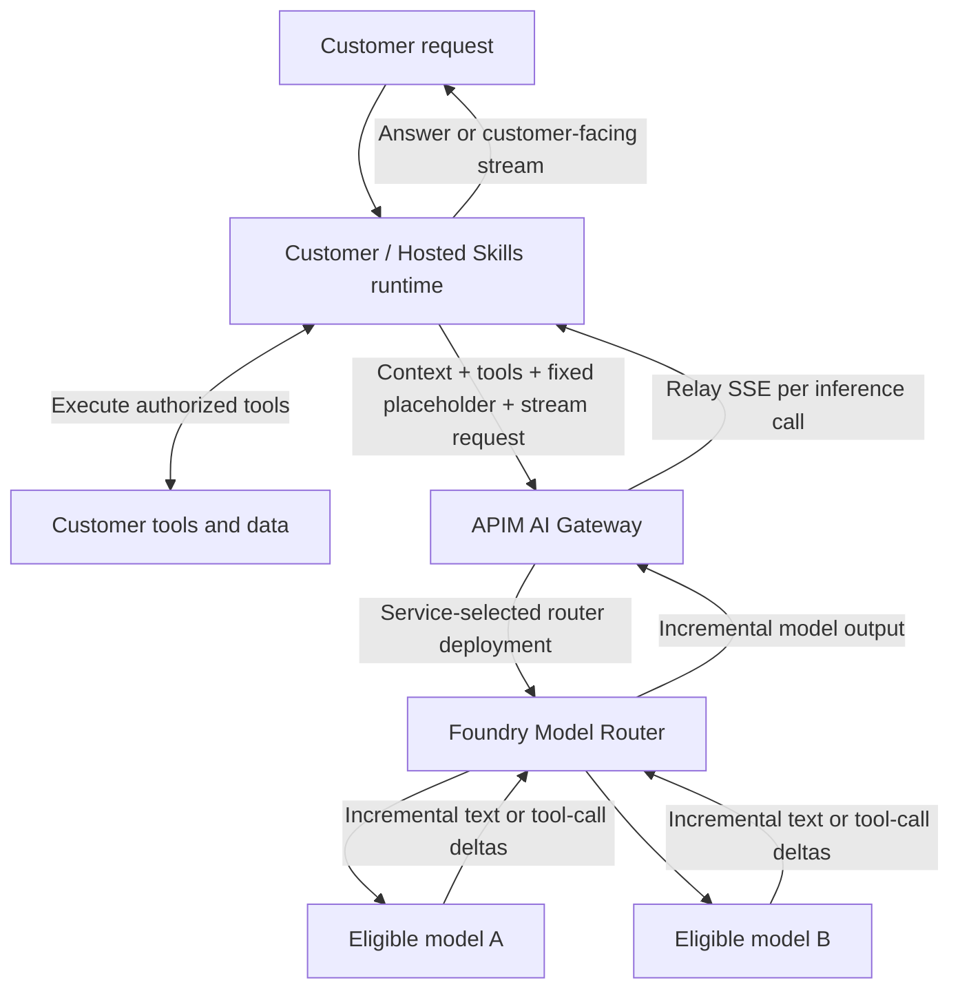

# POC 09: Stateless inference with Foundry Model Router

**Status:** Design and acceptance plan, with a separately prepared
[runnable MAF sample](../09-model-router-runtime-sample/README.md).
Sixty-seven local tests and all four original native A/B inventory JSON/SSE tool round trips
pass. The approved isolated gateway, router, and model-only Foundry project are
deployed. The sample uses project-based Responses, not the unsupported
resource-level Responses route. Each live stream delivered 12 text deltas and
terminal `done`; the separate synthetic APIM forwarding benchmark and other
production acceptance gates remain unverified.
The runtime sample now also includes real NWS weather observations and explicit
tool-failure handling. A further four-request mixed live run passes inventory
JSON/SSE for A and real weather JSON/SSE for B, with correct tool results and
terminal completion. Its runbook records provider limitations and evidence.
**Date:** 2026-11-04.
**Baseline:** [POC 08: service-selected named model through APIM](../08-stateless-ai-gateway/README.md).

For the standalone proposal derived from the Customer Model Service problem and
requirements, see [POC 09 proposal: architecture, API contracts, and stateless chat/streaming](proposal.md).

## 1. Goal

Keep the same customer-owned context, function tools, agent loop, and gateway
contract as POC 08. Replace the service-selected named model with managed
selection by Microsoft Foundry Model Router from an approved model subset.

The customer does not choose a model or routing profile. **Incremental streaming
is mandatory for each inference call**, and non-streaming JSON is also
required. There is **no session pinning, affinity registry, or separate
conversation store**. The router can select a different eligible model for a
later inference call, including the call after a tool result. That compatibility
must be tested, not assumed from support for simple text prompts.

## 2. Components and call flow



The model nodes represent the router's supported inference pool, not additional
public endpoints that the gateway must select. Most underlying supported models
do not require separate deployments; the current documentation identifies Claude
models as an exception. Verify exact deployment requirements before provisioning.

```mermaid
sequenceDiagram
    participant R as Customer / Hosted Skills runtime
    participant G as APIM AI Gateway
    participant MR as Foundry Model Router
    participant M as Eligible underlying model
    participant T as Customer tool
    R->>G: 1. Context + schemas + fixed placeholder + stream=true
    G->>MR: 2. Authenticate/authorize; select approved router deployment
    MR->>M: 3. Select an eligible model for this request
    M-->>MR: 4. Incremental text or tool-call deltas
    MR-->>G: 5. Relay deltas and reported metadata
    G-->>R: 6. Relay SSE as events arrive
    R->>T: 7. Assemble complete stream, validate, and execute authorized tool
    T-->>R: 8. Tool result
    R->>G: 9. Complete context + assistant call + tool result + fixed placeholder
    G->>MR: 10. Another stateless inference request
    MR->>M: 11. Select eligible model; not necessarily the previous model
    M-->>MR: 12. Stream answer or further tool-call deltas
    MR-->>G: 13. Relay SSE events
    G-->>R: 14. Relay SSE; runtime continues or finishes
```

**Model Router handles model selection, not the customer tool loop. APIM handles
gateway policies and forwarding, not arbitrary customer function execution.**
The existing customer/Hosted Skills runtime is the flow component. Neither a
new orchestrator backend nor Foundry Agent Service is required for this boundary.
Foundry Agent Service would be a different design if we later chose to delegate
the agent loop to a managed agent product.

## 3. Public API and service-owned routing

Reuse [POC 08's API examples](../08-stateless-ai-gateway/contract-examples.md).
The public request is the same in both POCs: `model: "service-default"` is a
fixed protocol placeholder, not a selection. APIM rejects other model values
and caller-controlled deployment or routing overrides before inference. All
schema, tool-result, error, context, identity, SSE, and JSON rules still apply.

The operator configures a router deployment, routing mode, approved subset,
region, and capacity. Initially evaluate one approved Balanced deployment;
Cost or Quality modes are optional operator-controlled experiments, not
per-request customer choices or guarantees of cost or latency.

APIM authenticates the workload, maps the verified customer through trusted
operator configuration, selects its approved router deployment, and rewrites
the backend model field. Foundry Model Router, not APIM or the customer, then
selects the underlying LLM from that deployment's approved subset.

Customer-specific eligibility is not automatically inferred from prompts or
APIM identity. Map verified customers to router deployments with compatible
approved model subsets. If customer policies differ, use separately configured
router deployments or deny the unsupported request. Do not route first and
try to enforce residency or model eligibility after processing. Direct backend
access and alternate gateway routes must not allow the caller to bypass policy.

Keep the [ordinary imported gateway API baseline](../08-stateless-ai-gateway/README.md#5-statelessness-and-protocol-compatibility).
APIM's unified model API preview is optional. Its Chat Completions interface is
not automatically compatible with the current Copilot Responses provider.
Foundry documents [Responses API model routing](https://learn.microsoft.com/en-us/azure/foundry/openai/how-to/responses-model-routing),
but a separately exposed Responses passthrough must still qualify the actual
gateway, SDK, streaming events, and tool continuation end to end.

## 4. Qualification and limits

### Mandatory per-inference streaming

- For `stream: true`, relay `text/event-stream` incrementally through the
  selected router and APIM; returning chunks only after the model finishes
  does not satisfy the requirement. `stream: false` remains supported as JSON.
- Preserve the selected API's event and completion semantics. For the shared
  Chat Completions contract, preserve choice/tool-call indexes, IDs, argument
  fragments, finish reason, and `[DONE]`. The runtime assembles the stream and
  executes only complete, validated, authorized tool calls. Each tool result
  starts a new inference call and a new stream.
- Apply the [POC 08 streaming configuration and failure rules](../08-stateless-ai-gateway/README.md#mandatory-per-inference-streaming):
  a supported APIM tier, no response buffering or body logging, no response
  caching, explicit idle/deadline limits, and incomplete status for interrupted
  streams. No gateway or runtime replay is allowed after partial output.
  Cancellation propagation and any provider-internal failover behavior require
  separate verification.
- Qualify incremental text and tool-call streaming for every eligible router
  model and the actual runtime/SDK path. A synthetic backend can test gateway
  forwarding, but cannot prove router/model streaming compatibility.

### Router and policy limits

- Use only models supported by Foundry Model Router in the selected region and
  deployment type. It is not a general router over arbitrary customer URLs,
  all catalog models, or arbitrary external providers.
- Select a subset qualified for the exact API, function tools, tool results,
  structured output, streaming, parameters, and context size used by the caller.
  Agent Service tool support alone is not evidence that this raw API/SDK path works.
- The smallest eligible model can constrain the usable context window. Reject
  oversized context explicitly; do not silently truncate customer instructions
  or tool results. The runtime owns any deliberate summarization.
- Model Router currently does not process audio input; audio is outside this POC.
- Automatic failover can change the underlying model and introduce additional
  attempts. Keep every possible fallback within the approved subset. Disable
  extra gateway cross-model fallback/retry for the baseline, and record SDK
  retry configuration to avoid hidden retry amplification.
- Failover is not a promise of availability or inference idempotency. Provider
  errors and interrupted streams remain visible; never replay partial output
  transparently or execute partial tool calls.
- Do not enable preview session affinity. Do not use a router session identifier
  as authorization or as an application conversation store.
- Use runtime-supplied history, not provider-managed threads, for this baseline.
  Enforce/qualify `store: false` where supported; provider retention and
  provider-side prompt caching policies still apply. Neither gateway response
  cache nor semantic response cache is enabled.
- Router version identifiers can remain unchanged as the active pool evolves.
  Record router configuration and approved subset for repeatable evaluation.
  Pinning a router deployment is not pinning an underlying model.
- Global deployment types do not guarantee inference stays in the resource's
  region. Verify Global/Data Zone options and end-to-end data policy explicitly.

## 5. Telemetry and cost

Capture verified customer identity, gateway request ID, service-selected policy,
configured router deployment, elapsed time/time to first event, terminal status,
reported serving model, and reported token usage. Correlate all model calls in
one caller-owned run without logging context, schemas, tool results, or credentials.

Where supported, preserve optional preview `model_selection_details` and
`routing_trace` metadata. The documented preview opt-in and schema are
API/version-specific; see [router monitoring](https://learn.microsoft.com/en-us/azure/foundry/openai/how-to/monitor-model-router).
Do not make normal inference depend on preview metadata being present.
Missing attempt details are unknown, not evidence that exactly one attempt ran.
Qualify serving-model/usage visibility separately for JSON and SSE.

Measure the complete tool loop, not just its first model call. Use current
published router and underlying-model rates, reported usage, and attempt
information where available. Include APIM capacity costs separately. Do not
assume an automatic route is always cheaper or faster. Missing usage or internal
attempt accounting must be reported as unknown/estimated, not free.

## 6. POC comparison and acceptance plan

Run the same synthetic customer inventory scenario, runtime, tool implementation,
payloads, and common negative tests as [POC 08](../08-stateless-ai-gateway/README.md#7-proposed-poc-and-acceptance-plan).
The public request does not change between arms; operator configuration selects
a named deployment in POC 08 or a router deployment in POC 09. No synthetic
provider double may be labeled evidence of real router decisions.

| Case | Required evidence |
| --- | --- |
| Basic routing | The fixed placeholder reaches the customer's service-selected router; reported serving model is in the approved subset |
| Tool compatibility | Valid tool-call name, arguments, call ID and tool result survive the actual router/API/SDK path |
| Cross-turn continuation | Caller resubmits full context; completion works without affinity when a model change is observed; otherwise cross-model continuation remains unverified |
| Candidate portability | Separately test the common message/tool-result shape against each candidate where direct testing is supported |
| No silent context change | Original instructions and tool results are preserved; no hidden truncation, reasoning-state removal, or tool execution |
| Customer policy | Caller-supplied models or route overrides and disallowed customer-to-router mappings fail before inference |
| Health/fallback | Where controlled failure injection is supported, document actual eligible fallback attempts and errors; otherwise mark unverified |
| Stateless operation | Fresh caller connection/worker continues with supplied messages; no session-create, binding lookup, or transcript retrieval |
| Incremental SSE | Meet POC 08's synthetic timing gate through the actual APIM path; observe real router/model text and tool deltas before completion |
| Streamed tools and failures | Assemble interleaved fragments; execute no partial call; cover missing `[DONE]`, post-header errors, cancellation, and no replay after partial output |
| Streaming isolation | Interleave two customers' streams through both the synthetic fixture and the live gateway/router path; no cross-customer events or tool arguments |
| JSON compatibility | The same fixed placeholder, customer mapping, and tool contract work with `stream: false` |
| Runtime compatibility | Qualify the exact pinned runtime/SDK, gateway route, router, API version, and approved model subset for streaming and tool continuation |
| Model visibility | Record actual served-model evidence, or mark the attribution acceptance gate blocked rather than inventing a model |
| Comparison | Report task correctness, tool errors, total run cost, p50/p95 total latency, and time to first event for both arms |

For the later live comparison, propose 20 pre-reviewed tasks with three runs per
task per arm, covering context-only, tool-required, multi-turn, and failure
scenarios. Randomize/interleave arms and keep environment and caller settings
equivalent. A model change is allowed, but do not require a fixed number of
distinct selected models: router choices are workload-dependent.

Proposed promotion targets, to approve before paid testing:

- No unauthorized tool execution or cross-customer data disclosure in any test.
- Every completed tool call has valid schema and matching call/result correlation.
- At least 95% task correctness and no more than a five percentage-point drop
  from the explicit baseline on the agreed answer rubric.
- Total measured token/router cost no greater than the baseline, and p95 total
  run latency no greater than 1.2 times baseline. Report infrastructure costs
  separately and treat incomplete cost evidence as inconclusive.

These are small-pilot decision thresholds, not statistical proof or production
SLOs. If routing fails a gate, retain POC 08 rather than silently relaxing the
contract. Thresholds, model selection, region/capacity, SDK compatibility, and
paid-call approval remain implementation prerequisites.

## 7. Recommendation and evidence boundary

First establish POC 08 as the working contract baseline. Then evaluate POC 09
with the same caller and tools. Add managed routing only if measured quality,
cost, latency, policy, and compatibility justify it.

This folder contains the design and acceptance plan. The separate
[runtime sample](../09-model-router-runtime-sample/README.md) supplies APIM/Model
Router Bicep, native MAF app/tools, and opt-in test commands. Its actual pinned
MAF client uses Responses, so the sample exposes a separate Responses passthrough
alongside Chat Completions. Its Responses backend is the approved model-only
project endpoint, authenticated with the gateway identity and `ai.azure.com`
audience. All four live A/B JSON/SSE tool checks pass with a 15-second pause
between runtime requests; the shared router is limited to 10 model requests per
minute at approved capacity 10. Stream errors, including observed provider 429s,
are failures, not successful completion. The runtime tool deterministically
calculates shippable stock rather than relying on model arithmetic.
Synthetic tests alone are not live router evidence, and POC 06's evidence does
not validate these paths. Refer to the sample runbook for measured results,
costs, earlier failed attempts, and the remaining acceptance gates.

## Sources

- [Foundry Model Router concepts, supported pool, deployment types, and limitations](https://learn.microsoft.com/en-us/azure/foundry/openai/concepts/model-router)
- [Model Router setup, routing modes, subsets, and APIs](https://learn.microsoft.com/en-us/azure/foundry/openai/how-to/model-router)
- [Model Router with the Responses API](https://learn.microsoft.com/en-us/azure/foundry/openai/how-to/responses-model-routing)
- [Router observability and optional preview metadata](https://learn.microsoft.com/en-us/azure/foundry/openai/how-to/monitor-model-router)
- [Function calling and application-owned execution](https://learn.microsoft.com/en-us/azure/foundry/openai/how-to/function-calling)
- [APIM AI Gateway capabilities](https://learn.microsoft.com/en-us/azure/api-management/genai-gateway-capabilities)
