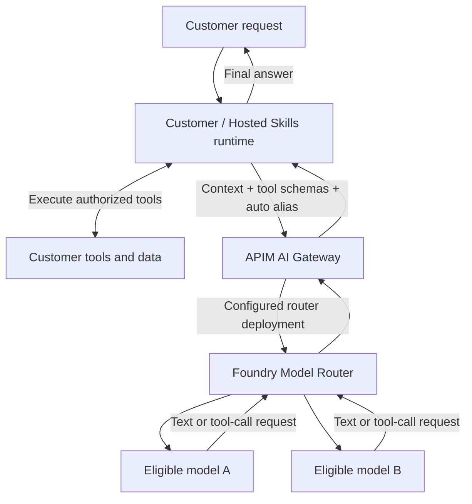

# POC 09: Stateless inference with Foundry Model Router

**Status:** Design only; no implementation, deployment, or live validation.
**Date:** 2026-11-04.
**Baseline:** [POC 08: explicit model choice through APIM](../08-stateless-ai-gateway/README.md).

## 1. Goal

Keep the same customer-owned context, function tools, agent loop, and gateway
contract as POC 08. Replace explicit model choice with managed selection by
Microsoft Foundry Model Router from an approved model subset.

The customer requests a routing profile instead of a concrete model. There is
**no session pinning, affinity registry, or separate conversation store**.
The router can select a different eligible model for a later inference call,
including the call after a tool result. That compatibility must be tested, not
assumed from support for simple text prompts.

## 2. Components and call flow



The model nodes represent the router's supported inference pool, not additional
public endpoints that the gateway must select. Most underlying supported models
do not require separate deployments; the current documentation identifies Claude
models as an exception. Verify exact deployment requirements before provisioning.

```mermaid
sequenceDiagram
    participant R as Customer / Hosted Skills runtime
    participant G as APIM AI Gateway
    participant MR as Foundry Model Router
    participant M as Eligible underlying model
    participant T as Customer tool
    R->>G: 1. Context + schemas + auto-balanced
    G->>MR: 2. Authenticate/authorize; select configured router deployment
    MR->>M: 3. Select an eligible model for this request
    M-->>MR: 4. Assistant tool-call request
    MR-->>G: 5. Model response and reported model/usage metadata
    G-->>R: 6. Forward tool-call request
    R->>T: 7. Validate and execute authorized tool
    T-->>R: 8. Tool result
    R->>G: 9. Complete context + assistant call + tool result + auto-balanced
    G->>MR: 10. Another stateless inference request
    MR->>M: 11. Select eligible model; not necessarily the previous model
    M-->>MR: 12. Final answer or another tool request
    MR-->>G: 13. Return inference result
    G-->>R: 14. Forward result; runtime continues or finishes
```

**Model Router handles model selection, not the customer tool loop. APIM handles
gateway policies and forwarding, not arbitrary customer function execution.**
The existing customer/Hosted Skills runtime is the flow component. Neither a
new orchestrator backend nor Foundry Agent Service is required for this boundary.
Foundry Agent Service would be a different design if we later chose to delegate
the agent loop to a managed agent product.

## 3. Public API and routing profiles

Reuse [POC 08's API examples](../08-stateless-ai-gateway/contract-examples.md).
The only intentional request change is the configured public `model` alias.
All schema, tool-result, error, context, identity, and SSE rules still apply.

| Public alias | Proposed backend | Selection behavior |
| --- | --- | --- |
| `auto-balanced` | Router deployment configured for Balanced mode | Managed quality/cost tradeoff; initial candidate |
| `auto-cost` | Optional router deployment configured for Cost mode | Larger cost emphasis, subject to quality evaluation |
| `auto-quality` | Optional router deployment configured for Quality mode | Quality emphasis, not a latency or price guarantee |

These aliases are our proposed gateway configuration, not built-in Foundry API
values. Treat routing mode and model subset as deployment configuration for
this POC. Do not invent an arbitrary per-request `cost`/`quality` control.
Initially provision or reuse only one approved Balanced router deployment;
additional profiles are optional follow-up experiments.

APIM maps each approved alias to that deployment and rewrites the backend model
field. It does not choose the underlying LLM; Foundry Model Router does.

Customer-specific eligibility is not automatically inferred from prompts or
APIM identity. Map verified customers to profiles with compatible approved model
subsets. If customer policies differ, use separately configured profiles/router
deployments or deny the unsupported request. Do not route first and try to
enforce residency or model eligibility after processing.

Keep the [ordinary imported gateway API baseline](../08-stateless-ai-gateway/README.md#5-statelessness-and-protocol-compatibility).
APIM's unified model API preview is optional. Its Chat Completions interface is
not automatically compatible with the current Copilot Responses provider.

## 4. Qualification and limits

- Use only models supported by Foundry Model Router in the selected region and
  deployment type. It is not a general router over arbitrary customer URLs,
  all catalog models, or arbitrary external providers.
- Select a subset qualified for the exact API, function tools, tool results,
  structured output, streaming, parameters, and context size used by the caller.
  Agent Service tool support alone is not evidence that this raw API/SDK path works.
- The smallest eligible model can constrain the usable context window. Reject
  oversized context explicitly; do not silently truncate customer instructions
  or tool results. The runtime owns any deliberate summarization.
- Model Router currently does not process audio input; audio is outside this POC.
- Automatic failover can change the underlying model and introduce additional
  attempts. Keep every possible fallback within the approved subset. Disable
  extra gateway cross-model fallback/retry for the baseline, and record SDK
  retry configuration to avoid hidden retry amplification.
- Failover is not a promise of availability or inference idempotency. Provider
  errors and interrupted streams remain visible; never replay partial output
  transparently or execute partial tool calls.
- Do not enable preview session affinity. Do not use a router session identifier
  as authorization or as an application conversation store.
- Use runtime-supplied history, not provider-managed threads, for this baseline.
  Enforce/qualify `store: false` where supported; provider retention policies
  still apply. Neither gateway cache nor semantic response cache is enabled.
- Router version identifiers can remain unchanged as the active pool evolves.
  Record router configuration and approved subset for repeatable evaluation.
  Pinning a router deployment is not pinning an underlying model.
- Global deployment types do not guarantee inference stays in the resource's
  region. Verify Global/Data Zone options and end-to-end data policy explicitly.

## 5. Telemetry and cost

Capture verified customer identity, gateway request ID, requested profile,
configured router deployment, elapsed time/time to first event, terminal status,
reported serving model, and reported token usage. Correlate all model calls in
one caller-owned run without logging context, schemas, tool results, or credentials.

Where supported, preserve optional preview `model_selection_details` and
`routing_trace` metadata. The documented preview opt-in and schema are
API/version-specific; see [router monitoring](https://learn.microsoft.com/en-us/azure/foundry/openai/how-to/monitor-model-router).
Do not make normal inference depend on preview metadata being present.
Missing attempt details are unknown, not evidence that exactly one attempt ran.
Qualify serving-model/usage visibility separately for JSON and SSE.

Measure the complete tool loop, not just its first model call. Use current
published router and underlying-model rates, reported usage, and attempt
information where available. Include APIM capacity costs separately. Do not
assume an automatic route is always cheaper or faster. Missing usage or internal
attempt accounting must be reported as unknown/estimated, not free.

## 6. POC comparison and acceptance plan

Run the same synthetic customer inventory scenario, runtime, tool implementation,
payloads, and common negative tests as [POC 08](../08-stateless-ai-gateway/README.md#7-proposed-poc-and-acceptance-plan).
Only explicit model alias versus router profile changes between experiment arms.
No synthetic provider double may be labeled evidence of real router decisions.

| Case | Required evidence |
| --- | --- |
| Basic routing | Alias reaches the configured router; reported serving model is in the approved subset |
| Tool compatibility | Valid tool-call name, arguments, call ID and tool result survive the actual router/API/SDK path |
| Cross-turn continuation | Caller resubmits full context; completion works without affinity, even when a model change is observed |
| Candidate portability | Separately test the common message/tool-result shape against each candidate where direct testing is supported |
| No silent context change | Original instructions and tool results are preserved; no hidden truncation, reasoning-state removal, or tool execution |
| Customer policy | Unauthorized profile and disallowed customer-to-profile mapping fail before inference |
| Health/fallback | Where controlled failure injection is supported, document actual eligible fallback attempts and errors; otherwise mark unverified |
| Stateless operation | Fresh caller connection/worker continues with supplied messages; no session-create, binding lookup, or transcript retrieval |
| Streaming | Meet the same synthetic forwarding test as POC 08 and validate complete tool-call assembly on a real model stream |
| Model visibility | Record actual served-model evidence, or mark the attribution acceptance gate blocked rather than inventing a model |
| Comparison | Report task correctness, tool errors, total run cost, p50/p95 total latency, and time to first event for both arms |

For the later live comparison, propose 20 pre-reviewed tasks with three runs per
task per arm, covering context-only, tool-required, multi-turn, and failure
scenarios. Randomize/interleave arms and keep environment and caller settings
equivalent. A model change is allowed, but do not require a fixed number of
distinct selected models: router choices are workload-dependent.

Proposed promotion targets, to approve before paid testing:

- No unauthorized tool execution or cross-customer data disclosure in any test.
- Every completed tool call has valid schema and matching call/result correlation.
- At least 95% task correctness and no more than a five percentage-point drop
  from the explicit baseline on the agreed answer rubric.
- Total measured token/router cost no greater than the baseline, and p95 total
  run latency no greater than 1.2 times baseline. Report infrastructure costs
  separately and treat incomplete cost evidence as inconclusive.

These are small-pilot decision thresholds, not statistical proof or production
SLOs. If routing fails a gate, retain POC 08 rather than silently relaxing the
contract. Thresholds, model selection, region/capacity, SDK compatibility, and
paid-call approval remain implementation prerequisites.

## 7. Recommendation and evidence boundary

First establish POC 08 as the working contract baseline. Then evaluate POC 09
with the same caller and tools. Add managed routing only if measured quality,
cost, latency, policy, and compatibility justify it.

This folder contains a design and acceptance plan only. No router deployment,
custom service, executable prototype, paid model call, or acceptance result has
been created. Existing POC 06 live evidence does not validate these new paths.

## Sources

- [Foundry Model Router concepts, supported pool, deployment types, and limitations](https://learn.microsoft.com/en-us/azure/foundry/openai/concepts/model-router)
- [Model Router setup, routing modes, subsets, and APIs](https://learn.microsoft.com/en-us/azure/foundry/openai/how-to/model-router)
- [Router observability and optional preview metadata](https://learn.microsoft.com/en-us/azure/foundry/openai/how-to/monitor-model-router)
- [Function calling and application-owned execution](https://learn.microsoft.com/en-us/azure/foundry/openai/how-to/function-calling)
- [APIM AI Gateway capabilities](https://learn.microsoft.com/en-us/azure/api-management/genai-gateway-capabilities)
