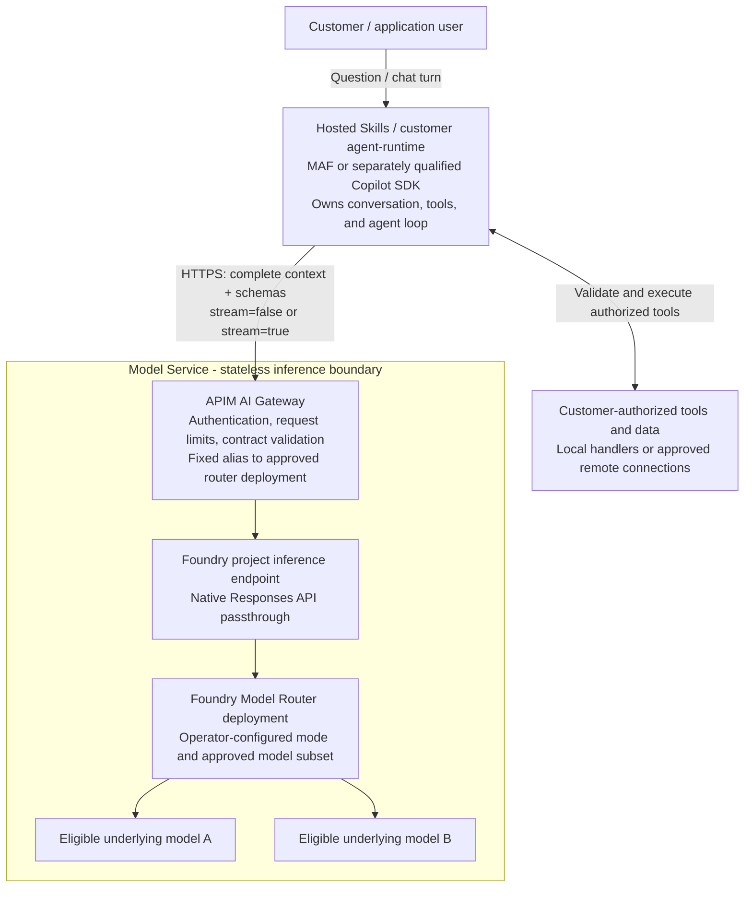
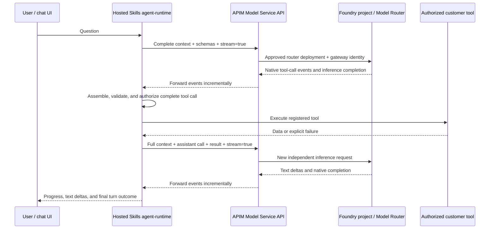

# POC 09 Proposal: Stateless Model Service with Foundry Model Router

**Date:** 2026-11-05

**Status:** Proposed service contract, informed by the runnable POC; not a production-readiness or deployment approval.

**Source:** [Customer Model Service: problem and requirements](../customer-model-service.md).

**Implementation:** [POC 09 runtime sample and qualification results](../09-model-router-runtime-sample/README.md).

## 1. Problem, requirements, and out of scope

### 1.1 Problem

- Hosted Skills customers using MAF or Copilot SDK need model access without
  managing individual model endpoints or provider credentials.
- The agent-runtime must retain control of conversation context and tools.

### 1.2 Requirements

- Provide one governed API through APIM; the service selects an approved model.
- Support JSON chat and mandatory incremental SSE on the same inference operation.
- Keep inference stateless: the runtime supplies context and tool schemas,
  executes authorized tools, and sends their results.
- Authenticate every request, separate customer and provider credentials,
  enforce limits, and report failures.

### 1.3 Out of scope

- **24-hour session requirement**, model pinning, or model-service bindings/expiry.
- Customer-selected models, arbitrary provider endpoints, or model-service
  conversation storage and tool execution.
- Provider-managed conversations, background jobs, or stream resume/replay.
- Customer-specific model entitlements, dedicated capacity, and production budgets.

## 2. High-level design and architecture

- Request path: customer -> agent-runtime -> APIM -> Foundry Model Router -> approved model.
- The runtime owns history and tools; APIM authenticates and maps `service-default` to the router.
- Model Router selects a model per inference; JSON or SSE returns through APIM.



The diagram shows the primary Responses request path, top to bottom. JSON or
SSE returns on the same request through model -> router -> project endpoint ->
APIM -> runtime. The runtime returns the answer or its own customer-facing
stream to the user.

The separate Chat Completions compatibility route goes from APIM to the
account's router deployment API. It does not translate Responses payloads into
Chat Completions.

### 2.1 Components and ownership

| Component | Owns | Does not own |
| --- | --- | --- |
| Customer application / browser | User experience and user authentication through its backend | APIM/provider credentials or direct model selection |
| Agent-runtime | Authorized conversation history, context preparation, tool registration, tool execution, tool-result continuation, user-facing chat/stream | Model weights or the service's router configuration |
| APIM AI Gateway | Workload authentication, shared API boundary, request admission, approved backend mapping, credential separation, incremental forwarding | Conversation history, tool execution, session bindings |
| Foundry project | Native Responses inference endpoint and scoped access | A hosted agent or customer conversation store in this design |
| Foundry Model Router deployment | Per-request selection from an operator-approved compatible subset | Customer tool orchestration or guaranteed same-model continuation |
| Underlying model | Text generation and structured tool-call requests | Permission to execute tools or access customer systems |
| Operator control plane | IaC, router configuration, model qualification, access configuration, monitoring | A session-creation operation on the inference path |

The **Model Service is a logical API and governance boundary**, not an
additional custom Function App in this proposal. The existing agent-runtime
can itself be a Function App; that is a different responsibility.

There is no second APIM traversal, custom inference proxy, Table Storage
binding registry, or Redis conversation/session store in the baseline.

### 2.2 What happens on one inference call

1. The runtime sends the question, relevant history, instructions, and allowed
   function schemas to APIM.
2. APIM validates the credential on that request and derives trusted customer
   identity. It rejects model/routing overrides.
3. APIM rewrites `service-default` to the operator-approved router deployment
   and authenticates to Foundry with its managed identity.
4. Model Router selects an eligible underlying model. The selection can differ
   from the previous request, including a request after tool execution.
5. JSON or SSE returns through APIM without storing a second conversation.
6. If the result requests a tool, the runtime validates and executes it, then
   makes another independent inference request with the complete context and
   tool result.

## 3. Model maintenance and service-owned routing

### 3.1 Operator configuration

Maintain a version-controlled deployment configuration containing:

- Foundry account/project and the router deployment.
- Router version, deployment type, region/data-processing policy, capacity,
  routing mode, and approved underlying model subset.
- A common supported context/output budget and compatible API/tool features.
- Gateway credential mappings, validation rules, and operational safety limits.

The current sample uses a Balanced `model-router` deployment, router version
`2025-11-18`, with GPT-4.1 and GPT-4.1-mini version `2025-04-14` as its approved
subset. These are pilot settings, not a permanent production recommendation.
Underlying eligibility, retirement rules, regional availability, and exact
feature compatibility require ongoing verification.

All authenticated pilot customers use the same approved configuration.
Customer-specific model subsets would require trusted server-side mappings to
appropriately configured router deployments; they are not inferred from a
prompt or an arbitrary customer header.

### 3.2 Request-time selection

```text
Caller model field: service-default
    -> APIM operator mapping: approved router deployment
    -> Foundry Model Router: eligible underlying model for this request
```

The caller cannot provide `economy`, `quality`, a provider deployment name, or
a routing-mode override. APIM must reject such attempts before inference.
Provider-reported model metadata in a response is not permission to call that
model directly.

The router chooses only among models supported by its selected deployment
type and configured subset. Not every Foundry catalog model or external
provider is automatically eligible.

### 3.3 Upgrades and availability

Qualify a new router configuration against the same API, tools, context
limits, and streaming tests before publishing it. Prefer a new deployment for
an incompatible change. Route new requests to the approved configuration and
allow already admitted requests to finish within their bounded deadlines.
There is **no conversation-length or 24-hour binding drain**.

`NoAutoUpgrade` is an operational setting, not a promise that a provider's
supported pool or retirement schedule is frozen forever.

Do not add gateway-level cross-model retries to the baseline. Foundry may have
its own routing/failover behavior within the approved pool; qualify it rather
than assuming one HTTP request means exactly one physical model attempt.
Never replay a partially delivered response transparently.

## 4. Model Service API contract

### 4.1 Public endpoint and operations

Illustrative public base URL:

```text
https://models.example.com/llm
```

| Operation | Purpose | Delivery |
| --- | --- | --- |
| `POST /llm/openai/v1/responses` | Primary native Responses contract used by the pinned MAF client | JSON or native Responses SSE |
| `POST /llm/v1/chat/completions` | Separate OpenAI Chat Completions compatibility contract | JSON or Chat Completions SSE |
| `POST /llm/openai/deployments/service-default/chat/completions` | Azure OpenAI SDK compatibility alias for the Chat Completions operation | Same Chat Completions contract |

The first operation is the primary POC 09 integration. The second and third
exist in the gateway configuration but require their own end-to-end live
qualification; a successful Responses test is not evidence that they work with
every SDK.

There is **no required `POST /sessions`, session GET, session models API, model
assignment API, stored-response GET, or conversation-expiry API**. SDK discovery
through `GET /models` is not part of this minimum contract. If a later client
needs it, expose only the fixed service placeholder, not a customer-selectable
underlying catalog.

These are new stateless routes. Do not silently reinterpret the old
session-affinity API or its guarantees as this contract.

### 4.2 Authentication, headers, and request invariants

Required pilot request headers:

```http
Content-Type: application/json
api-key: <customer-apim-subscription-key>
```

The `api-key` value is an **APIM subscription key**, not an Azure OpenAI or
Foundry provider key. This header matches the actual MAF/Azure OpenAI client
path. It differs from examples using APIM's default
`Ocp-Apim-Subscription-Key`; clients must use the header configured on this API.
Keys stay in the runtime/backend secret environment, never browser code.

An Entra workload-token contract is a future production option, not an
authentication mode already demonstrated by the pilot.

For every request:

- `model` must be exactly `service-default`.
- Context, instructions, and tool results are inline and caller-owned.
- `store` is omitted or `false`; APIM forces `false` upstream.
- Responses `background` is omitted or `false`; `truncation` is omitted or
  `disabled`. APIM forces these stateless-profile values.
- Reject `previous_response_id`, provider conversation/thread references,
  unknown top-level fields, and customer routing/deployment overrides.
- Limit the initial profile to qualified inline text and function-call/result
  items. Hosted tools, provider file IDs, and other features require a separate
  contract/qualification; do not treat them as stateless by default.
- Application, agent, conversation, and request correlation identifiers are
  metadata, not authorization or model bindings. Do not trust a JSON tenant ID
  or caller-chosen header to establish customer identity.

Body-level allowlists do not replace validation of nested messages, tool
schemas, or input budgets.

### 4.3 Primary Responses API: ordinary JSON chat

The following examples are illustrative, not captured model responses.
Placeholder provider model names deliberately make no served-model claim.

**Request**

```http
POST /llm/openai/v1/responses
Content-Type: application/json
api-key: <customer-apim-subscription-key>
```

```json
{
  "model": "service-default",
  "instructions": "You are a helpful assistant. Answer concisely.",
  "input": [
    {"role": "user", "content": "Hello."}
  ],
  "stream": false,
  "max_output_tokens": 128,
  "store": false,
  "background": false,
  "truncation": "disabled"
}
```

**HTTP 200, `Content-Type: application/json`**

```json
{
  "id": "resp_chat_001",
  "object": "response",
  "created_at": 1793890800,
  "status": "completed",
  "model": "<provider-reported-model>",
  "output": [
    {
      "id": "msg_chat_001",
      "type": "message",
      "role": "assistant",
      "status": "completed",
      "content": [
        {"type": "output_text", "text": "Hello! How can I help?", "annotations": []}
      ]
    }
  ],
  "error": null,
  "incomplete_details": null,
  "usage": {"input_tokens": 10, "output_tokens": 8, "total_tokens": 18}
}
```

Additional native provider fields remain provider-compatible. Preserve reported
model and usage metadata without rewriting it to invent underlying attribution.
Missing usage means unknown consumption, not zero.
An HTTP 200 is not sufficient: inspect the native response status and error/
incomplete details before treating a JSON result as successful.

### 4.4 Multi-turn chat: the runtime resubmits context

On the next user message, send another request to the same API:

```json
{
  "model": "service-default",
  "instructions": "You are a helpful assistant. Answer concisely.",
  "input": [
    {"role": "user", "content": "Hello."},
    {"role": "assistant", "content": "Hello! How can I help?"},
    {"role": "user", "content": "What did I just say?"}
  ],
  "stream": false,
  "max_output_tokens": 128,
  "store": false,
  "background": false,
  "truncation": "disabled"
}
```

There is no model-service session reference. The second call works because the
runtime supplied the history, not because APIM or Foundry retrieved
`resp_chat_001`. A different compatible model can answer this turn.

The runtime may deliberately summarize history to fit the common context
budget. The gateway must not silently truncate it or substitute another
customer's history.

### 4.5 Primary Responses API: incremental streaming

Use the **same operation and body**, changing `stream` to `true`:

```json
{
  "model": "service-default",
  "instructions": "You are a helpful assistant. Answer concisely.",
  "input": [
    {"role": "user", "content": "Hello."}
  ],
  "stream": true,
  "max_output_tokens": 128,
  "store": false,
  "background": false,
  "truncation": "disabled"
}
```

Success starts HTTP 200 with `Content-Type: text/event-stream`. The target
contract also requires `Cache-Control: no-store`; verify/add this header during
gateway hardening rather than assume the current policy already sets it.

The following is a **selected-event excerpt**. Native lifecycle events such as
`response.created`, output-item/content-part events, and text-done events must
also pass through unchanged; this excerpt is not permission to discard them.
Each SSE event ends with a blank line.

```text
event: response.output_text.delta
data: {"type":"response.output_text.delta","item_id":"msg_chat_001","output_index":0,"content_index":0,"delta":"Hello! ","logprobs":[],"sequence_number":3}

event: response.output_text.delta
data: {"type":"response.output_text.delta","item_id":"msg_chat_001","output_index":0,"content_index":0,"delta":"How can I help?","logprobs":[],"sequence_number":4}

event: response.completed
data: {"type":"response.completed","sequence_number":8,"response":{"id":"resp_chat_001","object":"response","created_at":1793890800,"status":"completed","model":"<provider-reported-model>","output":[{"id":"msg_chat_001","type":"message","role":"assistant","status":"completed","content":[{"type":"output_text","text":"Hello! How can I help?","annotations":[]}]}],"error":null,"incomplete_details":null,"usage":{"input_tokens":10,"output_tokens":8,"total_tokens":18}}}

```

**Responses does not use Chat Completions' `[DONE]` marker.** The client must
observe the native completed lifecycle with a successful response status.
`response.failed`, `response.incomplete`, an error event, cancellation, or EOF
without successful completion is not a complete answer.

HTTP transport chunks are not SSE event boundaries. Parse UTF-8/SSE framing,
including partial events and multiple events in one chunk. Do not assume one
chunk or delta equals one token.

### 4.6 Function-tool request and continuation

The runtime registers executable tools locally or through trusted connections.
The model service receives **schemas**, not executable implementations or tool
credentials. For example:

```json
{
  "model": "service-default",
  "instructions": "Use lookup_stock for inventory. Report available_to_ship and source unchanged.",
  "input": [
    {"role": "user", "content": "How many units of A-101 can ship today?"}
  ],
  "tools": [
    {
      "type": "function",
      "name": "lookup_stock",
      "description": "Read inventory and the shippable quantity for the authorized customer.",
      "parameters": {
        "type": "object",
        "properties": {"sku": {"type": "string"}},
        "required": ["sku"],
        "additionalProperties": false
      },
      "strict": true
    }
  ],
  "tool_choice": "auto",
  "stream": false,
  "max_output_tokens": 128,
  "store": false,
  "background": false,
  "truncation": "disabled"
}
```

A successful inference can return a function request instead of final text:

```json
{
  "id": "resp_tool_001",
  "object": "response",
  "created_at": 1793890800,
  "status": "completed",
  "model": "<provider-reported-model>",
  "output": [
    {
      "id": "fc_stock_001",
      "type": "function_call",
      "call_id": "call_stock_001",
      "name": "lookup_stock",
      "arguments": "{\"sku\":\"A-101\"}",
      "status": "completed"
    }
  ],
  "error": null,
  "incomplete_details": null
}
```

The runtime validates the complete arguments against the registered schema,
authorizes the operation using trusted customer identity, and executes the
tool. Tenant selection is not a model argument. For streamed calls, assemble
argument deltas by item/call identifiers and wait for complete, successful
inference termination before execution.

The next inference resends instructions, schemas, original context, the
assistant function call, and the matching result:

```json
{
  "model": "service-default",
  "instructions": "Use lookup_stock for inventory. Report available_to_ship and source unchanged.",
  "input": [
    {"role": "user", "content": "How many units of A-101 can ship today?"},
    {
      "id": "fc_stock_001",
      "type": "function_call",
      "call_id": "call_stock_001",
      "name": "lookup_stock",
      "arguments": "{\"sku\":\"A-101\"}",
      "status": "completed"
    },
    {
      "type": "function_call_output",
      "call_id": "call_stock_001",
      "output": "{\"sku\":\"A-101\",\"on_hand\":7,\"reserved\":2,\"available_to_ship\":5,\"source\":\"customer-A-inventory\"}"
    }
  ],
  "tools": [
    {
      "type": "function",
      "name": "lookup_stock",
      "description": "Read inventory and the shippable quantity for the authorized customer.",
      "parameters": {
        "type": "object",
        "properties": {"sku": {"type": "string"}},
        "required": ["sku"],
        "additionalProperties": false
      },
      "strict": true
    }
  ],
  "tool_choice": "auto",
  "stream": true,
  "max_output_tokens": 128,
  "store": false,
  "background": false,
  "truncation": "disabled"
}
```

The next model can now generate the answer from the supplied data without a
server-side conversation lookup. A `call_id` correlates a function call/result;
it is not a routing session or an authorization credential.

Every eligible model must support this continuation shape. Success without an
observed model change does not prove cross-model continuation.

### 4.7 Separate Chat Completions compatibility contract

The native Chat Completions request uses `messages`, not Responses `input`.
For example:

```http
POST /llm/v1/chat/completions
Content-Type: application/json
api-key: <customer-apim-subscription-key>
```

```json
{
  "model": "service-default",
  "messages": [
    {"role": "system", "content": "You are a helpful assistant. Answer concisely."},
    {"role": "user", "content": "Hello."}
  ],
  "stream": false,
  "max_tokens": 128,
  "store": false
}
```

**HTTP 200 JSON**, illustrating the minimum relevant success fields:

```json
{
  "id": "chatcmpl_chat_001",
  "object": "chat.completion",
  "created": 1793890800,
  "model": "<provider-reported-model>",
  "choices": [
    {
      "index": 0,
      "message": {"role": "assistant", "content": "Hello!"},
      "finish_reason": "stop"
    }
  ],
  "usage": {"prompt_tokens": 10, "completion_tokens": 2, "total_tokens": 12}
}
```

For streaming, send the same messages with `stream: true`. Optional
`stream_options: {"include_usage": true}` requires provider/API qualification.
Illustrative SSE:

```text
data: {"id":"chatcmpl_chat_001","object":"chat.completion.chunk","created":1793890800,"model":"<provider-reported-model>","choices":[{"index":0,"delta":{"role":"assistant","content":"Hello"},"finish_reason":null}]}

data: {"id":"chatcmpl_chat_001","object":"chat.completion.chunk","created":1793890800,"model":"<provider-reported-model>","choices":[{"index":0,"delta":{"content":"!"},"finish_reason":"stop"}]}

data: [DONE]

```

Chat Completions tools use
`tools[].function.{name,description,parameters}`, assistant `tool_calls`, and
`role: "tool"` messages carrying the matching `tool_call_id`. This differs from
Responses function-call items. The [shared Chat Completions tool examples](../08-stateless-ai-gateway/contract-examples.md)
describe that separate shape; their gateway-header example must be adapted to
the `api-key` header above.

Both operations provide JSON and streaming. They are **not interchangeable
payloads**, and this proposal adds no Responses-to-Chat translation layer.

For Chat Completions, require a valid terminal finish reason and, for streaming,
`[DONE]`. `stop` ends an ordinary inference; `tool_calls` hands control back to
the runtime. `length` or `content_filter` is a partial/blocked outcome, not a
complete answer. Preserve choice/tool indexes and call IDs while assembling
fragments. A final usage-only chunk may have empty `choices`; missing usage
remains unknown.

### 4.8 Limits and error contract

| Control | Initial profile / requirement |
| --- | --- |
| Request body | At most 1 MiB in the pilot policy |
| Output | 1-256 requested output tokens; default 256 in the pilot; examples request 128 |
| Context window | Budget against the smallest qualified eligible model and tool overhead; no silent truncation |
| Responses output field | `max_output_tokens` |
| Chat output field | One qualified output-limit field; never conflicting `max_tokens` and `max_completion_tokens` |
| Chat choices | `n` omitted or exactly 1 |
| Concurrency / rates | Bound at runtime/gateway and size against shared provider capacity; no reserved-capacity or fairness promise |
| Proposed absolute deadline | 120 seconds for one runtime user turn, including inference, tools, and continuations; each inference uses at most the remaining turn budget |
| Proposed stream idle limit | 30 seconds without an upstream event, also bounded by the absolute deadline |
| Retry | No added gateway replay; callers use an explicit attempt/cost budget, never automatic replay after partial output |

The old custom proxy's 25-second default is not an implemented timer in this
direct-gateway design. The sample has a 120-second runtime setting and APIM
`forward-request timeout="120"`. The latter controls waiting for backend
headers, **not an absolute total stream lifetime**. Production approval must
implement and test the proposed end-to-end absolute/idle deadline, including
connection cleanup; the current settings alone do not prove enforcement.
Configure SDK transport retries explicitly within the remaining attempt/time
budget; library defaults are not a service retry guarantee.

Target pre-stream error envelope:

```json
{
  "error": {
    "code": "invalid_model",
    "type": "invalid_request_error",
    "message": "Use the fixed service-default model placeholder."
  }
}
```

| HTTP status | Meaning |
| --- | --- |
| 400 | Invalid JSON, unsupported fields, invalid placeholder, conflicting parameters, or invalid stateful-profile options |
| 401 | Missing/invalid caller credential |
| 403 | Authenticated but not permitted, or claimed customer conflicts with verified identity |
| 413 | Input exceeds the configured byte limit |
| 429 | Gateway or provider capacity/rate limit; preserve safe retry guidance when available |
| 502 | Invalid upstream response or upstream protocol failure before streaming starts |
| 503 | Inference service/provider unavailable |
| 504 | Upstream timeout before a response can be returned |

Provider-originated safe 4xx/5xx details can be preserved as appropriate; never
return credential-bearing internal details. Uniform envelopes for APIM-native
authentication/rate errors and all provider errors are a **hardening task**,
not a claim about the current sample policy.

There are no model-service `409 model_binding_conflict` or `410 session_expired`
outcomes because there is no model binding.

After SSE headers are sent, the HTTP status cannot change. Forward native
provider failure events if emitted. A transport failure can instead end at EOF;
the APIM-only baseline does not promise to manufacture a custom error event.
An error, incomplete terminal state, or missing success marker means failure.
Do not append a fake successful completion to make the stream look finished.

On cancellation, close the downstream/upstream request as supported and verify
propagation. Cancellation is not rollback and does not guarantee zero token
charges. Business tools require their own idempotency/reconciliation; an
inference request ID does not make tool side effects exactly once.

## 5. How standalone chat and simple streaming work

### 5.1 Standalone chat without tools

1. A user sends a question to the runtime's chat endpoint.
2. The runtime loads only that user's authorized history and creates a
   Responses request with `stream: false`.
3. APIM and Model Router return JSON. No tool needs to run for a context-only
   question.
4. The runtime saves the new messages in its own conversation store and returns
   the assistant text.
5. The next turn resubmits the required history as in section 4.4.

A plain text answer does not require Foundry Agent Service, a new orchestration
backend, a model-service session API, or a weather/inventory tool.

### 5.2 Customer-facing streaming, with or without tools

The runtime changes the model request to `stream: true` and relays text
incrementally to its user-facing stream. It must not wait for the full model
answer and then split the completed text into pretend streaming chunks.

For a tool-assisted turn:



There are **two inference streams** in this example. The runtime may keep
**one outer customer-facing stream** open across both and the tool execution.
An inference-complete event containing a tool call is not a completed user
answer.

### 5.3 Existing runtime app surface, separate from the model API

The sample exposes:

| Runtime operation | Purpose |
| --- | --- |
| `GET /agents/inventory/` | Standalone chat UI; route name retained for compatibility |
| `POST /agents/inventory/chat` | User-facing JSON chat |
| `POST /agents/inventory/chatstream` | User-facing runtime SSE, spanning the agent loop |

An initial runtime chat body is:

```json
{"prompt": "How many units of A-101 can ship today?"}
```

The JSON response includes `response`, `model`, `tool_calls`, and a runtime
`session_id` when the runtime exposes a usable conversation reference. The
runtime's optional `x-ms-session-id` header supports its own conversation
continuation when configured. It is **not sent to the model service to pin or
retrieve a model assignment**, and it does not authorize history access.

The runtime SSE protocol is also separate from Foundry's native SSE. This is
an illustrative selected-event excerpt, not a captured transcript:

```text
data: {"type":"session","session_id":"runtime-owned-conversation"}

data: {"type":"tool_start","tool_call_id":"call_stock_001","tool_name":"lookup_stock","arguments":"{\"sku\":\"A-101\"}"}

data: {"type":"tool_end","tool_call_id":"call_stock_001","tool_name":null,"result":"{\"sku\":\"A-101\",\"on_hand\":7,\"reserved\":2,\"available_to_ship\":5,\"source\":\"customer-A-inventory\"}"}

data: {"type":"delta","content":"5 units can ship; "}

data: {"type":"delta","content":"source: customer-A-inventory."}

data: {"type":"done"}

```

`tool_end` names can be null: correlate with `tool_call_id`. A `tool_start`
event alone does not prove execution. A completed agent turn can end with an
honest tool-failure explanation; positive tool acceptance additionally requires
a successful tool result. Inference errors/truncation remain failed outcomes.

The sample supports inventory and real NWS weather observations. Weather uses
a runtime-owned handler and an approved public provider; it is not a browsing
capability added by Model Router. Unsupported coverage, stale data, and
provider failures produce explicit results rather than weather from memory.

The local debug UI is anonymous/localhost for demonstration. A production
runtime must authenticate users and authorize conversation/tool access before
loading history. The browser must not hold the model-service key.

## 6. Why this design is stateless

**Stateless means no customer conversation or model assignment is required
from a previous inference request to process the next one.** It does not mean
the infrastructure has no configuration, metrics, access counters, or open
network connections.

| State | Owner / treatment | Why it does not create model-service conversation state |
| --- | --- | --- |
| Conversation/history and summaries | Customer / Hosted Skills runtime | Resent explicitly on each inference |
| Tool implementations, connections, permissions | Runtime and customer systems | Never installed/executed by the inference gateway |
| Selected model for one request | Transient Foundry inference decision | No binding is looked up on the next call |
| Streaming parser/buffers and request correlation | Bounded in-flight request | Released at completion, cancellation, or failure |
| APIM credentials, policies, and router settings | Operator configuration / managed identity | Shared service configuration, not a transcript or session registry |
| Rate counters and metadata-only telemetry | Gateway/monitoring | Operational state; no prompts or history used to continue chat |
| Provider data retention or prompt caching | Provider policy | Separate governance concern; `store: false` is not a zero-retention guarantee |

Consequences:

1. **No affinity:** successive requests may hit different gateway workers and
   different eligible models.
2. **No restart recovery lookup:** a new request works after a restart if the
   runtime resends context and service configuration/access are available.
   An in-flight stream interrupted by a restart still fails; it is not resumed.
3. **No 24-hour boundary:** there is no binding expiry, renewal, cleanup job, or
   requirement to create a new model-service session. Authentication tokens and
   request deadlines can still expire independently.
4. **No stored-response dependency:** response IDs and tool-call IDs are
   correlation data, not a substitute for sending history.
5. **Explicit trade-off:** context is resent and consumes input tokens; context
   limits and cross-model compatibility must be enforced.
6. **Isolation remains mandatory:** the runtime must never mix customer
   histories. The gateway cannot detect that the runtime mistakenly included
   another user's documents in otherwise valid input.

Concurrent requests have separate request contexts and response streams. The
runtime must serialize or reject overlapping turns for the same conversation
and coordinate its own history revisions. Stateless inference does not
provide ordered conversation writes or exactly-once tool actions.

## 7. Authentication, gateway configuration, and operational controls

### 7.1 Separate trust boundaries

| Hop | Authentication / authorization |
| --- | --- |
| User -> runtime | Runtime-owned user authentication and conversation/tool permissions |
| Runtime -> APIM | Pilot customer-specific APIM key on every request; derive customer from the verified subscription |
| APIM -> project Responses endpoint | Gateway managed identity, `https://ai.azure.com` audience, scoped Foundry User permission |
| APIM -> account Chat Completions endpoint | Gateway managed identity, `https://cognitiveservices.azure.com` audience, scoped Cognitive Services OpenAI User permission |
| Runtime -> customer tool | Tool-specific scoped identity/connection, separate from model credentials |

The primary upstream Responses path is:

```text
https://<foundry-account>.services.ai.azure.com/api/projects/<project>/openai/v1/responses
```

The Chat Completions compatibility backend is:

```text
https://<foundry-account>.openai.azure.com/openai/deployments/<router-deployment>/chat/completions
```

APIM supplies the approved backend API version where required. It removes the
caller API key, caller authorization, and routing overrides before acquiring
its own backend token. In the actual pilot, the resource-level Responses route
returned unsupported-operation errors; the project-based route was required.

Production hardening must prevent direct backend/gateway-policy bypass through
RBAC and appropriate networking. The pilot's public network configuration and
local debug endpoints are not proof of production tenant isolation.

### 7.2 Mandatory streaming configuration

- Use a supported classic/v2 APIM tier; Consumption is not suitable for this
  long-running SSE path. The current pilot uses Developer, which has no
  production SLA.
- Set `buffer-response="false"` on the inference `forward-request`.
- Disable response caching and semantic response caching.
- Disable request/response body diagnostics at API **and inherited global**
  scopes. Avoid outbound body inspection/transformation/validation policies
  that buffer SSE.
- Preserve content types, native event order, call identifiers, completion
  markers, and reported usage.
- Align caller, runtime, gateway, and provider deadlines. Qualify cancellation,
  idle behavior, connection capacity, and long-duration behavior end to end.

The relevant baseline backend policy is:

```xml
<backend>
  <forward-request timeout="120" buffer-response="false" />
</backend>
```

It is a streaming prerequisite, not a full security policy or proof of the
total streaming lifetime.

### 7.3 Telemetry, cost, and data-processing policy

Record request/attempt correlation, verified customer, policy/configuration
version, router deployment, latency, success/failure/partial status, and
reported usage/served-model metadata when available. Do not log prompts, tool
arguments/results, response bodies, or credentials.

One logical turn can involve several charged model calls and possibly
provider-internal attempts. Count attempts without double-counting gateway
observations. Missing final usage or unobservable internal attempts means
unknown/estimated cost, never zero.

The pilot router is configured for 10 model requests and 10,000 tokens per
minute at capacity 10. A typical one-tool turn uses two inference calls. The
smoke driver spaces runtime requests by 15 seconds, but other callers share
capacity and provider 429s remain possible. Pilot operational rate/quota
guards are not a dollar cap or a full customer entitlement/budget system.

APIM has an ongoing fixed cost even when inference is idle. Model Router adds
its routing meter plus underlying inference charges. Removing the binding
store/proxy reduces components, but does not establish lower total cost than
POC 08. Compare measured full-turn cost and latency.

GlobalStandard does not guarantee processing stays in the account's region.
Residency, provider retention, prompt caching, telemetry location, and runtime
history storage require separate approval. Neither private networking nor
`store: false` by itself establishes regional-only processing or zero retention.

## 8. Qualification, implementation gaps, and adoption

### 8.1 Existing evidence

The [runtime sample](../09-model-router-runtime-sample/README.md) records:

- 116 passing local tests against the actual pinned runtime/MAF, with synthetic
  provider transport for deterministic success/failure coverage.
- Original A/B inventory JSON and SSE tool round trips through real APIM and
  project-based Model Router.
- A further four-request mixed live run: inventory JSON/SSE for A and real NWS
  weather JSON/SSE for B, with one actual tool call per request.
- In the mixed run, inventory delivered 12 text deltas and weather delivered
  30; both streams ended with runtime `done`, and answers matched tool results.
- The original runtime basic-chat entrypoint passed JSON history recall and a
  streaming continuation with 9 text deltas and terminal `done`; the runbook
  distinguishes the initial format-check failure from its approved recheck.
- Real missing-key, invalid-input, customer-conflict, and model-override
  rejection checks, plus an observed provider 429 surfaced as failure.

These are functional POC results, not production SLOs. Weather/provider-failure
cases were exercised with synthetic responses locally, not by disrupting NWS.
The results describe a local runtime sample; verify the revision and
configuration separately before making claims about another environment.

### 8.2 Required acceptance gates

| Gate | Required evidence / current boundary |
| --- | --- |
| Stateless continuation | Resume with complete context on a fresh connection/worker; no binding or transcript lookup; injected restart may fail an active stream but not require session recreation |
| Basic chat | Context-only JSON and SSE work without executing a tool; multi-turn results use resent history |
| Tool correctness | Complete validated arguments, authorized dispatch, matching call/result IDs, explicit tool failures, no execution of partial arguments |
| Streaming forwarding | Through actual APIM, emit at least five controlled events 500 ms apart; each arrives within 250 ms of its calibrated emission time, without an end-of-response burst |
| Streaming isolation | Interleave customer streams under load; no cross-customer text, arguments, or tool results; sequential A/B tests alone are insufficient |
| Native protocol compatibility | Responses and Chat Completions separately pass JSON/SSE, tool, error, and completion-marker tests with the exact selected SDK |
| Eligible-model portability | Qualify every approved candidate for the common context/schema/result profile; observe a real model change before claiming cross-model continuation |
| Model attribution | Record reliable underlying-model evidence or explicitly mark attribution unknown; do not equate the router name with the served LLM |
| Failure/cancellation | Pre-header HTTP errors, late provider errors, truncated streams, client disconnects, deadline enforcement, retry budgets, and unknown final usage are correctly represented |
| Governance hardening | Nested payload/context-budget validation, `no-store` header, safe consistent error envelopes, secret lifecycle, backend bypass prevention, and production user isolation |

The synthetic timing gate needs a controlled backend and clock-calibrated
measurement harness through real APIM; the current model deltas and session
event timestamps do not establish it. Time to a runtime `session` event is not
model time-to-first-token.

Before promotion, agree the task rubric, quality/cost/latency thresholds,
capacity, residency, and paid-test budget. A comparison with POC 08 should
measure the complete agent/tool turn, not only its first model call.

### 8.3 Adoption steps

1. Approve this stateless contract and compatible model subset.
2. Configure or reuse the qualified APIM/router/project resources with
   least-privilege access. This document does not authorize new provisioning.
3. Configure the runtime client to use the gateway and `service-default`;
   remove any model-service session-binding adapter.
4. Keep user/conversation authorization and history in the runtime. Register
   only approved tools and their scoped connections there.
5. Qualify the exact MAF path first. Treat Copilot SDK and Chat Completions
   support as separate compatibility work, not an inference from MAF success.
6. Complete the unverified gates before making production availability,
   fairness, billing, residency, or reliability claims.

**Decision summary:** one governed inference boundary, service-owned
per-request routing, runtime-owned conversations/tools, native JSON or SSE,
and no durable model-service sessions.

## References

- [Source problem and requirements](../customer-model-service.md)
- [POC 09 detailed design and acceptance plan](README.md)
- [Runnable POC 09 inventory/weather sample](../09-model-router-runtime-sample/README.md)
- [Shared Chat Completions tool examples](../08-stateless-ai-gateway/contract-examples.md)
- [Model Router concepts and limitations](https://learn.microsoft.com/en-us/azure/foundry/openai/concepts/model-router)
- [Model Router configuration](https://learn.microsoft.com/en-us/azure/foundry/openai/how-to/model-router)
- [Model routing with the Responses API](https://learn.microsoft.com/en-us/azure/foundry/openai/how-to/responses-model-routing)
- [APIM SSE configuration and tier restrictions](https://learn.microsoft.com/en-us/azure/api-management/how-to-server-sent-events)
- [APIM forwarding policy and timeout semantics](https://learn.microsoft.com/en-us/azure/api-management/forward-request-policy)
- [Application-owned function execution](https://learn.microsoft.com/en-us/azure/foundry/openai/how-to/function-calling)
