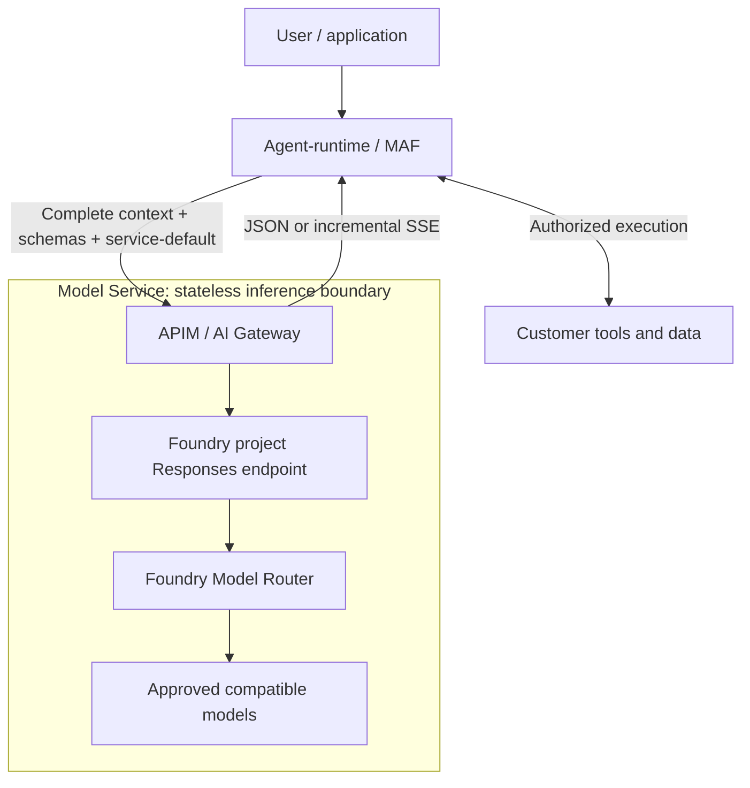

# POC 09 Proposal: Stateless Model Service

**Date:** 2026-11-05

**Status:** Proposed contract and runtime changes; the MAF pilot is functional, not production-approved.

Stateless alternative to the [original requirements](../customer-model-service.md),
not an implementation of their 24-hour affinity guarantee.
The [session-affinity contract](../CONTRACT.md) is unchanged.

## 1. Problem

Customers running agents with MAF or Copilot SDK need governed model access
without managing provider endpoints or credentials. The agent-runtime must
retain conversation context and tool execution while the service selects a
compatible model for each inference.

## 2. Requirements

1. Route **every model call through APIM / AI Gateway**, including delegated,
   workflow and tool-originated calls; prohibit direct Foundry access or fallback.
2. Accept only `service-default`; route to an operator-approved Model Router
   subset qualified for the common text, function-tool and context profile.
3. Keep history, authorization, tools and the agent loop in the runtime.
   Resend complete context on every inference; do not require provider-side state.
4. Support JSON and genuine incremental SSE on the same inference operation,
   preserving each protocol's tool, completion and failure semantics.
5. Authenticate every request, derive customer identity from verified credentials,
   separate customer/provider secrets, and enforce limits, deadlines and cancellation.
6. Make required runtime changes explicit across all roles and entrypoints;
   qualify MAF first and Copilot SDK separately. Report partial failures and
   unknown usage explicitly; never replay partial output transparently.

## 3. Out of scope

- Customer-selected models, 24-hour model/version pinning, session bindings or expiry.
- Model-service conversation storage, agent hosting/orchestration or tool execution.
- Provider-managed conversations/retrieval, background inference, stream resume or replay.
- Arbitrary provider endpoints, customer-specific model entitlements, dedicated capacity or spending budgets.
- Production availability, cost or residency guarantees based only on pilot results.

## 4. Design and ownership

**All model calls must go through APIM configured as the AI Gateway.**
This includes main/delegated agents, workflows, and tool-originated model calls.
There is **no direct access from the agent-runtime or browser to Foundry models**;
gateway failure must not trigger a bypass/fallback. Only the gateway identity invokes Foundry.

### 4.1 Designs considered

AI Gateway is APIM's governance capability, not a separate gateway service.

| Approach | Model selection | Team-managed components | Trade-offs / decision |
| --- | --- | --- | --- |
| APIM / AI Gateway + Model Router + models | APIM forwards to Model Router, which selects an approved underlying model per inference | APIM policies, router configuration/subset, access, quotas and evaluations | **Selected POC 09 design.** Less custom routing code, but an additional routing meter. MAF pilot functional; production gates pending. |
| AI Gateway + models only | APIM maps the alias to a fixed approved model or uses explicit backend-routing/load-balancing policies | APIM policies and approved named model deployments/backends, access, quotas and evaluations | **Alternative / POC 08 baseline.** No Model Router or routing Function charge. Selection is fixed or policy-defined; qualify the exact API/SDK path. |
| APIM + Function App routing + models | APIM calls a routing-only Function for an approved backend ID, validates it, then forwards inference to the model | APIM, named model deployments, Function hosting/rules, identity, CI, monitoring and rollback | **Considered, not implemented.** Bespoke rules and potential routing-meter savings; additional Function cost, latency and operational ownership. Routing quality needs independent evaluation. |

All three retain `service-default`, runtime-owned history/tools and APIM-only
model access. The Function row is routing-only, not an inference/streaming proxy;
both Function variants are covered in the [cost estimates](#traffic-based-monthly-estimate).

### 4.2 Selected POC 09 design



| Owner | Responsibility |
| --- | --- |
| Agent-runtime | User/conversation authorization, history and summarization, tool execution, agent loop, customer-facing JSON/SSE |
| APIM / AI Gateway | Authenticate each request, derive trusted customer identity, validate/limit requests, map the fixed alias, separate credentials, forward incrementally |
| Foundry Model Router | Select an eligible model per inference from the operator-approved subset; no same-model continuation guarantee |
| Operator | Versioned router/API configuration, model qualification, access/network controls, capacity and monitoring |

The Model Service is **not another Function App** and owns no conversation, binding, or tool execution.
Every inference resends context; runtime sessions remain runtime-owned.
API contracts are in the [FAQ](#75-what-are-the-api-contracts).

## 5. Changes needed in the agent-runtime

**Pilot:** existing MAF works through APIM; no new provider, orchestrator, routes, or history store.
**Adoption:** promote sample-local checks into an opt-in app-wide gateway-only profile.
Other deployments retain existing behavior.

Use the existing environment settings:

```text
AZURE_FUNCTIONS_AGENTS_PROVIDER=azure_openai
AZURE_OPENAI_ENDPOINT=https://<approved-apim-host>/llm
AZURE_OPENAI_API_KEY=<customer-apim-subscription-key>
AZURE_OPENAI_DEPLOYMENT=service-default
AZURE_FUNCTIONS_AGENTS_MODEL=service-default
AZURE_FUNCTIONS_AGENTS_ENABLE_COPILOT=false
```

| Runtime surface | Required change / what stays |
| --- | --- |
| Configuration: [env.py](../../azure-functions-agents-runtime/src/azure_functions_agents/config/env.py), [_provider_config.py](../../azure-functions-agents-runtime/src/azure_functions_agents/harness/_provider_config.py) | Validate approved HTTPS host + `/llm`, APIM key and fixed alias. Reject direct providers, base-URL overrides and credential/default-provider fallback; autodetection alone is insufficient. |
| Resolved agents: [_maf_runner.py](../../azure-functions-agents-runtime/src/azure_functions_agents/harness/agent_framework/_maf_runner.py), [schema.py](../../azure-functions-agents-runtime/src/azure_functions_agents/config/schema.py) | Qualify every catalog entry after merging. Replace concrete models with `service-default`; validate configured `agent_configuration.max_output_tokens` within 1-256 and the common text/function/context profile. |
| Client/context: [_maf_client.py](../../azure-functions-agents-runtime/src/azure_functions_agents/harness/agent_framework/_maf_client.py), [_maf_execution.py](../../azure-functions-agents-runtime/src/azure_functions_agents/harness/agent_framework/_maf_execution.py) | Keep `OpenAIChatClient`'s native Responses, runtime history/tools and `store: false`. Qualify wire options and budget SDK retries; no protocol translation or provider-state continuation. |
| Delegation/workflows: [runner.py](../../azure-functions-agents-runtime/src/azure_functions_agents/runner.py), [engine.py](../../azure-functions-agents-runtime/src/azure_functions_agents/workflows/engine.py) | Specialists build separate clients from their resolved models. Enforce the gateway target across all roles/entrypoints and tool-originated model calls; parent settings alone are insufficient. |
| Endpoints/history/tools: [endpoints.py](../../azure-functions-agents-runtime/src/azure_functions_agents/registration/endpoints.py) | Preserve UI/JSON/SSE and runtime sessions. Enforce user/conversation/tool isolation and coordinate overlapping turns. No browser keys; anonymous debug settings are not production authorization. |
| Streaming/telemetry: [_maf_execution.py](../../azure-functions-agents-runtime/src/azure_functions_agents/harness/agent_framework/_maf_execution.py), [_maf_observability.py](../../azure-functions-agents-runtime/src/azure_functions_agents/harness/agent_framework/_maf_observability.py) | Qualify native termination/errors, deadlines, idle detection and cancellation cleanup. Record metadata-only attempts/usage; distinguish alias from reported serving model. Disable sensitive-content capture. |
| Copilot SDK: [_copilot_providers.py](../../azure-functions-agents-runtime/src/azure_functions_agents/harness/copilot_sdk/_copilot_providers.py) | Deferred: host-only Azure endpoint validation rejects `/llm`. Qualify gateway Responses path/header/alias before enabling preview; no direct/built-in fallback. |

**Customer-facing contract stays separate:** `GET /agents/inventory/` serves the UI;
`POST /agents/inventory/chat` and `/chatstream` accept `{"prompt":"Hello."}`.
JSON: `response`, `model`, `tool_calls`, optional usable `session_id`.
Runtime SSE uses `session`, `tool_start`, `tool_end`, `delta`, `done` / `error`;
correlate by `tool_call_id`. `done` ends the loop, not proof of tool success.
Session IDs / optional `x-ms-session-id` never authorize access or pin models.

## 6. Gateway controls and acceptance

| Control | Pilot / target |
| --- | --- |
| Body / output | At most 1 MiB; requested output 1-256 tokens, default 256; no silent context truncation |
| Capacity | Per-key pilot: 12 calls/minute, 200/hour; shared router: 10 requests and 10,000 tokens/minute at capacity 10; no fairness or dollar-cap promise |
| Time / retries | Target: 120-second whole-turn deadline including tools/delegation; each inference uses remaining budget; 30-second upstream-event idle limit; explicitly bounded attempts, no replay after partial output |
| Gateway forwarding | Pilot `forward-request timeout="120" buffer-response="false"`; its timeout is for backend **headers**, not total stream lifetime; absolute/idle enforcement requires qualification |

APIM alone uses managed identity: project Responses uses the `https://ai.azure.com`
audience / scoped Foundry User role; account Chat Completions uses
`https://cognitiveservices.azure.com` / Cognitive Services OpenAI User.
APIM strips caller credentials and owns backend paths/API versions.
Enforce RBAC/network/egress: no runtime provider keys, Foundry inference role, or direct-model reachability.
**Required enforcement, not demonstrated by the public-network pilot.**

Version and requalify router configuration before changes; no 24-hour binding drain.
Pilot router settings: [IaC](../09-model-router-runtime-sample/infra/main.bicep).
`NoAutoUpgrade` does not freeze eligibility; GlobalStandard is not regional-only;
`store: false` is not zero retention. Approve data policy and full-turn cost/latency;
router-internal attempts can add cost. No added gateway replay.
Developer APIM has no production SLA.

Recorded [sample evidence](../09-model-router-runtime-sample/README.md): 116 local tests,
live inventory/weather JSON/SSE tool round trips, and native basic-chat continuation.
Recorded POC results, not a new test run or proof of these gates:

| Gate | Required evidence |
| --- | --- |
| Gateway-only access | Capture every role/entrypoint's model traffic through APIM; reject direct endpoints/overrides; prove runtime credentials and networking cannot bypass the gateway |
| Statelessness / portability | Fresh worker/connection continues from resent history; no binding lookup; qualify every candidate and observe a real model change before claiming cross-model continuation |
| JSON / tools / protocols | Each exposed API and exact SDK passes native JSON/SSE, complete authorized tools, matching IDs, explicit failures and correct terminal markers |
| Incremental delivery / isolation | Through real APIM, at least five controlled events 500 ms apart, each arriving within 250 ms of calibrated emission; interleave customers without cross-customer events |
| Failure / hardening | Test late errors, truncated EOF, disconnects, absolute/idle deadlines, cleanup and retry budgets; complete nested/context validation, `no-store`, consistent safe errors and production user isolation |

Detailed qualification remains in the [design](README.md).
Documentation only: runtime changes/deployment are not implemented or authorized.
See the [APIM timeout reference](https://learn.microsoft.com/en-us/azure/api-management/forward-request-policy)
and [Responses routing reference](https://learn.microsoft.com/en-us/azure/foundry/openai/how-to/responses-model-routing).

## 7. FAQ

### 7.1 Why not use AI Gateway alone? Why Model Router?

**We use both.** [AI Gateway](https://learn.microsoft.com/en-us/azure/api-management/genai-gateway-capabilities)
is APIM's governance capability, not another service: authentication, limits,
observability and policy-based backend routing/load balancing.
Model Router adds prompt-aware model selection within an approved subset.
APIM remains mandatory; keep POC 08's fixed-model baseline if managed routing
does not pass the quality/cost/latency gates.

### 7.2 Why not create our own routing component, like POC 06?

[POC 06](../06-shared-foundry-apim/README.md) uses a stateful asynchronous agent
runner over one fixed model, not an intelligent model selector.
A custom router is not inherently wrong, but adds hosting, availability,
configuration and maintenance ownership. A routing-only Function avoids most
proxy/SSE work; a full inference proxy does not.
Keep orchestration in the runtime. Consider custom routing only when bespoke
rules or measured savings justify ownership cost; see the [cost comparison](#traffic-based-monthly-estimate).

### 7.3 Which components does the team manage?

| Component | Team responsibility |
| --- | --- |
| Existing agent-runtime | Gateway client/configuration, user/history isolation, tools, agent loop and runtime scaling |
| APIM / AI Gateway | APIs, policies, customer access, gateway capacity, networking and telemetry |
| Foundry account/project and Model Router deployment | RBAC, router version/mode/subset, quota/capacity, evaluations and cost monitoring |

Microsoft operates the underlying managed routing/model-serving infrastructure.
No new routing Function App, binding store, separate AI Gateway service or model GPU fleet is required.

### 7.4 How do we scale models when traffic grows?

- Size for inference requests/minute, tokens/minute and concurrent SSE connections;
  tool loops and delegation multiply model calls per user turn.
- Increase allocated router deployment capacity within supported
  [quota tiers](https://learn.microsoft.com/en-us/azure/foundry/openai/concepts/model-router#quota-tiers);
  request quota increases where available. Model Router does not create unlimited capacity.
- Scale runtime workers/concurrency and APIM tier/units separately. Apply gateway
  admission limits and bounded backoff on 429 within the remaining deadline;
  never replay partial output or bypass APIM. Capacity changes require approval and load qualification.

### 7.5 What are the API contracts?

#### Endpoints and authentication

Public base: `https://<approved-apim-host>/llm`. All operations support JSON and SSE.

| POST path | Protocol / qualification |
| --- | --- |
| `/llm/openai/v1/responses` | Primary native Responses API; qualified with the pinned MAF runtime |
| `/llm/v1/chat/completions` | Separate Chat Completions compatibility route; live SDK qualification pending |
| `/llm/openai/deployments/service-default/chat/completions` | Azure OpenAI SDK alias for Chat Completions; qualification pending |

Required headers: `Content-Type: application/json` and
`api-key: <customer-apim-subscription-key>`.
Keep this **APIM key**, not a provider key, in backend secret storage.
Identity comes from the verified subscription, not caller metadata.
Entra authentication is future work. No session/assignment/discovery API is required.

#### Request and result

| Field / rule | Contract |
| --- | --- |
| `model` | Required string, exactly `service-default`; APIM replaces it with the approved router deployment |
| `stream` | Optional boolean, default `false`; `true` requests native SSE on the same operation |
| `store` | Omitted or `false`; APIM forces `false` upstream |
| Responses | Required inline text `input` or input-item array; optional string `instructions`; output limit is `max_output_tokens` |
| Chat Completions | Required nonempty `messages`; one of `max_tokens` / `max_completion_tokens`, never both; `n` omitted or `1` |
| Stateless profile | Responses `background` omitted/`false`, `truncation` omitted/`disabled`; APIM forces these values |
| Rejected | Unknown top-level fields, routing/deployment overrides, `previous_response_id`, provider conversation/thread/file references, and hosted tools |

Full allowlists: [pilot policy](../09-model-router-runtime-sample/infra/policy.xml).
Inline text/function calls are the minimum profile; other options need qualification.
Nested/context-budget validation remains hardening work.

Minimal Responses request; change only `stream` to `true` for SSE:

```json
{
  "model": "service-default",
  "input": [{"role": "user", "content": "Hello."}],
  "max_output_tokens": 128,
  "stream": false,
  "store": false,
  "background": false,
  "truncation": "disabled"
}
```

HTTP 200 JSON preserves the native response, not a custom flattened answer:

| Protocol | Result and successful termination |
| --- | --- |
| Responses | `id`, `object: "response"`, `status`, `output[]`, reported `model`/`usage`; require `status: "completed"` and inspect `error` / `incomplete_details` |
| Chat Completions | `id`, `object: "chat.completion"`, `choices[].message`, `finish_reason`, reported `model`/`usage`; `stop` completes text, `tool_calls` hands control to the runtime |

HTTP 200 alone is not success; incomplete/blocked/failed results are not complete answers.
Function-call completion is not user-turn completion.
Preserve metadata; router names do not prove underlying-model attribution.
Missing usage/attribution means unknown, not zero.

#### Tools and continuation

| Protocol | Tool schema / returned call / next request |
| --- | --- |
| Responses | `tools[]` uses `type: "function"`, `name`, `parameters`; returned `function_call` has `call_id`, `name`, JSON-string `arguments`; resend the call plus `function_call_output` with matching `call_id` and string `output` |
| Chat Completions | `tools[].function` contains `name`/`parameters`; assistant `tool_calls` has IDs and arguments; resend it plus `role: "tool"` messages with matching `tool_call_id` |

Validate complete arguments, authorize using trusted identity, and execute only registered tools;
never partial streamed arguments. Continuations resend instructions, schemas, history, calls and results;
each may select another model. Call IDs are correlation, not authorization/bindings.
Return explicit tool failures; side effects require idempotency/reconciliation.
See [Chat Completions examples](../08-stateless-ai-gateway/contract-examples.md), using this proposal's `api-key` header.

#### Streaming and errors

Successful SSE starts HTTP 200 with `Content-Type: text/event-stream`.
The target also requires `Cache-Control: no-store` (**not yet set by the pilot policy**).

| Protocol | Required completion semantics |
| --- | --- |
| Responses | Preserve lifecycle, text/tool-argument deltas, and `response.completed` with successful status; no Chat Completions `[DONE]` |
| Chat Completions | Preserve choice/tool indexes, IDs, argument fragments and finish reason, followed by `[DONE]`; `length` / `content_filter` are partial/blocked |

- Forward incrementally with `buffer-response="false"`; no response/semantic cache, body diagnostics at API or inherited scopes, or outbound body policies that buffer SSE.
- Parse UTF-8/SSE framing across transport chunks; preserve event order and final usage, including usage-only Chat chunks.
- Native errors, `response.failed` / `response.incomplete`, cancellation, or EOF without successful termination mean failure. Never replay partial output or manufacture a success marker.
- Assemble tool calls by IDs and execute only after successful inference completion. The runtime can hold one customer-facing stream across multiple inference/tool cycles.

Target pre-stream error envelope:

```json
{"error": {"code": "invalid_model", "type": "invalid_request_error", "message": "Use service-default."}}
```

| HTTP status | Meaning |
| --- | --- |
| 400 | Invalid JSON, fields, alias, profile options, or conflicting limits |
| 401 / 403 | Missing/invalid credentials / unauthorized customer or identity conflict |
| 413 / 429 | Body too large / gateway or provider rate/capacity limit |
| 502 / 503 / 504 | Upstream protocol failure / unavailable service / timeout |

Preserve safe provider errors/retry guidance; uniform envelopes remain hardening work.
After SSE headers, status cannot change: native errors or truncated EOF mean failure.
No binding-conflict/expiry, resume, or exactly-once guarantees.

### 7.6 Would a lightweight routing Function reduce cost, and how would we maintain it?

**Potentially, for routing-only rules, not necessarily for an inference proxy.**
This is an optional cost comparison, not a change to the selected POC 09 architecture
or approval to create resources.

- **Routing-only:** APIM calls a short-lived Function for an approved backend ID,
  validates the ID, then forwards inference/SSE itself. The Function never calls
  Foundry or holds the stream. Use deterministic rules, not an extra LLM classifier.
- **Streaming proxy:** runtime -> APIM -> Function -> protected APIM model API ->
  approved model. The Function stays active while awaiting/forwarding the response;
  billing includes that wall-clock duration, not just CPU work. No direct Foundry access.

Without Model Router, provide qualified named model deployments/backends and their
quotas. Keep `service-default` and the native API contract; qualify this alternative separately.
The assumed model mix below does not prove that custom rules match Model Router's quality.

**Maintenance:** version routing rules and the approved backend catalog with IaC;
use managed identity and fail closed on unknown IDs or routing failures. Own CI
routing/contract/tool tests, model-retirement evaluations, metadata-only monitoring,
cold-start/capacity checks, canary rollout and rollback. Keep history and tools in
the runtime; no binding database is needed. If simple rules fit APIM policies,
avoid a Function entirely.

#### Traffic-based monthly estimate

Public USD retail rates checked **2026-11-06**, East US 2 / Global Standard:

| Meter | Rate |
| --- | --- |
| APIM Developer, one unit | $0.0658/hour; $48.034 at 730 hours/month |
| GPT-4.1-mini input / output | $0.40 / $1.60 per million tokens |
| GPT-4.1 input / output | $2.00 / $8.00 per million tokens |
| Model Router, additional input routing meter | $0.14 per million input tokens |
| Functions Flex Consumption, on demand | $0.000026/GB-second plus $0.40 per million executions |

**Assumptions:** two model calls per user turn, averaging 2,000 input and 200
output tokens per call, including resent context. Router and custom columns
assume 80% mini / 20% GPT-4.1; fixed-model columns use only that model.
Both Function cases assume 512 MB, one active execution per instance, one
Function invocation per model call, no always-ready instances, and average
total billable durations of **1 second routing-only** or **30 seconds streaming proxy**.
Durations and model mix are hypothetical, not measured sample results.

| User turns/month | APIM + Model Router | APIM + routing-only Function | APIM + streaming-proxy Function | APIM + fixed mini | APIM + fixed GPT-4.1 |
| ---: | ---: | ---: | ---: | ---: | ---: |
| 1,000 | $52.63 | $52.09 | $52.85 | $50.27 | $59.23 |
| 10,000 | $93.95 | $88.62 | $96.16 | $70.43 | $160.03 |
| 100,000 | $507.23 | $453.91 | $529.31 | $272.03 | $1,168.03 |

Totals include one APIM unit and model tokens. Function costs conservatively
**exclude free grants**: routing-only compute/executions are $0.03 / $0.27 / $2.68
for these rows. Available Flex grants of 250,000 executions and 100,000 GB-seconds
per eligible subscription/month could cover those routing-only meters, but are
shared with other apps and do not make storage or monitoring free.

For either Function, GB-seconds = turns x 2 x 0.5 GB x duration.
The routing-only option saves approximately **$5.33/month at 10,000 turns** or
**$53.32/month at 100,000 turns**, before additional costs and maintenance.
At 30 seconds/call, the proxy costs more than Model Router; without free grants,
its routing-meter break-even is about 21.5 seconds/call at 512 MB.

These are estimates, not an actual bill or a quality comparison. They exclude
storage, logging, networking, runtime hosting, tools, retries and taxes; assume
no caching discounts. Cold starts, always-ready/Premium hosting, additional APIM
capacity and different token/model mixes change the result. Developer APIM has
no production SLA; traffic requires separate quota/load qualification.
Sources: [Azure retail prices](https://prices.azure.com/api/retail/prices),
[Functions pricing and free grants](https://azure.microsoft.com/en-us/pricing/details/functions/),
and [Flex instance sizes/billing](https://learn.microsoft.com/en-us/azure/azure-functions/flex-consumption-plan).

#### High-volume monthly estimate: 1 billion tokens per app

**Confirmed workload:** each app/user consumes 1 billion **total input + output
tokens per month**. Retain the previous 10:1 input/output ratio: approximately
909.09 million input and 90.91 million output tokens per app. At 2,200 tokens
per inference, that is approximately 454,545 model calls per app/month.
Retain the same model mix, Function durations and retail rates above.

These are clients of a shared service, **not one APIM or Model Router deployment
per client**. The table excludes production APIM costs: do not reuse the pilot's
$48.03 Developer-unit estimate at this scale. Add gateway cost `G`, sized for the
selected production tier, units/regions, request-volume charges where applicable,
and measured streaming load. `G` may differ between architectures.
Hosting the 10,000 customer agent-runtime apps is also outside this service estimate.

| Apps/users | Total tokens/month | Model tokens + Model Router | Model tokens + routing-only Function | Model tokens + streaming-proxy Function | Fixed mini model tokens | Fixed GPT-4.1 model tokens |
| ---: | ---: | ---: | ---: | ---: | ---: | ---: |
| 1 | 1 billion | $1,043.64 | $922.45 | $1,093.82 | $509.09 | $2,545.45 |
| 100 | 100 billion | $104,363.64 | $92,245.45 | $109,381.82 | $50,909.09 | $254,545.45 |
| 1,000 | 1 trillion | $1,043,636.36 | $922,454.55 | $1,093,818.18 | $509,090.91 | $2,545,454.55 |
| 10,000 | 10 trillion | $10,436,363.64 | $9,224,545.45 | $10,938,181.82 | $5,090,909.09 | $25,454,545.45 |

**Shared service total = table amount + production APIM `G` + other cloud costs.**
The existing exclusions and no-free-grant assumption still apply; Function
grants are shared per eligible subscription, not multiplied by 10,000 users.
Fixed-model columns are pricing alternatives, not quality-equivalent results.

At **10,000 apps**, the 80/20 mix contributes **$9,163,636.36/month in model
inference**. Model Router adds **$1,272,727.27/month**; a 1-second routing-only
Function adds approximately **$60,909.09/month**. The difference is approximately
**$1,211,818.18/month**, before different gateway/platform costs, operational
ownership and validation that custom rules deliver acceptable quality.
The 30-second streaming proxy adds approximately $1,774,545.45/month instead.

**Capacity is a separate prerequisite, not included in these arithmetic estimates.**
Using a 730-hour month, 10,000 apps imply approximately:

- 4.545 billion inference requests/month, averaging 1,730 requests/second
  (103,778 requests/minute) and 228 million combined tokens/minute.
- 52,000 simultaneous inference connections if all calls stream for 30 seconds.
- 1,730 concurrent routing Function executions at the assumed 1-second duration;
  do not assume one Function App or default regional limits cover that demand.

Peaks, provider admission estimates, retries and failover need additional headroom.
Qualify production APIM, Function concurrency/instance limits, regional model
quota/capacity and per-client admission before committing to this volume.
Additional model deployments do not create additional subscription quota.
The existing A/B pilot does not establish 10,000-client onboarding or throughput.
All model access remains through APIM; region choices must respect the data policy.
See [Model Router quotas](https://learn.microsoft.com/en-us/azure/foundry/openai/concepts/model-router#quota-tiers)
and [Functions scaling limits](https://learn.microsoft.com/en-us/azure/azure-functions/functions-scale).
