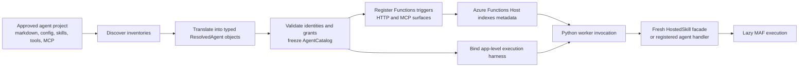
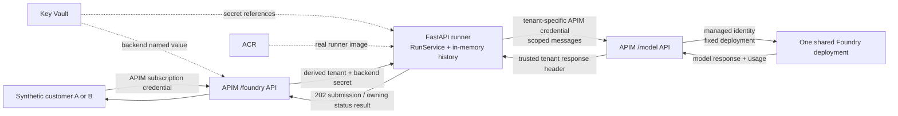
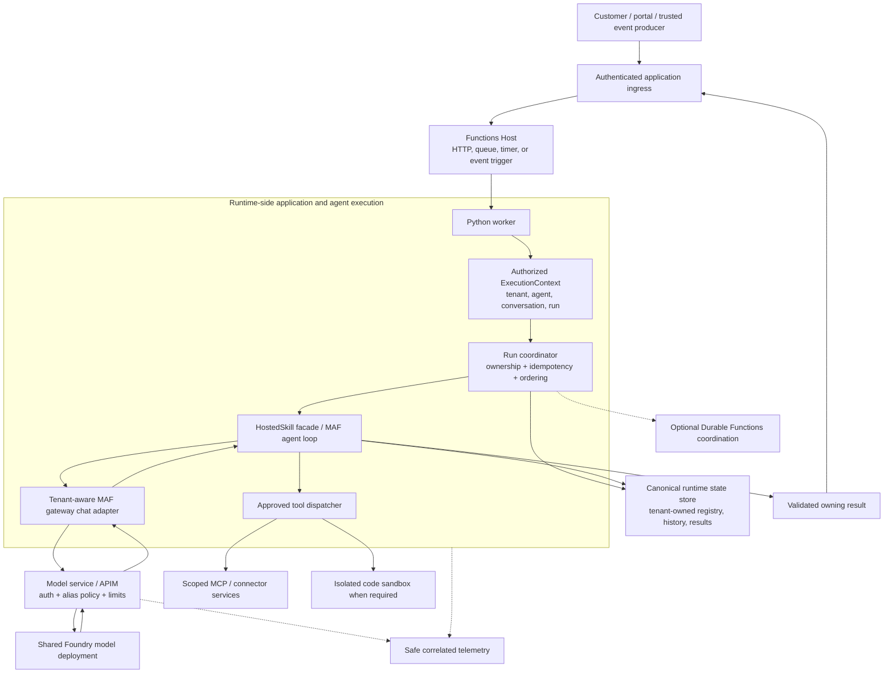
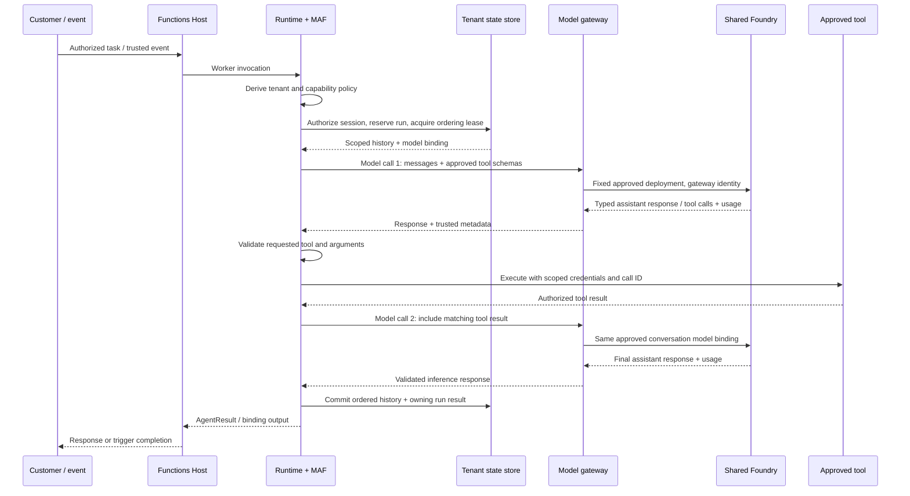
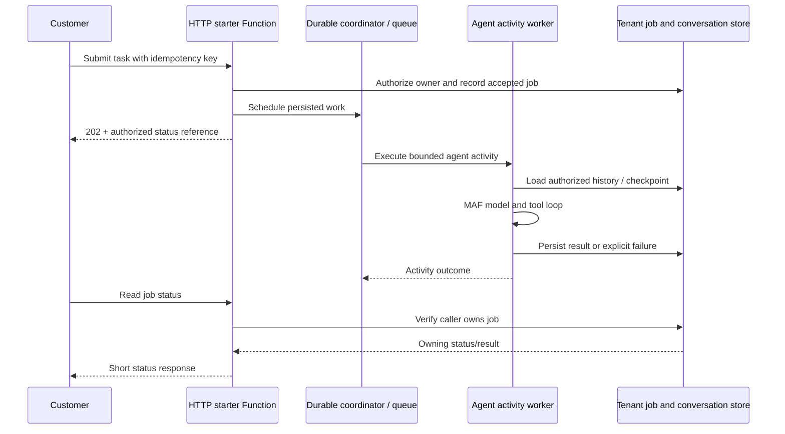
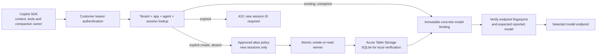

# Hosted Skills Architecture: Functions Host, Agent Runtime, and Shared Model Service

**Status:** the original standalone Foundry/APIM POC is live-validated.
The additional multi-endpoint, fixed 24-hour routing service is implemented and
locally tested, including a real Copilot SDK smoke against a synthetic provider.
Its Azure Table adapter is not live-deployed/qualified. The external
Functions-to-model-service integration remains a proposal, not a deployed feature.

**Prepared:** 2026-10-31 UTC. Runtime source baseline:
`5174e72d6036cc6248013d3678f715f7c0e14998`.
The original live evidence was recorded on 2026-10-30. It is separate from the
locally validated routing extension; the external runtime checkout is unchanged.

**Updated:** 2026-11-02 for implemented 24-hour model affinity. The user selected
Azure Table Storage with a SQLite local-test adapter and a fixed, non-sliding
24-hour lifetime. No Azure resource or paid model changes were made for this
extension. Details are in [section 12.5](#125-implemented-24-hour-session-affinity)
and the [POC 07 guide](07-session-affinity/README.md).

**Audience:** Hosted Skills platform, Functions host, agent runtime,
model-service, identity, storage, and operations owners.

## Contents

1. [Executive design](#1-executive-design)
2. [Scope, evidence, and terminology](#2-scope-evidence-and-terminology)
3. [Component responsibilities](#3-component-responsibilities)
4. [Functions host and agent runtime architecture](#4-functions-host-and-agent-runtime-architecture)
5. [Current model service: as built](#5-current-model-service-as-built)
6. [Recommended integrated architecture](#6-recommended-integrated-architecture)
7. [End-to-end execution flows](#7-end-to-end-execution-flows)
8. [API and adapter contracts](#8-api-and-adapter-contracts)
9. [Tenant identity and isolation](#9-tenant-identity-and-isolation)
10. [State, history, and durable execution](#10-state-history-and-durable-execution)
11. [Tools, skills, and compute isolation](#11-tools-skills-and-compute-isolation)
12. [Model routing and governance](#12-model-routing-and-governance)
13. [Caching architecture](#13-caching-architecture)
14. [Timeouts, failures, and cancellation](#14-timeouts-failures-and-cancellation)
15. [Infrastructure and deployment lifecycle](#15-infrastructure-and-deployment-lifecycle)
16. [Observability and data handling](#16-observability-and-data-handling)
17. [Validated evidence and acceptance plan](#17-validated-evidence-and-acceptance-plan)
18. [Integration delivery stages](#18-integration-delivery-stages)
19. [Decisions and unresolved questions](#19-decisions-and-unresolved-questions)
20. [Source references](#20-source-references)

## 1. Executive design

The platform should separate three responsibilities:

1. **Functions Host: when and where an invocation executes.** It receives
   triggers, dispatches work to a language worker, applies host lifecycle and
   execution limits, and manages binding integration.
2. **Agent Runtime: how an agent completes the task.** It loads authored
   instructions, supplies the correct conversation context, drives the
   model/tool loop, enforces tool policy, and produces the owning invocation's
   result.
3. **Model Service: which approved inference backend is called and under what
   policy.** It authenticates model access, maps logical aliases to deployments,
   applies limits, and returns model responses and usage. It does not need to
   execute customer tools or become a second agent runtime.

**Recommendation:** retain Microsoft Agent Framework (MAF) as the default agent
runtime, retain canonical conversation history on the runtime side, and add an
explicit, tenant-aware MAF inference adapter for a shared Microsoft Foundry
deployment behind an API Management (APIM) gateway.

Sharing the model deployment does **not** mean sharing conversation history,
customer credentials, tool state, or result ownership. Conversely, creating a
new Python object per request does not establish a separate operating-system,
storage, identity, or provider-cache boundary.

The implemented POC proves a useful part of this design: two credential-scoped
synthetic tenants can use one Foundry deployment while retaining separate
histories and owning run results. It does not yet prove the integration with a
real Functions-hosted agent, its tools, durable workflows, or production
multi-tenant storage.

For customers using Copilot SDK as their agent runtime, the new routing entry
point accepts SDK-owned context directly. Compaction/context ownership stays
with that SDK; the service persists only the immutable model route. This is
the same separation of responsibilities, not a MAF loop wrapped around a
second Copilot loop.

## 2. Scope, evidence, and terminology

### 2.1 What exists versus what is proposed

| Surface | Current status | What this document adds |
| --- | --- | --- |
| Functions agent runtime | External source checkout, public preview; reviewed at the baseline commit | Explanation of host/runtime boundaries and an integration design |
| HostedSkill facade and MAF execution | Implemented in the external runtime | Tenant-context and gateway-adapter requirements, not runtime modifications |
| Foundry/APIM model-service POC | Real Azure deployment and bounded live acceptance passed | As-built design, constraints, and reuse boundaries |
| Multi-endpoint, 24-hour session model service | Implemented with Azure Table/SQLite registries, JSON/SSE proxy and customer auth; locally tested | Fixed routing contract and Copilot SDK custom-provider setup; new Azure deployment still required |
| Functions Host calling the shared model service | Not wired or live-tested | Proposed runtime-owned-history integration |
| Durable routing metadata | Atomic immutable registry implemented; Azure SDK behavior locally tested | Live Azure Table/RBAC and deployment qualification |
| Durable transcript state and distributed agent-turn ordering | Not implemented in this POC | Remains distinct from immutable model routing |
| GitHub Copilot Fusion | Actual SDK enablement blocked; no Azure Fusion runner | Conditional future backend, explicitly outside the selected path |

The authoritative POC evidence is in [live-results.json](live-results.json),
[REPORT.md](REPORT.md), and the [POC 06 guide](06-shared-foundry-apim/README.md).
The runtime design source is [its architecture document][runtime-architecture].

### 2.2 Distinct identifiers

| Identifier | Meaning | Important boundary |
| --- | --- | --- |
| Azure subscription ID | Administrative/billing scope for Azure resources | Not a SaaS customer identity |
| Entra tenant ID | Identity directory identifier | Not necessarily the application's customer partition |
| SaaS `tenant_id` | Server-authorized customer partition | Must be derived from verified identity and entitlement |
| APIM subscription ID | Gateway credential/product subscription | The POC maps two of these to synthetic tenants |
| Public conversation/session ID | Customer-facing conversation reference | Must be authorized; knowing it is not permission |
| Internal session ID | Runtime/provider storage reference | Must be bound to an authorized owner |
| Agent run ID | One customer task or agent turn | May contain several model and tool calls |
| Model call ID | One inference request within a run | Required for tracing and usage reconciliation |
| Workflow instance ID | Durable coordination instance | Requires its own ownership checks |
| Deployment-session ID | Provisioning/audit correlation | The `sessionId` in the attached parameter file means this, not a chat session |

Do not use these identifiers interchangeably. In particular, an APIM
subscription key is not an Entra identity, and a provider request ID is not a
conversation authorization token.

## 3. Component responsibilities

| Component | Owns | Must not implicitly own |
| --- | --- | --- |
| Hosted Skills authoring/control plane | Approved agent versions, instructions, capability grants, tenant entitlements | Unrestricted runtime credentials supplied by customer prompts |
| Functions Host | Trigger listeners, invocation dispatch, bindings, worker lifecycle, host limits | Model selection, conversation isolation, semantic tool approval |
| Python language worker | Application code and runtime library execution | A dedicated process per customer unless separately provisioned |
| Agent Runtime / MAF | Prompt assembly, model/tool loop, response contract, canonical agent history | Cross-tenant identity inferred from an arbitrary session string |
| Runtime-side run coordinator, proposed | Job ownership, idempotency, durable state, session ordering | A second, conflicting transcript alongside MAF history |
| Model-service adapter, proposed | MAF-compatible inference contract, scoped credentials, correlation, error mapping | Tool execution or automatic model substitution |
| APIM AI gateway | Authenticated model ingress, alias/deployment policy, limits, trusted headers | Customer conversation memory by default |
| Foundry model deployment | Inference and provider-reported usage | Application-level SaaS tenant authorization or customer tool execution |
| State store | Authorized transcripts, session registry, checkpoints, result references | Provider prompt/KV caches |
| Tools / MCP / code sandbox | Explicitly authorized side effects and computation | Authority inferred only from model-generated arguments |
| Observability plane | Safe correlation, timings, usage, failure evidence | Raw credentials or routine prompt/response capture |

**One agent run is not one model call.** A typical task can make an initial model
call, execute tools, make more model calls, and then return a final answer.
Governance and attribution must cover every call, not only the customer's
initial prompt.

## 4. Functions host and agent runtime architecture

### 4.1 Startup and registration

The external runtime is a library inside a Python Function App. It is not the
Azure Functions host binary and is not itself a hosted Foundry agent service.

The reviewed startup pipeline is **discover -> translate -> register**:



The composition root creates an identity index and immutable catalogs before
mutating the Function App. Discovery inventories project inputs; translation
resolves typed configuration and capabilities; registration applies Azure
Functions decorators and builds handlers. SDK clients, credentials, and
execution resources are acquired lazily, not as an incidental result of
discovering an agent file. [Sources][runtime-architecture]: [composition][runtime-app]
and [runner boundary][runtime-runner].

The selected harness is app-scoped. MAF is the default; the runtime's Copilot
path is an explicit preview selection, not a per-call silent fallback.
Selecting the Copilot harness does not establish Fusion availability.

### 4.2 Invocation and HostedSkill injection

For ordinary application Functions, the `hosted_skill` decorator:

- Resolves an approved agent from the catalog.
- Validates the handler signature and capability compatibility.
- Hides the injected parameter from Functions worker indexing.
- Creates a fresh `HostedSkill` facade for each Function invocation.

The handler explicitly invokes `HostedSkill.run(prompt, session_id=...)` or
`HostedSkill.stream(...)`. The facade validates inputs, binds session-scoped
sandbox tools, copies capability lists, and calls the selected runtime.
See [injection implementation][runtime-injection] and [facade][runtime-binding].

**Important current limitation:** at the reviewed commit, an agent injected
through `hosted_skill` cannot declare chat-time subagents or enable Dynamic
Workflows. Ordinary registered agent execution has separate support for these
features. A Durable Function App containing the facade is not evidence that
the facade supports every autonomous-agent workflow feature.

The binding itself is also not a tenant authentication system. The application
handler must establish an authorized customer context before invoking it.
Built-in HTTP surfaces have their own [endpoint authorization layer][runtime-auth].

### 4.3 Where MAF runs

MAF constructs a fresh agent/session for execution, builds the configured chat
client, attaches approved tools and skills, and supplies a history provider.
The framework executes the model/tool loop in the Python worker.
See [MAF execution][runtime-maf-execution].

The provider resolver currently selects `openai`, `azure_openai`, or `foundry`
from explicit/runtime environment configuration. The MAF client factory builds
the corresponding provider client. The Foundry branch expects a **Foundry
project endpoint** and credential, not an arbitrary APIM gateway URL.
[Provider resolution][runtime-provider] and [client construction][runtime-maf-client]
are therefore the relevant integration surfaces.

### 4.4 What the host does not guarantee

Functions scales and schedules invocations; that does not give each invocation
a dedicated Python process or independent global variables. Multiple requests
can share a worker, app settings, cached clients, and application identity.

Therefore:

- Never change process environment variables to select another tenant's key.
- Never place customer-specific mutable agent history on a shared singleton.
- Never assume a fresh facade means fresh external storage.
- Never assume native function-key authentication provides per-customer
  authorization.
- Do not start essential untracked background work and return from a Function.
  Use an awaited bounded execution, queue, or durable coordinator instead.
  [Functions guidance][functions-reliability].

## 5. Current model service: as built

### 5.1 Deployed shape

The current POC has a FastAPI runner in Azure Container Apps, APIM Consumption,
one Foundry account/model deployment, Key Vault, ACR, managed identities, and
observability resources. **There is no Functions Host in this POC deployment.**



`G1` and `G2` are two API surfaces in **the same APIM service**, not two
independent gateways. The second gateway hop is intentional: the runner does
not have direct Foundry inference permission.

### 5.2 Authentication and policy

The [gateway module](infra/live/modules/api-management.bicep) implements:

1. APIM credential validation and an allowlist of two subscription IDs.
2. Server-side mapping to `customer-a` or `customer-b`.
3. Rejection of a conflicting caller tenant header.
4. Trusted tenant-header and backend-authentication override on runner calls.
5. Removal of incoming `Authorization` and APIM subscription headers before
   backend forwarding.
6. Fixed `chat` alias and shared deployment routing.
7. `store=false`, no streaming, and bounded output on the model route.
8. APIM managed-identity authentication to Foundry.
9. A server-derived tenant response header on model responses.

The [runner middleware](live_pocs/app.py) checks its secret-backed backend
credential and accepted tenant before protected run endpoints execute.
Direct health GETs contain configuration only and do not call a model.

The [transport](live_pocs/foundry.py) selects the synthetic tenant's gateway
credential, sends only that session's history, and rejects a missing/mismatched
tenant response header before accepting content. This response contract was
added after live testing exposed the missing outbound header; the guard was
not weakened to make the test pass.

### 5.3 State and limits

The [run service](live_pocs/service.py) owns:

- Session key: `(tenant_id, agent_id, public_session_id, model_alias)`.
- Server-generated internal session and run IDs.
- An `asyncio.Lock` per session, serializing turns in the single process.
- Explicit creation; duplicate create returns 409, unknown resume returns 404.
- Tenant-owned run read/cancel; another tenant receives 404.
- History append only after a successful response.
- Session quarantine on failure, timeout, or cancellation.
- Explicit cleanup-failure metadata.

Configured pilot limits are 20 sessions per tenant, 10 turns per session,
20 pending runs across the service, and a 90-second run deadline.
See [configuration](live_pocs/config.py) and
[container settings](infra/live/modules/container-app.bicep).

This is **not a durable job queue**. Submission starts an in-process task.
Restart or scale-to-zero loses histories and run records. A maximum of one
replica and one Uvicorn worker is essential to the current ordering assumption;
increasing either requires a different state/locking design.

### 5.4 The current POC is not a full agent runtime

The runner sends a short text prompt and transcript with fixed instructions
stating that the model has no tools or file access. It accepts text completion
responses. It does not implement the MAF tool-call/message contract, a customer
agent catalog, structured tool execution, or durable workflows.

Calling this runner from a Function would demonstrate a **remote conversation
service call**, not automatically integrate the Function's existing MAF agent.

## 6. Recommended integrated architecture

### 6.1 Target shape

The following diagram is **proposed**, except for the reusable APIM/Foundry
inference plane:



The model service is a **logical boundary**, not a requirement to add another
microservice for every responsibility. Reuse APIM policies for supported
authentication/routing controls. Add a small policy/control service only if
cross-instance budgets, entitlement lookup, or other requirements cannot be
correctly expressed at the gateway. Such a service is not currently deployed.

### 6.2 Choose one canonical history owner

Two reasonable designs exist, but they must not be mixed accidentally:

| Design | History and tool-loop owner | Consequence |
| --- | --- | --- |
| **A. Runtime-owned history, recommended** | MAF/runtime state layer | Model service receives complete scoped inference input; no independent transcript append |
| B. Remote agent/session service | Remote service | Functions becomes a client; the remote service must implement agent/tool semantics, durability, and lifecycle |

Design A best preserves the existing runtime, its skills, tools, response
contract, and workflow mechanisms. It also avoids synchronizing two histories.

For a Copilot SDK caller, the SDK is the runtime-side history/context owner in
Design A. [The implemented routing service](live_pocs/routing_app.py) stores no
transcript and supplies a session-scoped provider URL. It does not turn the
legacy POC run API into a Copilot session host.

**Do not implement Design A by sending MAF's full conversation to
`/foundry/runs` as a plain prompt.** The POC runner would add its own system
instructions and remembered transcript. Tool messages and history could be
duplicated or flattened, and the two state owners could disagree after failure.

Instead, integrate at the MAF **chat-client/inference boundary** and use the
model plane. Retain the POC run API as a direct-client experiment or explicit
remote-service option, not a hidden layer inside every MAF model call.

### 6.3 Adapter placement

The proposed adapter should:

- Satisfy MAF's typed chat-response contract.
- Accept already-authorized, request-scoped execution context.
- Serialize MAF messages and approved tool definitions without flattening them.
- Map approved aliases to gateway request models.
- Attach per-call credential, trace, and ownership metadata.
- Preserve provider usage, finish reasons, and tool-call IDs.
- Fail explicitly when the gateway lacks a required capability.

Wire it through the [existing MAF client construction boundary][runtime-maf-client]
with explicit configuration. No automatic fallback and no second harness
selection mechanism are needed.

Simply setting `FOUNDRY_PROJECT_ENDPOINT` to the APIM root is **not** an
implemented solution: endpoint semantics, credentials, request paths, response
types, and supported SDK operations differ. Compatibility must be tested with
the pinned MAF version.

## 7. End-to-end execution flows

### 7.1 One bounded agent run with tools

This is the proposed integrated sequence:



Critical consequences:

- Every model round trip passes the model policy boundary.
- Every tool execution is authorized separately; a model tool call is a
  request for an action, not proof that the action is permitted.
- Tool output is associated with its matching tool-call ID.
- The final response belongs to the authorized run, not to a model cache key.
- A tool or model failure must not produce a success-shaped fallback.

### 7.2 Long-running HTTP task

For tasks that exceed ingress deadlines, use an asynchronous **runtime-owned**
job contract. The Functions HTTP starter records the authorized job and
schedules durable/queued work before returning 202. It must not merely start
an untracked Python task.



Durable orchestrators replay. Model calls, external tools, and nondeterministic
SDK operations belong in **activities**, not directly in replaying orchestrator
code. Durable coordination does not automatically checkpoint a MAF agent's
in-memory loop. Resume boundaries, tool idempotency, and canonical history
updates must be designed explicitly. [Durable constraints][durable-constraints].

The runtime's [Dynamic Workflows][runtime-workflows] are an experimental,
separate agent capability. Do not assume they can be enabled on an injected
HostedSkill or that they already solve SaaS tenant isolation.

Job admission must also handle the database/queue handoff: use a durable
transactional outbox or an equivalent idempotent scheduling/reconciliation
mechanism. Do not acknowledge a job whose only scheduling record exists in
worker memory. If enqueue/start has an uncertain outcome, reconcile against
the owning run/idempotency reference rather than launching a duplicate agent.

### 7.3 Timer, queue, and event tasks

For non-HTTP triggers, no customer bearer token is inherently present. Map a
trusted producer/binding to a tenant and validate any signed/authorized event
envelope. A tenant field inside arbitrary message JSON is not sufficient.

The reviewed auto-registered non-HTTP handler generates a new session ID and
serializes trigger data into a prompt. Customer-specific continuity and
duplicate-event handling therefore need an explicit application policy, not
an assumption that event payloads already identify authorized conversations.
See [trigger handler construction][runtime-handlers].

Retries and redelivery are trigger-specific. Persist an event/idempotency
reference before side effects and never equate host retry with safe input
correction or exactly-once external execution.

## 8. API and adapter contracts

The initial implemented runtime/service interface is specified in
[CONTRACT.md](CONTRACT.md), with concrete session/inference examples,
authentication, fixed-lifetime semantics, and failure handling.
The contract targets **Agent Runtime (MAF / Copilot SDK)** as alternatives:
MAF remains the default and Copilot is explicitly selected. Framework-specific
context, compaction, and persistence stay with the caller; the local native
smoke validates Copilot, not the still-pending external MAF adapter.

### 8.1 Existing POC surfaces

| Surface | Current contract | Ownership |
| --- | --- | --- |
| `POST /foundry/runs` | `session_id`, `prompt`, `agent_id`, `model_alias`, `new_session`; returns 202 | Tenant derived from APIM credential |
| `GET /foundry/runs/{run_id}` | Owning run status and result | Foreign or unknown run returns 404 |
| `DELETE /foundry/runs/{run_id}` | Requests cancellation, returns 202 when accepted | Not a conversation or transcript deletion API |
| `POST /model/chat/completions` | Fixed `model=chat`, messages, bounded nonstreaming model request | Gateway identity/policy; no runner-owned history on this route |
| Direct runner `/healthz` | Configuration-only health | No credentials, prompts, or model invocation required |

These are the original POC 06 surfaces. The new SDK-compatible routing
entry point has its own authenticated `/sessions` and session-scoped
`/v1/chat/completions` paths, described in
[section 12.5](#125-implemented-24-hour-session-affinity); the deployed gateway
has not automatically acquired those routes.

APIM's `/foundry` prefix is removed on backend forwarding; the runner implements
`/runs`, not `/foundry/runs`. These routes are defined in
[the application](live_pocs/app.py) and
[the gateway](infra/live/modules/api-management.bicep).

Example existing submission, using a separately supplied APIM credential:

```json
{
  "session_id": "conversation-001",
  "prompt": "Summarize this synthetic test information.",
  "agent_id": "assistant",
  "model_alias": "chat",
  "new_session": true
}
```

Tenant, backend URL, provider credential, and an arbitrary model are not
caller-selectable JSON fields. Extra submission fields are rejected.

### 8.2 Required target inference contract

The following are **requirements for the proposed MAF adapter**, not capabilities
proven by the current text-only runner:

| Contract area | Required behavior |
| --- | --- |
| Messages | Preserve supported system/user/assistant/tool roles, content types, ordering, and tool-call associations |
| Tools | Carry approved schemas; preserve typed calls and outputs; never execute tools in APIM |
| Model alias | Select only aliases granted to the authenticated tenant/agent; resolve server-side |
| Options | Allow only supported, policy-bounded generation/structured-output options |
| Response | Preserve text, tool calls, finish reason, reported model, provider ID, and usage |
| Streaming | Explicit capability and gateway qualification; reject unsupported requests, never silently downgrade |
| Cancellation | Bounded client cancellation plus persisted outcome; do not claim provider/tool rollback |
| Errors | Stable, sanitized codes; unknown usage remains unknown, not zero |
| Correlation | Separate tenant authorization from run/model-call/trace references |

The current response parser requires text `message.content` and ignores other
provider fields. That is insufficient for a MAF response consisting only of
tool calls. Reusing it unchanged would break the agent loop even if basic
chat requests succeed.

A model-service adapter must remain a transport/provider abstraction. It should
not convert an LLM-generated tool request into an HTTP side effect itself.

### 8.3 Target agent-job contract

For asynchronous host runs, introduce a runtime-side job schema containing:

- Server-derived tenant and caller entitlement.
- Approved agent/configuration version.
- Public conversation ID mapped to an internal conversation.
- Agent run ID, idempotency key, status, and deadline.
- Result/error reference and usage reconciliation status.

Return only a public owning reference. Authorize job read, cancel, history,
stream replay, and result retrieval independently. A Durable status URL or
unguessable GUID is not a replacement for that authorization.

## 9. Tenant identity and isolation

### 9.1 Three authentication boundaries

1. **Customer/event -> application:** verified user/service identity and
   application entitlement.
2. **Runtime -> model gateway:** workload credential plus an authorized customer
   scope. The gateway must verify that the workload is entitled to act for that
   tenant; a workload token plus an arbitrary tenant header is insufficient.
3. **Gateway -> Foundry:** managed identity with the least required inference role.

The POC implements synthetic credential partitions, not a full Entra
multi-customer identity system. Its runner can read both tenant gateway
credentials in one process, so compromise of that process is not isolated
to one synthetic tenant.

For production, prefer a workload-authenticated gateway contract with an
explicit, validated tenant entitlement/delegation mechanism. An Entra
directory tenant claim may be one input, but map it to the platform's own
customer registry and authorization policy.

The runtime's Easy Auth path trusts platform-validated principal headers only
when enforcement is established, then applies allowlists. Do not copy an
incoming principal header through a different ingress and assume it is trusted.
See [the actual auth implementation][runtime-auth].

### 9.2 Proposed immutable execution context

Create one authorized context at ingress and carry it explicitly through the
facade, runtime request, adapter, tools, and workflow activities:

| Field | Purpose |
| --- | --- |
| `tenant_id`, `app_id` | Customer/application partition |
| Caller/principal reference | Entitlement and audit association |
| `agent_id`, agent configuration version | Approved instructions and capabilities |
| Public and internal conversation IDs | Authorized continuity |
| `agent_run_id`, parent run/workflow reference | Owning task and nested lineage |
| `model_call_id`, attempt number | Per-inference attribution |
| Approved model binding / policy version | Prevent arbitrary routing or silent drift |
| Capability grants and credential references | Scoped tools/provider access |
| Deadline, cancellation and retry budget | Bounded execution |
| Trace context | Observability only, never authorization |

Credential references, not raw secrets, belong in persisted context. Customer
prompts must never be able to modify this context.

### 9.3 Surfaces that must use the same policy

Apply the same ownership check to HTTP chat, injected HostedSkill calls,
streaming, history reads, job status/cancel, queue/timer mapping, subagent
delegation, workflow leaf activities, tool execution, and result download.

Nested agents must inherit the authorized tenant lineage and receive only
their approved capability subset. A fresh leaf session isolates its transcript
from the parent; it does not authorize a different customer or credential.
If tenant-context propagation is unavailable on a surface, gate that surface
instead of assuming inheritance.

## 10. State, history, and durable execution

### 10.1 Current state comparison

| Layer | Current storage/ordering | Limitation |
| --- | --- | --- |
| POC runner | In-memory tenant/agent/session/alias dictionary and per-session lock | Lost on restart; not safe across replicas |
| New routing service | Azure Table immutable insert/read, or SQLite primary-key insert for local use | Durable routing metadata only; no conversation transcript, tool state or distributed agent lock |
| MAF history | Agent-scoped local JSONL or Blob-backed transcript | Current path has no explicit SaaS tenant segment |
| MAF turn ordering | Process-local `(agent_slug, session_id)` lock | Does not coordinate multiple Functions workers |
| Runtime storage selection | `AzureWebJobsStorage` connection or Blob service URI; identity-based alternative | Infrastructure authentication is not per-session caller authorization |
| Dynamic Workflow | Durable coordination for supported experimental workflow paths | Not a universal durable checkpoint of all MAF execution |

The current MAF Blob name is
`agent-sessions/{agent_slug}/{session_id}.jsonl`. The local history has the same
agent/session shape. A syntactically valid ID that has no Blob can produce an
empty history; it is not an explicit application-owned resume lookup.
[Blob history][runtime-blob], [file history][runtime-file],
[storage selection][runtime-storage], [locking][runtime-locks].

The container or storage account can be configured differently per application.
That is useful infrastructure separation, but the reviewed path alone does
not establish tenant ownership for a shared multi-customer Function App.

### 10.2 Recommended canonical state

For the integrated design, keep a tenant-aware registry and a single
runtime-owned transcript:

```text
tenants/{tenant_id}/apps/{app_id}/agents/{agent_id}/
  conversations/{internal_conversation_id}/
    metadata
    ordered transcript records
    runs/{agent_run_id}
    tool-results/{tool_call_id}
```

This is a proposed logical layout, not an existing runtime path.

Registry metadata should bind the public conversation to its owner, internal
ID, agent version, approved model binding, current revision, lifecycle status,
and retention policy. Validate identifiers before building storage references.
Do not treat a tenant-prefixed string or Blob folder as an RBAC boundary.

A narrow first bridge can map
`(tenant_id, app_id, agent_id, public_session_id)` to a server-generated
runtime session ID before calling the current facade. That reduces collision
risk, but still requires authorized history endpoints, durable metadata, and
cross-worker ordering. It is not the complete production storage change.

### 10.3 Ordering and idempotency

For each conversation:

1. Authorize the caller and resolve the owning registry entry.
2. Atomically reserve the run/idempotency reference.
3. Acquire a distributed ordering lease or use conditional versioned updates.
4. Load the last committed transcript and binding.
5. Execute bounded work with distinct model/tool call references.
6. Commit the result with the expected conversation revision/fencing token.
7. Release ordering ownership and expose the terminal result.

Blob leases and ETags are possible building blocks; an atomic append alone
does not serialize the whole read -> infer -> write transaction. A stale worker
must not commit after another worker has taken ownership.

Do not promise exactly-once model inference or tool side effects. A request can
complete remotely and fail before its local result is committed. Preserve
`outcome_unknown`, reconcile usage, and use tool-specific idempotency where
supported.

### 10.4 Retention and deletion

Specify separate retention/deletion for transcript, result, tool artifact,
workflow history, application cache, and telemetry. Deleting a run reference
is not necessarily deleting its conversation or provider-side state.

With stateless model requests and `store=false`, the application still has
transcript/telemetry obligations. The parameter does not mean zero provider
processing retention or disabled prompt caching.

## 11. Tools, skills, and compute isolation

The runtime inventories and filters tools, MCP servers, and skill directories.
MAF then presents the approved definitions to the model and executes matching
authorized calls. Customer-authored English instructions are task data, not a
grant to access arbitrary tools.

Three execution cases have different boundaries:

| Execution | Boundary | Design requirement |
| --- | --- | --- |
| Trusted platform Python tool | Functions worker/application process | Request-scoped authorization; no arbitrary tenant code import |
| MCP/connector call | External service and credential scope | Per-tenant resource/credential authorization and egress policy |
| Customer/generated code | Explicit isolated sandbox | Session ownership, resource limits, restricted egress, secret minimization, cleanup |

The runtime supports an ACA Dynamic Sessions-backed Python sandbox, when
configured, with a session identifier derived from the runtime session.
That identifier must also be tenant-authorized. The reviewed POC did **not**
deploy or validate that sandbox. [Sandbox implementation][runtime-sandbox].

Do not run arbitrary customer Python in the shared Functions worker simply
because the model suggested it. Python code in the project's tool inventory
is imported by discovery and must be platform-trusted or processed through an
approved isolated build/execution mechanism.

If a customer requires stronger compute isolation, separate Function Apps,
identities, storage, or sandbox pools can still use a **shared model deployment**.
Compute isolation and inference deployment isolation are independent decisions.

## 12. Model routing and governance

### 12.1 Logical model binding

Agent authoring should request a policy-approved alias, not a provider URL or
customer-supplied model credential. The service resolves:

```text
authorized tenant + agent/config version + model alias + policy version
  -> provider/API + deployment + supported capabilities + limits
```

The POC uses `chat -> chat-modelpoc-dev-e8d5`, backed by
`gpt-4.1-mini` version `2025-04-14`, GlobalStandard capacity 3.
These details are in [the parameters](infra/live/main.parameters.json) and
[the Foundry module](infra/live/modules/foundry.bicep).

For the initial integration, keep the approved deployment/version binding
stable for a conversation. If policy changes the backend, make the migration
explicit and record it; a stable alias does not imply a stable underlying
model. Tenant-specific model variants remain optional exceptions.

### 12.2 Limits and economics

Current APIM limits are:

- Model API: 12 calls/minute, with a product-level 720 model calls/hour quota.
- Runner API: 120 calls/minute, with 7,200 runner requests/hour quota.
- Product aggregate: 7,920 calls/hour.
- The model route caps supported output requests at 128 tokens.

These are per-subscription **request** controls, not hard token or financial
budgets. Polling consumes gateway calls. APIM Consumption lacks native
`llm-token-limit`, `rate-limit-by-key`, and `quota-by-key` support.
Production token governance needs a qualified gateway tier or a correct
shared budget mechanism; request counts alone do not bound multi-call agent
cost. [Policy/tier references][apim-gateways].

A run budget should account for all model attempts, input growth, output,
tool/connector charges, and retries. Record cached tokens separately and keep
unreported usage unknown. Reconcile accepted application turns against
provider counters, because failures can still consume tokens.

Make underlying SDK retry behavior explicit in the adapter. Hidden SDK attempts
must not bypass the run's approved budget; disable them for the initial
controlled integration or count and authorize every attempt centrally.

### 12.3 Residency and model lifecycle

The POC resources are in East US 2, but **GlobalStandard is a global inference
deployment type**. Resource location is not a guarantee that all processing
occurs in that region. Strict data-zone/geography requirements may require a
different deployment type and separate approval/qualification.
[Foundry multitenancy guidance][foundry-tenancy].

The selected model version is a low-cost, short-lived baseline listed as
Legacy in the prior capability review. Production support/retirement policy
and representative model quality must be reviewed separately.

### 12.4 Fusion

The [real Fusion SDK prototype](live_pocs/fusion.py) and
[enablement findings](05-github-fusion/README.md#live-sdk-preflight) are retained.
The requested `fusion` selector was rejected because dynamic Auto tiers were
unavailable. No legacy Auto, fixed-model, or mock substitute was accepted.

Fusion is a future conditional runtime/backend workstream. It requires actual
supported enablement, customer entitlement/billing design, SDK/tool/session
qualification, and model-selection/usage evidence. It is not an active route
in this architecture or interchangeable with the Foundry text-completions API.

### 12.5 Implemented 24-hour session affinity

The user approved **Azure Table Storage plus SQLite local verification** and
**fixed 24-hour expiry from creation**, rather than sliding expiry.

The implementation is a separate opt-in entry point,
[live_pocs.routing_app](live_pocs/routing_app.py), backed by
[routing policy/contracts](live_pocs/routing.py) and
[registry adapters](live_pocs/routing_storage.py). It preserves the legacy
[POC 06 application](live_pocs/app.py) unchanged.



#### Binding identity and persistence

The logical identity is
`(application_id, tenant_id, agent_id, public_session_id)`. Azure partition and
row keys hash the two unambiguous identity pairs. The immutable entity records:

- Original customer/session scope and a server-generated SDK session ID.
- Public model alias and selected endpoint ID.
- An endpoint fingerprint covering URL, concrete deployment/model/version,
  expected reported model, credential reference and configured limits.
- Creation timestamp and expiry exactly 24 hours later.

No transcript, prompt, response, tool output or credential value is persisted.
The SDK retains its own context in its separately scoped persistence layer.
The service's routing registry does not implement SDK state persistence.

Azure uses `create_entity`, not upsert. If two workers race, one insertion wins;
the other reads that row. A conflicting requested alias returns 409. SQLite
uses the corresponding unique primary key and transactional insert. A missing
or denied table, uncertain write, unresolved conflict, corrupt record or
changed owner fails explicitly; there is no memory/default-route fallback.

The Azure account/table must already exist and the service must have the
required data-plane role. Production uses managed identity, with
`DefaultAzureCredential` available only through explicit development
configuration. The adapter does not create resources or tables implicitly.
[Azure Table SDK reference][table-sdk].

#### Customer API and SDK transport

`POST /sessions` accepts `agent_id`, `session_id`, and `model_alias` under the
customer's bearer API credential. It returns 201 for a new binding or 200 for
an identical existing binding, including a session-scoped provider base URL:

```text
{service-root}/sessions/{agent_id}/{session_id}/v1
```

Copilot SDK uses this URL with its custom provider, the model alias,
`wire_api="completions"`, the customer's service API key and returned provider
limits. The gateway authenticates every request and loads the customer's
binding before forwarding `/chat/completions`. It does not assume the SDK
transmits its internal session ID as an HTTP header.

The proxy preserves the SDK's full messages, compacted summaries, function
schemas, tool-call IDs/results, stream options and response usage. It replaces
only the logical request model with the pinned deployment, applies bounded
output and `store=false`, and adds no agent instructions or history.

The initial supported protocol is **OpenAI-compatible Chat Completions,
including JSON and SSE**. Responses/native Anthropic endpoints, hosted
provider tools and shared provider-state references are not implemented.
This is not a generic protocol converter.

The returned `max_prompt_tokens` is a qualified SDK compaction-budget hint,
not server-side tokenizer enforcement. Server enforcement currently covers
request/response bytes, supported output limits and absolute inference/stream
deadlines. The caller must configure appropriate real model limits.

#### Request, failure and lifecycle rules

| Condition | Implemented behavior |
| --- | --- |
| Same binding requested again | Original endpoint, SDK session ID and expiry; no renewal |
| Different model requested for same session | 409; no forwarding or reassignment |
| Unknown/foreign session | 404; model requests cannot auto-create |
| Exactly at or after expiry | 410 on create/read/inference; use a new public session ID |
| Alias policy changes | Affect new sessions only; old bindings use stored endpoint IDs |
| Endpoint removed or fingerprint changes | 503; no fallback to another catalog entry |
| Provider reports another model | Reject before accepting JSON or first SSE data; later drift emits stream error |
| Backend key rotates under the same reference | Resolve current key; binding is unchanged |
| Provider error/timeout | Explicit error, one service attempt, binding unchanged |
| Stream failure | Explicit SSE error, no successful `[DONE]`, upstream cleanup |
| Service restart or another worker | Read the same durable binding; no process-local routing dependency |

Expiry is checked on request admission; a stream admitted before expiry may
complete under its bounded inference deadline. Expired records are retained
as tombstones, not automatically deleted/rebound. Operations must not remove
or auto-upgrade pinned endpoints during active windows. A version upgrade
should use a new endpoint ID and change aliases only for new sessions.

All instances must use the same application namespace and compatible catalog;
UTC clock synchronization and persistent storage availability are operational
requirements. Routing affinity is not a guarantee of uninterrupted backend
availability, a reserved replica/GPU, or 24-hour KV-cache retention.

#### Validation and deployment status

Deterministic tests cover exact expiry, no renewal, concurrent creation,
cross-process SQLite reads, Azure insertion conflicts/failures, owner
validation, endpoint drift, credential separation, raw SDK context/tools,
stream model checking, fragmentation, truncation, timeout and disconnect.
An opt-in test also runs the actual pinned Copilot SDK/native runtime for two
context-packed turns through a localhost service and synthetic provider.
It does not exercise a live model or force an actual SDK compaction event.

The combined regression run passed 125 tests, including 39 new routing tests
and the opt-in native smoke. Focused type checking passed with zero errors;
the 41-package lock passed public hash verification and a Linux Python 3.13
binary-only pip dry run. The expiry tests advance an injected clock across the
exact boundary; they are not a real-time 24-hour Azure soak.

The Azure adapter's real client construction/cleanup and SDK-shaped behavior
were checked locally. **No new routing service, storage account/table, role
assignment or gateway route has been deployed or live-validated.** The original
POC 06 Azure resources and paid results remain unchanged.

See the [guide and configuration](07-session-affinity/README.md) for startup,
SDK settings, table/RBAC prerequisites and explicit inference enablement.
The pinned SDK's Windows native shutdown emits upstream stdio warnings;
ordinary tests skip the native smoke unless explicitly enabled.

#### Future cost-aware admission

The current selector is an explicit alias-to-endpoint mapping, not an AI
classifier or per-request managed router. It provides the admission seam for
a future quality-qualified, cost-aware selector: choose a concrete eligible
endpoint once, persist it, and honor that binding for 24 hours.

Do not bind a session only to a managed router alias and claim a fixed
underlying model. Adaptive per-request routing/escalation needs a different,
explicit customer contract.

## 13. Caching architecture

| Cache/state category | Owner | What isolation must address |
| --- | --- | --- |
| Conversation history | Runtime/application | Tenant-owned lookup, mutation, deletion, and ordering |
| Provider prompt/KV cache | Model provider | Documented processing/cache boundary; not an application transcript |
| Stored provider responses/conversations | Provider plus application ownership registry | Authorization of every object reference and retention policy |
| Exact/semantic answer cache | Application/gateway, if introduced | Trusted tenant partition, access context, versioning and invalidation |
| Tool/sandbox state | Tool service/sandbox | Tenant/session ownership, credential scope and cleanup |

The POC has no semantic/application answer cache. It reported **zero cached
input tokens** in the accepted short scenario, so it did not exercise a
meaningful provider cache-hit workload.

Provider prompt caching reuses previously computed prompt prefixes; it is not
conversation memory or a reply-routing mechanism. Official documentation says
in-memory prompt caches are not shared between Azure subscriptions. That does
not prove separate SaaS-customer partitions inside the same subscription and
deployment. [Prompt-cache documentation][prompt-cache].

Do not:

- Use `prompt_cache_key` as authorization or tenant routing.
- Claim `store=false` disables prompt/KV caching.
- Infer KV partition assurance from a canary-recall test.
- Apply cache options for a different model family without checking support.

If answer caching is later approved, use a key based on authorized tenant,
agent/prompt/tool schema version, model binding, normalized request context,
and relevant data/entitlement versions. Cache lookup still requires
authorization; a hash of a prompt alone is insufficient. Default to no shared
answer cache until its tenant/retention/side-effect semantics are tested.

## 14. Timeouts, failures, and cancellation

### 14.1 Independent clocks

| Clock | Current POC value / platform behavior | Meaning |
| --- | --- | --- |
| APIM Consumption request duration | 30-second total limit | One gateway request, not the lifetime of an agent job |
| Runner -> model HTTP client | 20-second timeout setting | HTTPX operation timeout, not a durable job guarantee |
| POC run deadline | 90 seconds | Includes waiting for the in-process session lock |
| Acceptance caller HTTP timeout | 28 seconds | Deliberately below the gateway ceiling |
| Acceptance polling deadline | 120 seconds | Test harness limit, not a host execution contract |
| Functions `functionTimeout` | Hosting-plan and application configuration dependent | Separate from model-client and ingress limits |

Functions documentation also describes HTTP response limits independently of
execution timeouts; extending an agent timeout cannot extend every proxy/load
balancer deadline. Use the smallest effective deadline on the actual path.
[Functions hosting guidance][functions-scale].

The Functions hosting reference documents a 230-second HTTP response limit
independently of `functionTimeout` for its described HTTP paths. The current
APIM Consumption path has the much smaller 30-second ceiling. Qualify the
actual ingress/host topology rather than assuming the larger limit applies
through every gateway or container-hosted configuration.

A 202/polling design removes the long **agent** HTTP connection; it does not
remove the limit on an individual model request. Streaming, long reasoning, or
slow provider calls need explicit qualification and potentially a different
gateway/transport choice.

### 14.2 Failure policy

| Failure | Required action | Do not do |
| --- | --- | --- |
| Invalid identity or tenant mismatch | Reject before execution; audit safe code | Substitute another tenant/key |
| Missing/mismatched trusted response header | Reject response and mark failure | Accept content because HTTP was 200 |
| Unknown resume/run owner | Explicit not-found/ownership failure | Silently create empty history |
| Quota/rate limit | Surface throttling; apply an approved bounded policy | Retry indefinitely or switch model secretly |
| Model timeout/client disconnect | Record unknown remote outcome and usage | Claim zero charge or remote cancellation |
| Tool timeout or failure | Capture tool-specific outcome/idempotency evidence | Roll back assumed side effects |
| State-store/lease failure | Do not expose an uncommitted successful turn | Commit stale history or fabricate continuity |
| Cancellation | Stop local work, attempt cleanup, expose explicit outcome | Claim transactional undo |
| Cold-start readiness failure | Distinguish configuration readiness from inference | Treat a placeholder or health response as model success |

The POC quarantines a failed/cancelled session instead of automatically
replaying an uncertain turn. The application must choose a new authorized
conversation or an explicit recovery action.

For production, define a retry budget and safe recovery protocol. Agent-assisted
input repair, host trigger retry, and transport retry are different behaviors.
None should bypass authorization, repeat non-idempotent tools without a policy,
or hide prior token consumption.

## 15. Infrastructure and deployment lifecycle

### 15.1 Current resource footprint

Resource names are taken from the attached
[main.parameters.json](infra/live/main.parameters.json), not invented by this
design:

| Role | Resource / SKU |
| --- | --- |
| Resource group | `rg-modelpoc-dev-e8d5`, East US 2 |
| Foundry account | `ai-modelpoc-dev-e8d5`, AIServices S0 |
| Shared model deployment | `chat-modelpoc-dev-e8d5`, GlobalStandard capacity 3 |
| Gateway | `apim-modelpoc-dev-e8d5`, Consumption |
| Container Apps environment | `cae-modelpoc-dev-e8d5`, Consumption-only |
| POC runner | `ca-foundry-modelpoc-dev-e8d5`, 1 vCPU / 2 GiB, 0-1 replicas |
| Registry | `crmodelpocdeve8d5`, Basic |
| Secrets | `kv-modelpoc-dev-e8d5`, Standard |
| Logs / Insights | `log-modelpoc-dev-e8d5` / `appi-modelpoc-dev-e8d5` |
| Runner identity | `id-foundry-modelpoc-dev-e8d5`, user-assigned |

The supplied parameter file is a **bootstrap template**, not a live-state
snapshot: it contains `isPlaceholder=true` and a placeholder image. The guarded
deployment driver privately supplies required identity/contact/secure fields
and later sets the real image with `isPlaceholder=false`. Do not deploy the
public parameter file alone or infer that the live service still uses its
placeholder value.

`tenantASubscriptionId` and `tenantBSubscriptionId` identify APIM subscriptions.
Its `sessionId` correlates the provisioning session and tags. Neither is a
customer conversation-storage key.

### 15.2 Identity and secret scopes

The [role assignment module](infra/live/modules/role-assignments.bicep) grants:

- Runner: ACR pull and access to its backend and synthetic tenant gateway
  secrets; no direct Foundry inference grant.
- APIM: required Foundry inference role and runner backend-secret access.
- Deployer: required Key Vault administration role for this pilot.

Secret values are not in public parameters, images, results, or this document.
The deployment helper uses an ignored, Windows-DPAPI encrypted checkpoint and
a short-lived private parameter payload outside the image build context.

The service uses public HTTPS, not private endpoints/custom VNet isolation.
A stronger network/compute requirement is a separate design and approval,
not a property of the shared deployment.

### 15.3 Two-phase deployment

The [entry point](infra/live/main.bicep) and
[guarded driver](scripts/deploy_live_pocs.py) perform:

1. Validate exact target/operator/owned scope and preview infrastructure.
2. Create foundation resources and managed-identity role grants.
3. Defer gateway configuration/secret references until the grants exist.
4. Build the real hash-pinned, nonroot [runner image](Dockerfile.live) through ACR.
5. Preview/redeploy the real-image workload and gateway configuration.
6. Verify image equality and configuration health.
7. Run separately approved synthetic inference acceptance.

The ordering matters: the original live attempt tried resolving an APIM
Key Vault named value before the role module could complete. Separating
bootstrap service creation from gateway configuration avoids that dependency
cycle.

The public [dependency lock](requirements-live.lock) contains SHA-256 hashes.
Stock-pip and the real Linux build were tested; public artifact hash matches
alone had not caught the earlier invalid MD5 options.

### 15.4 Cost scope

The prior small-pilot estimate is approximately **USD 5.62/month before free
grants, plus model usage**. ACR Basic accounts for about USD 5/month while
retained. This assumes very low activity and is not a spend cap or invoice.

**That estimate does not include the proposed Functions host, runtime storage,
durable coordination, customer tool/sandbox usage, production telemetry, or a
different APIM tier.** Cost the combined target separately after host plan,
traffic, residency, isolation, retention, and availability requirements are
agreed.

Hosting selection is also separate: code-only Python Functions and a native
Copilot-runtime container have different compatibility requirements. The
current POC container is a FastAPI runner, not a Functions-host image.
[Functions hosting options][functions-scale].

## 16. Observability and data handling

### 16.1 End-to-end trace model

For the target, correlate:

```text
host invocation
  -> agent run
     -> model call 1 -> gateway/provider request
     -> tool call(s)
     -> model call 2 -> gateway/provider request
  -> persisted terminal result
```

Propagate W3C trace context through the adapter and activities. Retain separate
agent-run, model-call, tool-call, and provider-request IDs. A trace ID is not an
ownership proof.

MAF/runtime spans expose execution surface, model, tool, and usage evidence
where available. The external runtime has optional worker OpenTelemetry
exporter configuration and distinguishes host lifecycle telemetry from worker
agent spans. Do not assume an App Insights connection string alone exports all
SDK/runtime spans. Avoid duplicate exporters. [Runtime observability][runtime-observability].

### 16.2 Safe telemetry contract

Record tenant pseudonym/reference, agent/config version, model alias/reported
model, run/call IDs, stage, duration, outcome/error code, usage availability,
input/output/cached token counts, and cleanup outcome.

Do not routinely record prompts, response bodies, tool arguments containing
customer data, authentication headers, raw tokens, or secret values. A debug
mode needs explicit tenant consent, bounded retention, restricted access, and
redaction.

The deployed APIM diagnostic was checked for **zero-byte request/response
bodies** and absence of credential headers. App Insights gateway logs and
Container Apps logs are distinct from full host/worker/MAF tracing; the complete
combined trace chain remains an integration acceptance requirement.

### 16.3 Operational signals

Monitor both customer success and provider consumption:

- Accepted runs versus attempted/billed model requests.
- Warm inference latency versus cold-start, queue, lock, and full run latency.
- Unknown outcomes, quarantined sessions, cancellation/cleanup failures.
- Per-tenant model/token/tool usage and throttling.
- Storage conflicts, lease loss, replay/redelivery, and duplicate tools.
- Actual model binding changes, content-filter decisions, and retirement risk.

A healthy `/healthz` response proves configuration readiness only. The POC
deliberately keeps its `inference_verified` health field false; separate
acceptance evidence establishes real model execution.

## 17. Validated evidence and acceptance plan

### 17.1 What the live POC measured

The [recorded scenario](live-results.json) passed four model turns, all ten
authorization/history/correlation checks, and used one reported model:
`gpt-4.1-mini-2025-04-14`.

| Tenant | Turn | Runner elapsed ms | Input tokens | Output tokens | Cached input |
| --- | ---: | ---: | ---: | ---: | ---: |
| customer-a | 1 | 904.43 | 75 | 1 | 0 |
| customer-b | 1 | 540.81 | 73 | 1 | 0 |
| customer-a | 2 | 2095.54 | 97 | 16 | 0 |
| customer-b | 2 | 1404.69 | 95 | 14 | 0 |

Successful scenario totals: **340 input / 32 output tokens**.
Provider metrics reconciled **six requests, 492 input / 34 output tokens**
overall, including two earlier unaccepted attempts. The third failed scenario
stopped in a cold-start negative check before model submission.

The uncached token-rate estimate for the six reported requests was about
USD 0.000251, not an invoice. Eighty-six deterministic tests and 65 checked
resource operations passed during the implementation.

Four warm observations are not p50/p95, throughput, availability, model quality,
or a cold-start SLO. The canary test is not proof of provider KV partitioning.

### 17.2 Production and integration acceptance

| Requirement | Current evidence | Required next evidence |
| --- | --- | --- |
| Shared deployment with distinct customer histories | POC 06 direct-client scenario passed; POC 07 SDK context/proxy verified locally | Actual Function + runtime gateway integration with scoped history |
| Fixed 24-hour multi-endpoint routing | POC 07 local registry, atomicity, expiry, proxy and native SDK smoke | Live Azure Table/RBAC, restart/scale and real-model qualification |
| Host/runtime authentication | Source-reviewed | Live verified ingress, entitlement and delegated tenant context |
| Multi-call tool loop | Runtime source supports it; POC runner is text-only | Typed tool-call round trip through gateway, including tool-only responses |
| Cross-surface ownership | POC run read and spoof tests passed | History, streaming, workflow, nested leaf, cancel and result-download tests |
| Concurrent ordering | Single-process locks | Two workers/replicas, lease conflicts, stale-worker rejection, duplicate-event tests |
| Durable resume | Routing record survives a different process locally; transcript/agent recovery not qualified | Live registry and SDK-state restoration; restart at model/tool/commit boundaries with explicit unknown outcomes |
| Model budgets | Request limits and observed usage | Shared token/run budget across concurrent workers and all attempts |
| Cancellation | POC implementation/unit coverage | Live nested tool/provider cancellation and late-result handling |
| Provider cache boundary | Documentation only; zero cached tokens observed | Provider assurance for selected model/API/deployment and approved validation |
| Latency/cold starts | Warm measurements plus observed cold-start failures | Representative p50/p95/full-run and startup SLOs on the selected host plan |
| Network/residency | Public HTTPS; GlobalStandard | Requirement-specific deployment/network validation |
| Quality and GA | Small functional experiment | Representative customer tasks, evaluation gates, adoption and operating ownership |
| Fusion | Actual enablement rejection | Supported entitlement plus real SDK selection/usage/isolation qualification |

Do not declare integration complete until a real Functions-triggered MAF run
uses the gateway for every model turn, executes an authorized tool, resumes the
correct tenant's state, and returns the owning result.

## 18. Integration delivery stages

These are proposed implementation stages, not work executed by this document.
Runtime changes should follow the external project's FRD/review/worktree
process, without modifying the reference checkout in place.

1. **Approve identity and state ownership.** Choose runtime-owned canonical
   history; define customer mapping, every execution surface, host plan, and
   allowed feature set. Keep unsupported subagent/workflow surfaces gated.
2. **Complete runtime adapters.** POC 07 implements the SDK-facing stateless
   proxy and binding registry; the external MAF adapter is still proposed.
   Use explicit configuration,
   request-scoped credentials, typed messages/tool calls and safe metadata.
   Preserve existing provider defaults and no-fallback behavior.
3. **Run one Functions-hosted vertical slice.** Use a bounded HTTP or trusted
   event handler, one authorized tool, two tenants with the same public
   conversation name, and the shared model deployment.
4. **Qualify durable state and ordering.** Add the authorized registry and
   distributed version/lease mechanism; test restarts, redelivery and
   cancellation before permitting multiple workers/replicas.
5. **Add long jobs deliberately.** Use queue/Durable Activities with owned
   status APIs, checkpoint boundaries, tool idempotency, and replay-safe
   orchestration.
6. **Qualify operations and production policy.** Set measurable quality,
   latency, budget, retention, residency and availability gates. Cost the
   combined platform and document operating/incident ownership.
7. **Revisit optional routing/Fusion.** Only after baseline quality and identity
   requirements are met; require separate enablement and paid-test approval.

Preserve the existing offline experiments and opt-in live guards. Neither an
agent instruction nor a documentation update should silently enable cloud
calls, deployments, a different model, or stronger spending limits.

## 19. Decisions and unresolved questions

### 19.1 Recommended decisions

| Decision | Recommendation | Status |
| --- | --- | --- |
| Execution engine | MAF remains default inside Functions worker | Existing runtime behavior |
| Shared inference | Shared Foundry deployment behind APIM | POC implemented and validated |
| Transcript owner | Runtime/application, not both MAF and POC runner | Proposed integration choice |
| Integration boundary | SDK custom-provider URL and stateless proxy; MAF typed adapter where needed | SDK-facing service implemented locally; external Functions/MAF integration not implemented |
| Session-to-model affinity | Immutable customer/app/agent/session binding, 24 hours from creation | Implemented with Azure Table/SQLite; hosted deployment qualification pending |
| Tenant identity | Server-derived, explicitly propagated, authorized on every surface | Synthetic POC implemented; production design proposed |
| Model binding | Approved alias with recorded conversation binding | Fixed POC binding; production policy proposed |
| Long work | Runtime-owned queue/Durable coordination, not orphan background tasks | Proposed |
| Answer cache | Disabled initially | Current POC behavior and proposed default |
| Failure policy | Explicit failure/unknown outcome; no silent fallback | Current POC and proposed default |
| Stronger isolation | Separate compute/storage/identity when required, without necessarily separating models | Requirement-dependent |
| Fusion | Keep blocked until supported enablement and entitlement qualification | Current disposition |

### 19.2 Questions requiring product/owner decisions

- Are customer-authored agents only English instructions, or can customers
  upload executable tools? The latter changes the compute/build trust boundary.
- Is the application multi-directory, one directory with multiple customers,
  or both? What proves that a workload may act for each tenant?
- Which trigger, streaming, workflow, subagent, and history surfaces are in
  the initial integration?
- What retention, geography and provider-cache assurance does each customer
  require? GlobalStandard may not meet strict regional processing needs.
- Which host plan, cold-start and end-to-end latency SLOs are required?
- Does a conversation require an immutable model version, or an explicit
  versioned migration policy?
- Which tools have side effects and native idempotency/cancellation support?
- Who owns tenant state, model governance, gateway operation, evaluation,
  incident recovery and the final production approval?

No unavailable portal source, unrecorded ownership handoff, provider-cache
assurance, or GA decision is marked complete by this design.

## 20. Source references

### Repository evidence

- [Live POC guide](06-shared-foundry-apim/README.md)
- [Evaluation and concern report](REPORT.md)
- [Sanitized live results](live-results.json)
- [Hosted API](live_pocs/app.py), [run/session service](live_pocs/service.py),
  [configuration](live_pocs/config.py), [Foundry transport](live_pocs/foundry.py)
- [24-hour routing guide](07-session-affinity/README.md),
  [example catalog](07-session-affinity/config.example.json),
  [routing contracts/policy](live_pocs/routing.py),
  [Azure/SQLite registry](live_pocs/routing_storage.py),
  [SDK-compatible routing API](live_pocs/routing_app.py)
- [Bicep entry point](infra/live/main.bicep),
  [public bootstrap parameters](infra/live/main.parameters.json),
  [gateway policies](infra/live/modules/api-management.bicep),
  [identity grants](infra/live/modules/role-assignments.bicep)
- [Deployment helper](scripts/deploy_live_pocs.py),
  [paid acceptance driver](run_live_poc.py),
  [deterministic live tests](live_tests)

### External runtime baseline

The following links are pinned to the inspected source revision. The external
runtime is not bundled or changed by this repository.

- [Architecture][runtime-architecture] and [composition][runtime-app]
- [HostedSkill injection][runtime-injection] and [facade][runtime-binding]
- [Runner contract][runtime-runner] and [provider resolution][runtime-provider]
- [MAF client factory][runtime-maf-client] and [execution][runtime-maf-execution]
- [Inbound auth][runtime-auth] and [trigger handlers][runtime-handlers]
- [Blob history][runtime-blob], [file history][runtime-file],
  [storage selection][runtime-storage], [process-local locking][runtime-locks]
- [Dynamic Sessions tool][runtime-sandbox], [Dynamic Workflows][runtime-workflows],
  [observability][runtime-observability]

### Microsoft guidance

- [Functions Python programming model][functions-python]
- [Functions hosting and execution/HTTP limits][functions-scale]
- [Functions reliability and background-work guidance][functions-reliability]
- [Durable orchestrator constraints][durable-constraints]
- [Foundry multitenancy and processing boundaries][foundry-tenancy]
- [Prompt caching semantics][prompt-cache]
- [APIM gateway policy capabilities][apim-gateways] and [tier features][apim-features]
- [APIM product quota scope][apim-quota]
- [Azure Table asynchronous client][table-sdk]
- [Copilot SDK custom providers][copilot-byok] and [session persistence][copilot-persistence]

[runtime-architecture]: https://github.com/Azure/azure-functions-agents-runtime/blob/5174e72d6036cc6248013d3678f715f7c0e14998/docs/architecture.md
[runtime-app]: https://github.com/Azure/azure-functions-agents-runtime/blob/5174e72d6036cc6248013d3678f715f7c0e14998/src/azure_functions_agents/app.py
[runtime-injection]: https://github.com/Azure/azure-functions-agents-runtime/blob/5174e72d6036cc6248013d3678f715f7c0e14998/src/azure_functions_agents/_hosted_skill_app.py
[runtime-binding]: https://github.com/Azure/azure-functions-agents-runtime/blob/5174e72d6036cc6248013d3678f715f7c0e14998/src/azure_functions_agents/hosted_skill_binding.py
[runtime-runner]: https://github.com/Azure/azure-functions-agents-runtime/blob/5174e72d6036cc6248013d3678f715f7c0e14998/src/azure_functions_agents/harness/_agent_runner.py
[runtime-provider]: https://github.com/Azure/azure-functions-agents-runtime/blob/5174e72d6036cc6248013d3678f715f7c0e14998/src/azure_functions_agents/harness/_provider_config.py
[runtime-maf-client]: https://github.com/Azure/azure-functions-agents-runtime/blob/5174e72d6036cc6248013d3678f715f7c0e14998/src/azure_functions_agents/harness/agent_framework/_maf_client.py
[runtime-maf-execution]: https://github.com/Azure/azure-functions-agents-runtime/blob/5174e72d6036cc6248013d3678f715f7c0e14998/src/azure_functions_agents/harness/agent_framework/_maf_execution.py
[runtime-auth]: https://github.com/Azure/azure-functions-agents-runtime/blob/5174e72d6036cc6248013d3678f715f7c0e14998/src/azure_functions_agents/registration/_auth.py
[runtime-handlers]: https://github.com/Azure/azure-functions-agents-runtime/blob/5174e72d6036cc6248013d3678f715f7c0e14998/src/azure_functions_agents/registration/_handlers.py
[runtime-blob]: https://github.com/Azure/azure-functions-agents-runtime/blob/5174e72d6036cc6248013d3678f715f7c0e14998/src/azure_functions_agents/harness/agent_framework/_maf_blob_history.py
[runtime-file]: https://github.com/Azure/azure-functions-agents-runtime/blob/5174e72d6036cc6248013d3678f715f7c0e14998/src/azure_functions_agents/harness/agent_framework/_maf_file_history.py
[runtime-storage]: https://github.com/Azure/azure-functions-agents-runtime/blob/5174e72d6036cc6248013d3678f715f7c0e14998/src/azure_functions_agents/harness/_session_storage.py
[runtime-locks]: https://github.com/Azure/azure-functions-agents-runtime/blob/5174e72d6036cc6248013d3678f715f7c0e14998/src/azure_functions_agents/harness/_harness_execution.py
[runtime-sandbox]: https://github.com/Azure/azure-functions-agents-runtime/blob/5174e72d6036cc6248013d3678f715f7c0e14998/src/azure_functions_agents/system_tools/sandbox.py
[runtime-workflows]: https://github.com/Azure/azure-functions-agents-runtime/blob/5174e72d6036cc6248013d3678f715f7c0e14998/docs/workflows.md
[runtime-observability]: https://github.com/Azure/azure-functions-agents-runtime/blob/5174e72d6036cc6248013d3678f715f7c0e14998/docs/observability.md
[functions-python]: https://learn.microsoft.com/en-us/azure/azure-functions/functions-reference-python
[functions-scale]: https://learn.microsoft.com/en-us/azure/azure-functions/functions-scale
[functions-reliability]: https://learn.microsoft.com/en-us/azure/azure-functions/performance-reliability
[durable-constraints]: https://learn.microsoft.com/en-us/azure/durable-task/common/durable-task-code-constraints
[foundry-tenancy]: https://learn.microsoft.com/en-us/azure/architecture/guide/multitenant/service/foundry-models
[prompt-cache]: https://learn.microsoft.com/en-us/azure/foundry/openai/how-to/prompt-caching
[apim-gateways]: https://learn.microsoft.com/en-us/azure/api-management/api-management-gateways-overview
[apim-features]: https://learn.microsoft.com/en-us/azure/api-management/api-management-features
[apim-quota]: https://learn.microsoft.com/en-us/azure/api-management/quota-policy
[table-sdk]: https://learn.microsoft.com/en-us/python/api/azure-data-tables/azure.data.tables.aio.tableclient?view=azure-python
[copilot-byok]: https://github.com/github/copilot-sdk/blob/main/docs/auth/byok.md
[copilot-persistence]: https://github.com/github/copilot-sdk/blob/main/docs/features/session-persistence.md
