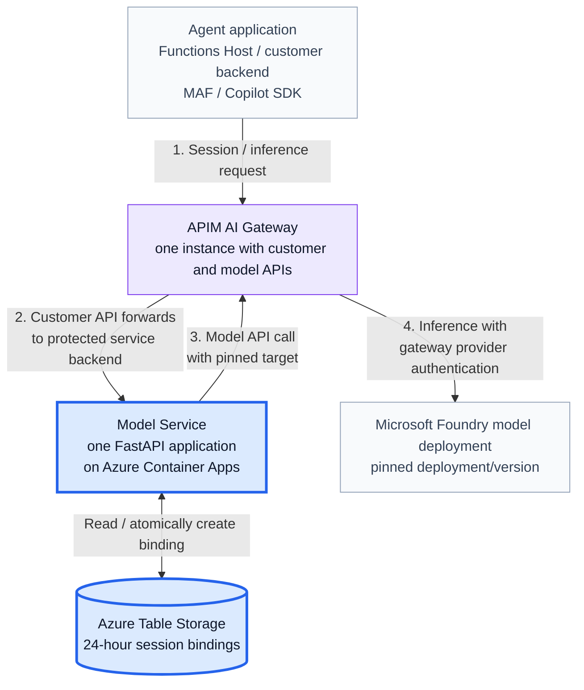
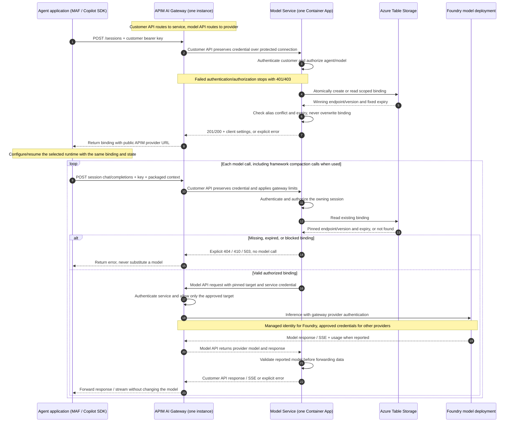

# Minimal Design: Customer Model Service

**Date:** 2026-11-03

**Status:** initial scope aligned with the locally tested session-routing
implementation. The diagrams show the intended APIM-integrated deployment;
the new Azure Table/service and gateway integration are not yet live-qualified.
The contract targets MAF / Copilot SDK; only the Copilot SDK client path has
been smoke-tested locally. The MAF adapter remains integration work.

## 1. Problem

Customers run agents through an **Agent Runtime (MAF / Copilot SDK)** and need
access to several model endpoints.

**Once a session selects a model, every request in that session must use the
same model/version for 24 hours, even if the model-service worker restarts.**

The selected runtime owns conversation state, context preparation, tool
execution, and the agent flow. Compaction follows that framework's capabilities
and configuration; Copilot SDK behavior is not assumed for MAF. The model
service must not maintain a second conversation history.

**Runtime choice:** Microsoft Agent Framework (MAF) is the default in the
Functions Agent Runtime. Copilot SDK is an explicit app-level preview option.
They are alternative execution harnesses, not two stacked agent loops.

## 2. Requirements and Initial Scope

The first version will:

1. Support multiple configured model endpoints.
2. Authenticate customers and restrict which agents and models they can use.
3. Persist one model binding per customer, agent, and session within the application.
4. Keep that binding fixed for **24 hours from creation**, without sliding renewal.
5. Forward runtime-packaged requests without adding history.
6. Reject unauthorized, expired, or conflicting requests.
7. Never silently substitute another model.
8. Keep the service behind APIM / AI Gateway; do not expose an alternate public
   inference path that bypasses gateway controls.
9. Support JSON and SSE through the same pinned-session inference API.
   Customer streaming requires a qualified APIM tier/configuration, not an
   assumption that the existing Consumption pilot supports long-running SSE.

**Boundary:** this provides routing consistency, not a guarantee of uninterrupted
provider availability. Active model deployments must not be retired or upgraded
during their binding window.

For this version, a session belongs to **one agent**. Conversation-wide affinity
across multiple agents is a future extension.

## 3. Design



**Each box is an actual resource or application component.** The blue boxes
identify the custom application and durable binding design. Purple is the
reused APIM resource whose API/policy configuration is in scope. Gray components
are existing callers/providers. Color does not imply network or compute isolation.

### Architecture Steps 1-4

The numbers on the architecture arrows describe these request hops:

| Step | Components involved | What happens |
| --- | --- | --- |
| **1. Session / inference request** | Agent application -> APIM customer API | The MAF / Copilot SDK caller sends either a session-binding request or a model request with runtime-packaged context, its customer bearer key, and the session reference. |
| **2. Customer API forwards** | APIM -> Model Service | APIM preserves the customer credential over the protected backend connection. The service authenticates the customer, checks agent/model permissions, and creates or reads the scoped binding in Azure Table Storage. Inference requires an existing, unexpired binding. |
| **3. Model API call** | Model Service -> the same APIM instance | For inference only, the service forwards the context with the server-selected pinned target and a separate service-to-gateway credential. It does not choose another model for an existing session. |
| **4. Provider inference** | APIM model API -> selected model endpoint | APIM authenticates the service, permits the approved target, and calls the pinned deployment using gateway-owned provider authentication. The customer's bearer key is not sent to the model provider. |

**Session creation uses steps 1-2 and the binding store; it does not call a
model. Inference uses all four steps.** The unnumbered storage arrow represents
the Model Service reading or atomically creating the binding during step 2.

The response returns through:
model -> APIM model API -> Model Service -> APIM customer API -> agent.
The Model Service checks the reported model before forwarding JSON or SSE and
preserves usage when reported. One APIM resource handles both API surfaces;
the model API honors the pinned target instead of reselecting a deployment.

### Components and Their Roles

| Component | Responsibility | Scope |
| --- | --- | --- |
| Agent application / Functions Host | Starts step 1 through its runtime client adapter. Runs MAF / Copilot SDK and owns conversation context, tools, and runtime state. | Existing caller; client adapter required |
| APIM AI Gateway - one instance | Receives step 1, forwards step 2 to the service, and handles steps 3-4 through its separate model API. Provides applicable limits, protected access, and provider authentication. | Managed resource reused; policies in scope |
| Model Service - one Container App | One FastAPI application performs the checks/binding lookup in step 2, makes the pinned call in step 3, and validates the returning model response. Its internal responsibilities are listed below. | Custom application in scope |
| Azure Table Storage | The service reads or atomically creates routing metadata during step 2. State survives application-replica restarts; it contains no conversation transcript. | External store; binding schema/access in scope |
| Microsoft Foundry model deployment | Receives step 4, performs inference with the pinned deployment/version, and returns a model response and usage when available. | Managed inference backend |

### Selected Model Endpoint: Microsoft Foundry

The selected endpoint is a **model deployment inside a Microsoft Foundry
resource**, not another Container App, Function, or agent runtime.

| Azure resource | Type | Purpose |
| --- | --- | --- |
| Foundry resource | `Microsoft.CognitiveServices/accounts`, kind `AIServices` | Provides the managed model inference endpoint |
| Model deployment | `Microsoft.CognitiveServices/accounts/deployments` | Configures the concrete model, version, deployment type, and capacity |

A Foundry resource can contain several deployments. Different models can
share the account endpoint; the inference request's `model` field selects a
**deployment name**, not the customer-facing alias:

```text
Foundry resource
  -> mini-v1       -> approved model A / fixed version
  -> standard-v1   -> approved model B / fixed version
```

In the original POC, `ai-modelpoc-dev-e8d5` contains
`chat-modelpoc-dev-e8d5`, using `gpt-4.1-mini` version `2025-04-14`,
GlobalStandard capacity 3. This is the recorded pilot baseline, not a
recommendation to adopt a Legacy model version for production.
See the [Foundry module](infra/live/modules/foundry.bicep) and
[public parameters](infra/live/main.parameters.json).

**Inference at architecture step 4:**

- The runtime prepares context; the Model Service resolves the session's
  pinned deployment and sends it through APIM's model API.
- APIM permits that target and uses its managed identity with the required
  Foundry inference role. Customer credentials are not sent to Foundry.
- Foundry operates the model-serving compute, processes the messages, and
  generates the response. Our Container App does not load model weights or
  run GPU inference.
- Response/model/usage information returns through APIM to the Model Service
  for validation, then through the customer API to the runtime. Tool execution
  remains with MAF / Copilot SDK; further model calls use the same binding.

An illustrative APIM-to-Foundry request is:

```http
POST https://<foundry-endpoint>/openai/v1/chat/completions
Content-Type: application/json

{"model":"chat-modelpoc-dev-e8d5","messages":[{"role":"user","content":"Summarize this information."}],"max_tokens":128,"store":false}
```

The 24-hour binding pins the deployment/version, not a physical GPU or
provider KV cache. Keep that deployment available and unchanged while bindings
are active; publish a new version under a new deployment name for new sessions.
The existing template uses `versionUpgradeOption: NoAutoUpgrade`. Provider
retirement, quota, and availability still require operational management.
GlobalStandard is a global processing deployment type; an East US 2 resource
does not guarantee East US 2-only inference.

### Inside the Model Service Application

These are code/configuration responsibilities **inside the same application**,
not independently deployed services:

| Internal responsibility | Implementation |
| --- | --- |
| Endpoint catalog and customer agent/model policy | Validated JSON configuration loaded at startup; secrets supplied separately |
| Customer authentication and authorization | Request checks against customer credentials, grants, session ownership, and expiry |
| Session API and 24-hour router | FastAPI handlers and routing logic; atomic binding persistence through the Table Storage adapter |
| Stateless JSON/SSE inference proxy | Async HTTP forwarding to the approved APIM model API; no transcript or tool execution |

Deploy one Python/FastAPI application on **Azure Container Apps**, separate
from the agent's Functions Host. Multiple replicas can run the same application
and compatible catalog while sharing the external binding table. Replicas are
not additional logical services. SDK/framework state still belongs to the caller.

The registry stores routing metadata only:

```text
Customer + Agent + Session
    -> Endpoint + Model version + Created time + Expiry
```

The application namespace separates applications. No prompts, conversation
history, tool outputs, or credential values are stored in the routing registry.
Runtime-state persistence and resume remain the caller's responsibility.

### Request flow

**Session creation (architecture steps 1-2):**

- Receive `POST /sessions` through APIM and authenticate the customer in the service.
- Check permission for the requested agent/model alias and resolve a new
  binding's alias to a configured endpoint.
- Atomically create the 24-hour binding or retrieve the existing one without
  changing its model or extending its expiry.
- Return the session-specific **APIM customer-API URL** for the runtime's client
  adapter. No provider inference is performed.

**Later inference requests (architecture steps 1-4):**

- Receive the request through APIM and authenticate/authorize again in the service.
- Load the existing binding and check ownership, expiry, and pinned endpoint.
- Forward runtime-packaged context through the APIM model API to that endpoint;
  validate and return the response along the reverse path.

Repeated creation with the same model returns the original binding and expiry.
At expiry, return **410: session expired**; a new session ID is required.
If the assigned endpoint is unavailable or changed, return an explicit error,
not another model.

### Sequence: Session Binding and Pinned Inference

Each participant corresponds to an application component or resource above.
One APIM lifeline handles both customer-facing and model-backend requests.



#### Reading the Sequence Numbers

The sequence diagram numbers individual messages; they expand the four
architecture hops rather than using the same numbering scheme.

| Sequence numbers | Meaning |
| --- | --- |
| **1-8** | Create or retrieve the session binding: authenticate, authorize, atomically access the table, and return client settings or an explicit error. No model call occurs. |
| **9-13** | Receive a subsequent inference request, repeat access checks, and read its existing model binding. |
| **14-15** | Failure alternative: return a missing/expired/blocked-binding error without contacting a model. |
| **16-23** | Valid-binding alternative: call the pinned provider through APIM, validate the response in the Model Service, and return JSON/SSE to the owning caller. |

Numbers 14-15 and 16-23 describe alternative branches, not successive model
attempts. Authentication/authorization failures stop earlier with 401/403.

For streaming, messages 19-20 and 22-23 carry incremental SSE events rather
than a buffered complete answer. The Model Service validates model identity
before forwarding the first data event and checks later reported models.
The deployment must disable response buffering on both APIM API surfaces.

**Deployment boundary:** [POC 06](06-shared-foundry-apim/README.md) already used
APIM on both hops for one fixed model. The new routing service is locally
tested as a standalone proxy. Its APIM customer/model routes, protected backend
ingress, and multi-endpoint policies remain deployment/integration work; the
existing fixed-`chat` policy cannot be reused unchanged. The selected APIM
tier's request limits still apply to JSON and streaming on the complete path.

## 4. Authentication: Who Is Calling?

For the minimal version, use **one distinct API key per customer backend**.

- The backend sends `Authorization: Bearer <customer-api-key>` over HTTPS.
- APIM's customer API preserves this credential when forwarding to the service.
- The model service validates the key and derives the customer identity.
- Customer identity is **not trusted from request JSON or an arbitrary tenant
  header**.
- Keys stay in backend secret storage, not browser code, source, or prompts.

Missing or invalid credentials return **401**.

APIM-to-service access must be protected against direct gateway bypass; a plain
tenant header is not gateway authentication. This backend protection is part of
the pending APIM integration, not an already implemented property of POC 07.

For inference, the service authenticates separately to APIM's model API.
APIM uses managed identity for Foundry, or the approved provider credential for
another backend. The customer key is never forwarded to that model API or the
provider. Azure Table access uses the service's managed identity.

## 5. Authorization: What Can This Caller Access?

Maintain a small customer policy:

| Customer | Allowed agents | Allowed models |
| --- | --- | --- |
| Customer A | Assistant | Economy, Quality |
| Customer B | Assistant | Economy |

For every operation, verify:

- The customer may use the requested agent and model.
- The binding belongs to that customer.
- The binding has not expired.
- The requested model matches the binding.

| Condition | Response |
| --- | --- |
| Model or agent not permitted | **403** |
| Session absent under that customer | **404** |
| Attempt to change the session's model | **409** |
| Session expired | **410** |
| Pinned endpoint unavailable or changed | **503** |

Knowing a session ID or URL does **not** grant access. This initial authorization
boundary is **customer-level**, not individual-user-level.

## 6. Agent Runtime - Model Service Contract

The Agent Runtime (MAF / Copilot SDK) owns context preparation, framework-specific
compaction, tool execution, and state persistence. Its client adapter translates
framework messages/options to this HTTP contract. The service owns access checks
and the model binding; it adds no history.
Every protected request carries the customer bearer key described in section 4.

### 6.1 Create or Retrieve a Session Binding

| API | Result |
| --- | --- |
| `POST /sessions` | 201 for a new binding; 200 for the same existing binding |
| `GET /sessions/{agent_id}/{session_id}` | Owning, unexpired binding metadata |
| `GET /sessions/{agent_id}/{session_id}/v1/models` | The session's one allowed model alias |

`POST /sessions`, with `Content-Type: application/json`:

```json
{
  "session_id": "conversation-001",
  "agent_id": "assistant",
  "model_alias": "economy"
}
```

`session_id` and `model_alias` are required; `agent_id` defaults to `assistant`.
Identifiers use 1-64 ASCII letters, digits, underscores, or hyphens. The caller
cannot supply a customer identity, endpoint, or provider credential.

Illustrative response, also returned by the owning session GET:

```json
{
  "tenant_id": "customer-a",
  "agent_id": "assistant",
  "session_id": "conversation-001",
  "sdk_session_id": "8ecde19dbfb341b292ee3bf5af54ada3",
  "model_alias": "economy",
  "model_name": "gpt-4.1-mini",
  "model_version": "2025-04-14",
  "created_at": "2026-11-03T14:30:00+00:00",
  "expires_at": "2026-11-04T14:30:00+00:00",
  "provider_base_url": "https://models.example.com/sessions/assistant/conversation-001/v1",
  "wire_api": "completions",
  "provider_limits": {
    "max_prompt_tokens": 32768,
    "max_output_tokens": 4096
  },
  "context_owner": "caller_sdk"
}
```

The selected runtime's adapter uses the returned binding, model alias, public
base URL, protocol, and limits with the customer's service API key. Copilot SDK
uses the returned ID/provider settings directly. MAF needs an explicit adapter
mapping the binding to its session/chat client and typed messages; that adapter
is not yet implemented.

The existing wire names `sdk_session_id` and `context_owner: "caller_sdk"` are
retained for API compatibility. They identify an opaque caller-side session
reference and caller-owned context, not a requirement to execute Copilot.
On resume, restore the selected framework's tenant-isolated state; do not
silently switch frameworks or start empty history.
The provider URL points to APIM's customer API and carries the routing reference;
it does not grant access and must not expose the container or provider URL.

### 6.2 Inference Request and Response

Send `POST {provider_base_url}/chat/completions`, using the same bearer
credential and `Content-Type: application/json`:

```json
{
  "model": "economy",
  "messages": [
    {"role": "system", "content": "You are a helpful assistant."},
    {"role": "user", "content": "Summarize this synthetic information."}
  ],
  "max_tokens": 128,
  "stream": false,
  "store": false
}
```

- `model` must match the binding's alias. The service substitutes the pinned
  provider deployment.
- `messages` contains the complete runtime-packaged context, including any
  framework-generated compaction summaries and tool-call results. Optional
  `tools` describes function tools; the service does not execute them.
- Output-token settings must fit the configured limit; `store` is omitted or
  false. Provider-managed conversation/response references are not supported.

**JSON success:** HTTP 200 with an OpenAI-compatible response. For example:

```json
{
  "id": "chatcmpl-example",
  "object": "chat.completion",
  "model": "gpt-4.1-mini-2025-04-14",
  "choices": [
    {
      "index": 0,
      "message": {"role": "assistant", "content": "A concise summary."},
      "finish_reason": "stop"
    }
  ],
  "usage": {"prompt_tokens": 12, "completion_tokens": 3, "total_tokens": 15}
}
```

Response `model` is the concrete provider-reported model, not the public alias.
Function-tool responses can have null text content and `tool_calls`. Preserve
tool-call IDs and usage; absent usage means unknown consumption, not zero.

**Streaming scenario:** use the same request and binding with `stream: true`;
optionally request `stream_options: {"include_usage": true}` when supported by
the provider. HTTP 200 returns `Content-Type: text/event-stream`. The runtime
reads `data:` events incrementally through
Foundry -> APIM model API -> Model Service -> APIM customer API -> runtime.
Successful completion ends in `data: [DONE]`. Tool-call deltas are assembled
and authorized by the runtime, not executed by the service.

The Model Service verifies the model before forwarding the first event.
After headers/data have started, failure is an SSE error event without a
successful `[DONE]`; HTTP status cannot be changed. A truncated stream or
disconnect is not a completed answer, and provider usage may still be billed.
Inference responses include the binding expiry in `X-Model-Session-Expires-At`.

**Gateway and timeout boundary:** Microsoft documents long-running SSE on
classic/v2 APIM tiers, not Consumption. Select and qualify a supported tier
before offering customer streaming; this task does not change the existing
APIM SKU. Disable `forward-request` response buffering, body logging, response
cache, and body-inspecting/aggregating policies on both API surfaces.
The service's default **25-second absolute deadline** still applies to SSE;
the 24-hour binding is not a 24-hour connection. Configuration currently allows
up to 120 seconds, subject to the gateway/caller path and capacity qualification.
See the [streaming contract](CONTRACT.md#41-streaming-request-and-response-sse)
and [Microsoft SSE guidance](https://learn.microsoft.com/en-us/azure/api-management/how-to-server-sent-events).

### 6.3 Expiry, Errors, and Retries

The access/conflict/expiry statuses are defined in section 5. Error bodies use:

```json
{
  "error": {
    "code": "session_expired",
    "type": "model_service_error",
    "message": "session_expired"
  }
}
```

- Repeating session creation with the same model preserves the original
  binding and expiry. Inference cannot create a missing session.
- At 24 hours, return 410 and require a new public session ID. An inference
  admitted before expiry may finish under its configured deadline.
- Invalid/oversized input returns 422/413; model mismatch or invalid provider
  output returns 502; registry/backend unavailability returns 503; timeout
  returns 504. Provider errors use `endpoint_http_<status>`, preserving 4xx/5xx.
- The service makes one upstream attempt. Inference is not guaranteed
  idempotent; framework/runtime retries need an explicit budget and may cost tokens.
- Configured byte/output limits and an absolute inference deadline apply
  (25 seconds by default). Disconnect does not guarantee provider rollback.
  `max_prompt_tokens` is a client context-budget hint, not a financial quota;
  its use must be qualified for the selected framework.

This is the initial Chat Completions JSON/SSE contract, not a durable agent-job
API. [CONTRACT.md](CONTRACT.md) retains the expanded field and failure reference.

## 7. Future Extensions

These are not required for the initial routing contract:

- **Entra ID/workload authentication**, per-user permissions, and richer
  credential lifecycle management.
- **Cost-aware admission routing:** choose the cheapest qualified model when
  creating a session, then preserve its 24-hour binding.
- Same-model failover, capacity management, and availability objectives.
- Shared token budgets, billing attribution, and detailed usage reconciliation.
- Additional provider protocols and cross-agent affinity.

## Implementation References

- [Session-affinity setup and SDK guide](07-session-affinity/README.md)
- [Agent Runtime - Model Service contract](CONTRACT.md)
- [Example endpoint/customer catalog](07-session-affinity/config.example.json)
- [Detailed architecture and qualification boundaries](DESIGN.md)

The routing implementation and Copilot SDK client path are locally tested;
the MAF adapter and new Azure Table/service/gateway deployment remain
unqualified. This document does not authorize a deployment or new paid model calls.

**In one sentence:** the Agent Runtime (MAF / Copilot SDK) owns the conversation;
our service owns customer access and the durable 24-hour model assignment.

## 8. FAQ: Storage, Cost, Cleanup, and Streaming

### Why Azure Table Storage Rather Than Redis?

The binding is small routing metadata, written once and point-read by its
customer/agent/session key. We need an authoritative record that survives
service restarts, not another conversation cache. Table Storage supplies that
with usage-based storage/operation charges and no separately provisioned
in-memory instance. Atomic insert prevents concurrent first calls from
selecting different models.

| Consideration | Azure Table Storage | Azure Managed Redis |
| --- | --- | --- |
| Initial fit | Durable key-based routing registry | Low-latency, high-throughput in-memory access |
| Billing shape | Stored GB plus operations | Provisioned node hours, even while idle |
| 24-hour expiry | Application checks `expires_at`; no automatic entity TTL deletion | Key TTL is available, but expiration/eviction must not silently recreate an existing binding |
| Recovery | Storage redundancy and recovery design still matter | Redis can be authoritative, but needs appropriate HA, persistence, eviction, and recovery controls |
| Current implementation | Azure Table adapter and SQLite local adapter | No Redis adapter or cache is implemented |

Redis is not inherently wrong or incapable of persistence. Its performance may
justify the cost at scale, but that must be measured. A future Redis cache can
sit in front of Table Storage; a cache miss must read the authoritative binding,
not select a new model. No comparative latency benchmark or production
availability equivalence is claimed here.

### What Would the Storage Cost Be?

**Illustrative public PAYG rates checked 2026-11-03: East US 2, USD.**
Use one representative month with **1 billable GB average stored,
1,000,000 total point reads, and 100,000 individual create writes**.
Reads include registration/status/inference lookups. Redis examples use
**Balanced B3 (3 GB), 730 hours**, with one versus two billed nodes.

| Option | Rates used | Illustrative monthly baseline |
| --- | --- | ---: |
| Table, Standard LRS / service-scoped encryption key | $0.045/GB-month; $0.00036 per 10,000 reads or writes | **$0.0846 (~$0.08)** |
| Table, Account Encrypted LRS | $0.045/GB-month; $0.005/10,000 reads; $0.025/10,000 writes | **$0.795 (~$0.80)** |
| Table, Account Encrypted ZRS | $0.0562/GB-month; $0.005/10,000 reads; $0.025/10,000 writes | **$0.8062 (~$0.81)** |
| Azure Managed Redis B3, one node / non-HA | $0.065/node-hour x 730 | **$47.45** |
| Azure Managed Redis B3, two nodes / HA | $0.065/node-hour x 730 x 2 | **$94.90** |

For example, Account Encrypted LRS is
`1 x $0.045 + (1,000,000 / 10,000) x $0.005 + (100,000 / 10,000) x $0.025`.
The Table encryption/key scope changes transaction rates; do not assume the
cheapest row applies to every account. Redis API prices are per node; HA is
not the one-node development price. Persistence requires an eligible HA setup.

These are **storage/compute baselines, not the total model-service bill or an
equivalent sizing/SLA comparison**. LRS, ZRS, and Redis HA have different
failure/performance characteristics; Redis needs memory headroom. Excludes
additional scans/lists, cleanup work, replication/persistence configuration,
networking, APIM, Container Apps, model tokens, support, tax, discounts, and
free grants. Retained metadata grows unless a separate retention policy is
implemented; 1 GB is an example average, not a forever-fixed footprint.
No Redis resource or Table account was provisioned for this comparison.

Sources: [Table pricing](https://azure.microsoft.com/en-us/pricing/details/storage/tables/),
[Managed Redis pricing](https://azure.microsoft.com/en-us/pricing/details/managed-redis/),
[Azure Retail Prices API](https://prices.azure.com/api/retail/prices),
and [Redis node calculation rules](https://github.com/AzureManagedRedis/amr-migration-skill/blob/main/references/pricing-tiers.md).
Retail filters were `armRegionName=eastus2`, `currencyCode=USD`,
`priceType=Consumption`, product `Tables` with the listed SKUs, and service
`Redis Cache`, product `Azure Managed Redis - Balanced`, SKU `B3`.
Rates were retrieved directly from the public Retail Prices API, not inferred
from a subscription bill.

### What Is Cleaned Up After 24 Hours?

**Expiry and deletion are separate.** At `created_at + 24 hours`, the service
rejects new session/inference use with 410. A request admitted before expiry
may finish within its bounded deadline. No background job is required to
enforce that access boundary.

**Current v1 behavior:** the full expired binding is retained as a tombstone.
There is no automatic Table TTL, compaction, or cleanup job. Keeping the record
prevents the same public session ID from being silently recreated with another
model. Deleting its only record would allow recreation and break that contract.

**Future physical cleanup:** add a separately approved retention policy and
collector, with a versioned compact-tombstone schema and efficient expiry index
or time buckets. Preserve a consumed-ID marker for as long as old IDs must
remain unusable. Full deletion requires an explicit ID-generation/reuse policy
that still rejects old IDs; do not simply purge every 24-hour row. The current
record decoder requires a full binding, so stripping fields is not a supported
manual cleanup operation. Avoid frequent whole-table scans under the current
hashed-key layout. This collector/schema change is not implemented here.

Do not delete the shared Foundry deployment, APIM instance, storage account,
or provider credentials when one session expires. SDK history, files, tools,
and telemetry have separate owners/retention policies; the routing service
does not store or automatically purge them.

### Can Customers Stream Responses?

**Yes at the service API: JSON and SSE use the same 24-hour binding.**
The local proxy/tests cover fragmented chunks, tool deltas, usage, model
mismatch, truncation, timeout, and disconnect cleanup. Customer-facing
end-to-end streaming through the two APIM APIs still needs a supported
classic/v2 tier and live/load qualification; the original Consumption,
single-model POC is not that evidence.

Use the [streaming contract](CONTRACT.md#41-streaming-request-and-response-sse)
for the exact request, events, buffering/timeouts, and error semantics.
There is no WebSocket protocol, token-stream replay, `Last-Event-ID` resume,
automatic reconnect/retry, or switch to another model. A failed stream may
have incurred tokens; missing final usage remains unknown rather than zero.

Further guidance:
[Table design patterns](https://learn.microsoft.com/en-us/azure/storage/tables/table-storage-design-patterns),
[Redis persistence](https://learn.microsoft.com/en-us/azure/redis/how-to-persistence),
[APIM SSE configuration](https://learn.microsoft.com/en-us/azure/api-management/how-to-server-sent-events),
and [forward-request buffering](https://learn.microsoft.com/en-us/azure/api-management/forward-request-policy).
