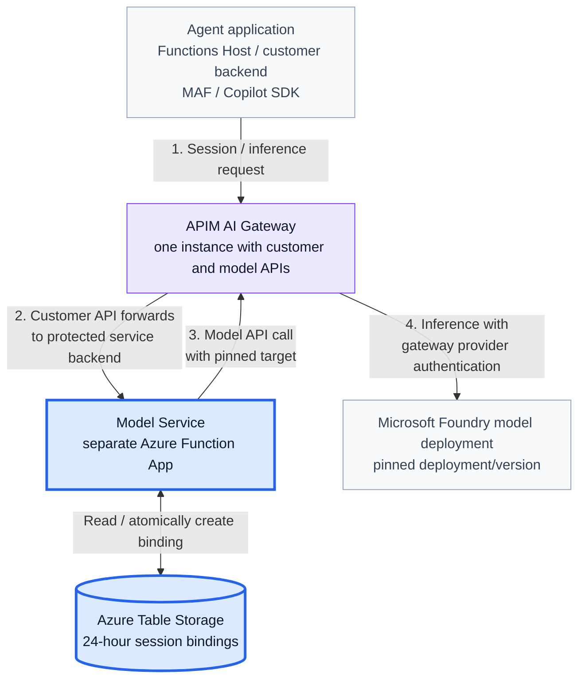
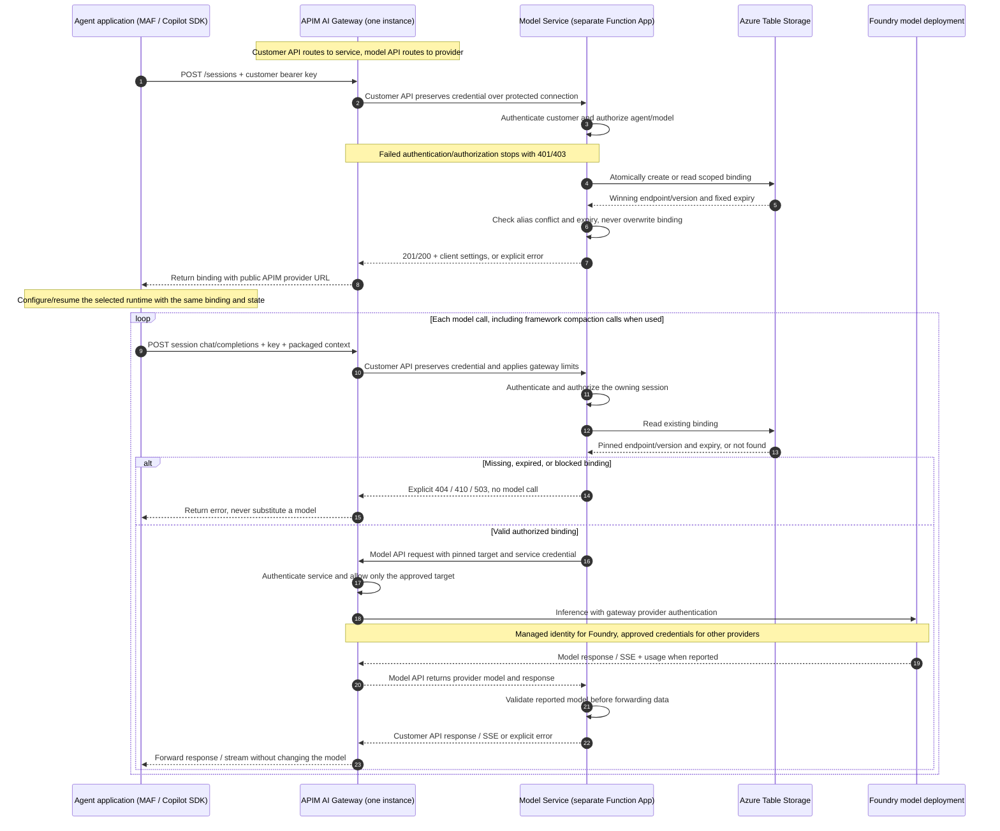

# Customer Model Service

**Date:** 2026-11-03

**Status:** the routing core and Copilot SDK caller path are locally tested.
The diagrams target a separate Azure Function App behind APIM. The Functions
hosting adapter and MAF adapter remain to be built; the new Azure Table/service
and gateway deployment is not live-qualified.
Shared-catalog access below is a design change; the prototype's customer
allowlist checks have not yet been removed.

## 1. Problem

Customers running agents with **MAF / Copilot SDK** need access to multiple
model endpoints. Each session must stay on the **same model/version for
24 hours, even across Model Service restarts**.

The runtime owns conversation context and tools; the Model Service owns
routing and must not keep a second conversation history.

## 2. Requirements and Initial Scope

All authenticated customers can choose any model in the shared catalog when
starting a session. Customer-specific access rules and quotas are future work.

The Model Service must:

1. Each session's model and version by application, customer, agent, and
   session for a fixed **24 hours**, including across service restarts.
2. Check access and expiry on every request. Reject expired or conflicting
   requests; never silently change the pinned model.
3. Forward the context it receives without keeping a second conversation history.
   The agent runtime owns conversation history and tools.
4. Support JSON and streaming through the same session API. Streaming must use a
   qualified APIM setup.
5. Route all requests through APIM / AI Gateway, keeping customer and provider
   credentials separate.

### Out of Scope

- Automatic switching to another model.
- Keeping the same model across multiple agents in one conversation.
- A guaranteed sub-millisecond session lookup.
- Automatic cleanup of expired bindings. A batch job may be added later.
- Customer-specific model/agent policies, traffic quotas, and spending budgets.

### Assumptions

- **Each session belongs to one agent**.
- A model deployment is not retired or upgraded while an active 24-hour binding
  uses it.
- The service checks expiry when a request arrives; deleting the stored record
  is not needed to reject an expired request. Any future cleanup must prevent
  old session IDs from being silently reused.

## 3. Design



**Each box is an actual resource or application component.** The blue boxes
identify the custom application and durable binding design. Purple is the
reused APIM resource whose API/policy configuration is in scope. Gray components
are existing callers/providers. Color does not imply network or compute isolation.

### Architecture Steps 1-4

The numbers on the architecture arrows describe these request hops:

| Step | Components involved | What happens |
| --- | --- | --- |
| **1. Session / inference request** | Agent application -> APIM customer API | The MAF / Copilot SDK caller sends either a session-binding request or a model request with runtime-packaged context, its customer bearer key, and the session reference. |
| **2. Customer API forwards** | APIM -> Model Service | APIM preserves the customer credential over the protected backend connection. The service authenticates the customer, validates new model choices against the shared catalog, and creates or reads the customer-scoped binding in Azure Table Storage. Inference requires an existing, unexpired binding. |
| **3. Model API call** | Model Service -> the same APIM instance | For inference only, the service forwards the context with the server-selected pinned target and a separate service-to-gateway credential. It does not choose another model for an existing session. |
| **4. Provider inference** | APIM model API -> selected model endpoint | APIM authenticates the service, permits the approved target, and calls the pinned deployment using gateway-owned provider authentication. The customer's bearer key is not sent to the model provider. |

**Session creation uses steps 1-2 and the binding store; it does not call a
model. Inference uses all four steps.** The unnumbered storage arrow represents
the Model Service reading or atomically creating the binding during step 2.

The response returns through:
model -> APIM model API -> Model Service -> APIM customer API -> agent.
The Model Service checks the reported model before forwarding JSON or SSE and
preserves usage when reported. One APIM resource handles both API surfaces;
the model API honors the pinned target instead of reselecting a deployment.

### Components and Their Roles

| Component | Responsibility | Scope |
| --- | --- | --- |
| Agent application / Functions Host | Runs MAF or Copilot SDK; owns conversation context, tools, and runtime state. | Existing caller; adapter required |
| APIM AI Gateway - one instance | Customer and model APIs provide access controls, limits, and provider authentication. | Reused resource; policy integration pending |
| Model Service - separate Function App | Python HTTP handlers check access, pin sessions, forward JSON/SSE, and validate responses. | Planned host; routing core locally tested |
| Azure Table Storage | Atomically saves model bindings across restarts; stores no conversation history. | Shared external store; schema/access in scope |
| Microsoft Foundry model deployment | Runs the pinned model/version; returns output and usage when supplied. | Managed inference backend |

### Selected Model Endpoint: Microsoft Foundry

The endpoint is a **model deployment inside a Microsoft Foundry resource**:

- **Resource:** `Microsoft.CognitiveServices/accounts` (`AIServices`) provides the endpoint.
- **Deployment:** `Microsoft.CognitiveServices/accounts/deployments` sets the model, version, deployment type, and capacity.

The Model Service replaces the public alias with the pinned deployment name.
APIM calls Foundry using managed identity, not the customer's key.

Foundry runs inference and returns JSON/SSE through APIM and the Model Service.
The Model Service does not host model weights or GPUs; tools stay with the runtime.

The 24-hour binding pins the deployment/version, not dedicated hardware or
cached conversation state. Keep the deployment unchanged while bindings are active.
See the [Foundry FAQ](#how-is-the-foundry-endpoint-configured) for examples,
pilot settings, upgrades, and region limits.

### Inside the Model Service Application

One Python **Function App**, separate from the agent's Function App:

- **Catalog:** startup-validated JSON for the shared model list; secrets supplied separately.
- **Access:** authenticate callers; check session ownership, expiry, and pinned model.
- **Router:** atomically create/read fixed 24-hour bindings in Table Storage.
- **Proxy:** forward JSON/SSE through APIM; no transcript storage or tool execution.

The current FastAPI prototype needs a Functions HTTP adapter. See the
[hosting comparison](#why-start-with-functions-instead-of-container-apps) and
[state FAQ](#how-do-function-app-instances-share-state).

### Model List Configuration

Reuse the `endpoints` and `models` sections of the operator-controlled
[model catalog](07-session-affinity/config.example.json):

- **`endpoints`:** approved deployments, model versions, URLs, and secret references.
- **`models`:** public model names mapped to endpoint IDs.

The same model list is available to every authenticated customer. Customer
credential mappings still identify callers; per-customer model grants are not
part of this design.

For example, the model-list portion is:

```json
{
  "models": {
    "economy": "mini-20250414",
    "quality": "standard-20250414"
  }
}
```

This is an excerpt; the linked file contains the full configuration.
Add endpoints to expand the list. To retire an endpoint, point its aliases to
an approved replacement for **new sessions**, then keep the old endpoint until
its last binding expires and accepted requests finish.
Do not edit an active endpoint in place.

Configuration loads at startup, not automatically on file changes. Roll out a
compatible catalog to every worker before counting the drain window.
This changes routing choices, not Foundry capacity; it does not add autoscaling,
health-based failover, or model switching for existing sessions.
See the [model-outage FAQ](#what-if-a-pinned-model-is-unavailable-for-hours).

### Request flow

1. **Start the session (architecture steps 1-2).**
   - The agent sends `POST /sessions` through APIM with its customer key and
     requested model.
   - The Model Service checks access and creates or reads the session's fixed
     24-hour model binding in Table Storage.
   - It returns the session's APIM URL and settings. No model is called yet.
   - Repeating the request with the same model keeps the original binding and
     expiry.
2. **Send a model request (architecture steps 1-4).**
   - The agent sends the request and its context through APIM.
   - The Model Service checks access and reads the session binding.
   - If the session is missing, expired, or its endpoint is unavailable, the
     service returns an error. It never picks a different model.
3. **Return the answer.**
   - For a valid session, the Model Service sends the request through APIM to
     the pinned Foundry deployment.
   - It checks the response model, then returns JSON or SSE to the agent.
   - At expiry, the service returns **410: session expired**; the agent must
     start a new session.

### Sequence: Session Binding and Pinned Inference

Each participant corresponds to an application component or resource above.
One APIM lifeline handles both customer-facing and model-backend requests.



#### Reading the Sequence Numbers

The sequence diagram numbers individual messages; they expand the four
architecture hops rather than using the same numbering scheme.

| Sequence numbers | Meaning |
| --- | --- |
| **1-8** | Create or retrieve the session binding: authenticate, check the shared catalog for new bindings, atomically access the table, and return client settings or an explicit error. No model call occurs. |
| **9-13** | Receive a subsequent inference request, repeat access checks, and read its existing model binding. |
| **14-15** | Failure alternative: return a missing/expired/unavailable-binding error without contacting a model. |
| **16-23** | Valid-binding alternative: call the pinned provider through APIM, validate the response in the Model Service, and return JSON/SSE to the owning caller. |

Numbers 14-15 and 16-23 describe alternative branches, not successive model
attempts. Invalid credentials stop earlier with 401; an unknown model for a
new binding returns 422.

For streaming, messages 19-20 and 22-23 carry incremental SSE events rather
than a buffered complete answer. The Model Service validates model identity
before forwarding the first data event and checks later reported models.
The deployment must disable response buffering on both APIM API surfaces.

## 4. Authentication: Who Is Calling?

For the minimal version, use **one distinct API key per customer backend**.

- The backend sends `Authorization: Bearer <customer-api-key>` over HTTPS.
- APIM's customer API preserves this credential when forwarding to the service.
- The model service validates the key and derives the customer identity.
- Customer identity is **not trusted from request JSON or an arbitrary tenant
  header**.
- Keys stay in backend secret storage, not browser code, source, or prompts.

Missing or invalid credentials return **401**.

APIM-to-service access must be protected against direct gateway bypass; a plain
tenant header is not gateway authentication.

For inference, the service authenticates separately to APIM's model API.
APIM uses managed identity for Foundry, or the approved provider credential for
another backend. The customer key is never forwarded to that model API or the
provider. Azure Table access uses the service's managed identity.

## 5. Authorization: What Can This Caller Access?

**Every authenticated customer can use the shared model catalog.** There is no
per-customer model or agent policy in this version. Choosing a model still pins
that session to its selected deployment/version for 24 hours.

For every operation, verify:

- The binding belongs to that customer.
- The binding has not expired.
- Any requested model matches the existing binding.

For a new session, check that the requested model exists in the shared catalog.

| Condition | Response |
| --- | --- |
| New session requests a model outside the shared catalog | **422** |
| Session absent under that customer | **404** |
| Attempt to change the session's model | **409** |
| Session expired | **410** |
| Pinned endpoint unavailable or changed | **503** |

Knowing a session ID or URL does **not** grant access. This initial authorization
boundary is **customer-level**, not individual-user-level.

## 6. Agent Runtime - Model Service Contract

MAF or Copilot SDK manages the conversation, context, tools, and runtime state.
Its adapter calls this HTTP API. The Model Service checks access and keeps the
model binding; it does not store chat history. Include the customer key with
every request.

**Agent Runtime change required:** Add an adapter that creates or resumes the
binding, configures a per-session model client with the returned
`provider_base_url` and model alias, sends the customer key on every request,
and handles **410** without switching models. Restore conversation state in
the runtime. No SDK changes are required.

### 6.1 Create or Retrieve a Session Binding

| API | Result |
| --- | --- |
| `POST /sessions` | 201 for a new binding; 200 for the same existing binding |
| `GET /sessions/{agent_id}/{session_id}` | Owning, unexpired binding metadata |
| `GET /sessions/{agent_id}/{session_id}/v1/models` | The session's pinned model alias, not the full catalog |

`POST /sessions`, with `Content-Type: application/json`:

```json
{
  "session_id": "conversation-001",
  "agent_id": "assistant",
  "model_alias": "economy"
}
```

`session_id` and `model_alias` are required; `agent_id` defaults to `assistant`.
Identifiers use 1-64 ASCII letters, digits, underscores, or hyphens. The caller
cannot supply a customer identity, endpoint, or provider credential.

Illustrative response, also returned by the owning session GET:

```json
{
  "tenant_id": "customer-a",
  "agent_id": "assistant",
  "session_id": "conversation-001",
  "sdk_session_id": "8ecde19dbfb341b292ee3bf5af54ada3",
  "model_alias": "economy",
  "model_name": "gpt-4.1-mini",
  "model_version": "2025-04-14",
  "created_at": "2026-11-03T14:30:00+00:00",
  "expires_at": "2026-11-04T14:30:00+00:00",
  "provider_base_url": "https://models.example.com/sessions/assistant/conversation-001/v1",
  "wire_api": "completions",
  "provider_limits": {
    "max_prompt_tokens": 32768,
    "max_output_tokens": 4096
  },
  "context_owner": "caller_sdk"
}
```

The selected runtime's adapter uses the returned binding, model alias, public
base URL, protocol, and limits with the customer's service API key. Copilot SDK
uses the returned ID/provider settings directly. MAF needs an explicit adapter
mapping the binding to its session/chat client and typed messages; that adapter
is not yet implemented.

The existing wire names `sdk_session_id` and `context_owner: "caller_sdk"` are
retained for API compatibility. They identify an opaque caller-side session
reference and caller-owned context, not a requirement to execute Copilot.
On resume, restore the selected framework's tenant-isolated state; do not
silently switch frameworks or start empty history.
The provider URL points to APIM's customer API and carries the routing reference;
it does not grant access and must not expose the container or provider URL.

### 6.2 Inference Request and Response

Send `POST {provider_base_url}/chat/completions`, using the same bearer
credential and `Content-Type: application/json`:

```json
{
  "model": "economy",
  "messages": [
    {"role": "system", "content": "You are a helpful assistant."},
    {"role": "user", "content": "Summarize this synthetic information."}
  ],
  "max_tokens": 128,
  "stream": false,
  "store": false
}
```

- `model` must match the binding's alias. The service substitutes the pinned
  provider deployment.
- `messages` contains the complete runtime-packaged context, including any
  framework-generated compaction summaries and tool-call results. Optional
  `tools` describes function tools; the service does not execute them.
- Output-token settings must fit the configured limit; `store` is omitted or
  false. Provider-managed conversation/response references are not supported.

**JSON success:** HTTP 200 with an OpenAI-compatible response. For example:

```json
{
  "id": "chatcmpl-example",
  "object": "chat.completion",
  "model": "gpt-4.1-mini-2025-04-14",
  "choices": [
    {
      "index": 0,
      "message": {"role": "assistant", "content": "A concise summary."},
      "finish_reason": "stop"
    }
  ],
  "usage": {"prompt_tokens": 12, "completion_tokens": 3, "total_tokens": 15}
}
```

Response `model` is the concrete provider-reported model, not the public alias.
Function-tool responses can have null text content and `tool_calls`. Preserve
tool-call IDs and usage; absent usage means unknown consumption, not zero.

#### Streaming Contract (SSE)

Use `POST {provider_base_url}/chat/completions` with the same customer bearer
credential, unexpired binding, model alias, and runtime-owned context.
The session is still pinned for 24 hours; streaming changes delivery, not model
selection or context ownership.

**Request:** `Content-Type: application/json`, with `stream: true`. When
supported by the provider, request final usage with `stream_options.include_usage`:

```json
{
  "model": "economy",
  "messages": [
    {"role": "user", "content": "Summarize this synthetic information."}
  ],
  "max_tokens": 128,
  "stream": true,
  "stream_options": {"include_usage": true},
  "store": false
}
```

**Success:** HTTP 200 with `Content-Type: text/event-stream`,
`Cache-Control: no-store`, and `X-Model-Session-Expires-At`.
Events return incrementally through
Foundry -> APIM model API -> Model Service -> APIM customer API -> runtime.
Each SSE event ends with a blank line; an illustrative wire response is:

```text
data: {"id":"chatcmpl-example","object":"chat.completion.chunk","created":1793716200,"model":"gpt-4.1-mini-2025-04-14","choices":[{"index":0,"delta":{"role":"assistant","content":"A concise"},"finish_reason":null}]}

data: {"id":"chatcmpl-example","object":"chat.completion.chunk","created":1793716200,"model":"gpt-4.1-mini-2025-04-14","choices":[{"index":0,"delta":{"content":" summary."},"finish_reason":"stop"}]}

data: {"id":"chatcmpl-example","object":"chat.completion.chunk","created":1793716200,"model":"gpt-4.1-mini-2025-04-14","choices":[],"usage":{"prompt_tokens":12,"completion_tokens":3,"total_tokens":15}}

data: [DONE]

```

The Model Service validates the reported model before forwarding the first
data event and checks later reported models. HTTP chunks can split SSE events;
the runtime must parse event framing, not treat each chunk as one token/event.
Text, function-tool deltas, and usage remain provider-compatible. The runtime
assembles and authorizes complete tool calls; it must not execute partial
arguments. Missing usage is unknown consumption, not zero.

**Failure after streaming starts:** HTTP status cannot change after headers
have been sent. A late failure emits a safe error event and no successful
`[DONE]`, for example:

```text
data: {"error":{"code":"provider_stream_interrupted","type":"model_service_error","message":"provider_stream_interrupted"}}

```

An error event or EOF without `[DONE]` is a failed/partial outcome, not a complete
answer. On caller disconnect or local cancellation, the service closes the
upstream stream, but cannot promise rollback or zero provider cost.
No token-stream replay, `Last-Event-ID` resume, automatic reconnect/retry,
WebSocket, or mid-stream model fallback is supplied.

**APIM requirements for both API surfaces:**

1. Use a supported **classic/v2 APIM tier** for customer SSE. Microsoft does not
   support long-running SSE on Consumption. No SKU change is performed here.
2. Set `buffer-response="false"` on `forward-request` for the customer API and
   the model-backend API; preserve SSE content type and relay events promptly.
3. Disable response caching, request/response body logging, and policies that
   inspect/aggregate/buffer the stream. Keep caller/provider credentials separate.
4. Align caller, service, and gateway limits with headroom for both hops.
   `forward-request timeout` controls waiting for backend headers, not an
   unlimited total streaming lifetime.

Illustrative backend policy on each supported-tier API, not a full API policy:

```xml
<backend>
  <forward-request timeout="120" buffer-response="false" />
</backend>
```

**Duration and limits:** the service's **25-second absolute inference/stream
deadline** remains the default. Configuration permits
`upstream_timeout_seconds` up to 120, subject to full-path qualification.
The example gateway header timeout does not override the shorter application
deadline or a tier's total limit. Longer-than-120-second application streaming
needs a separate implementation/capacity review. Configured byte/output limits
also apply; `max_prompt_tokens` is a client context-budget hint, not a financial
quota. A 24-hour binding is not a 24-hour connection. A stream admitted before
binding expiry can finish only within its bounded deadline; it cannot start
another inference after expiry.

**Qualification boundary:** local tests cover proxy SSE behavior; the Functions
hosting adapter, live two-hop APIM streaming, load, and runtime failure handling
remain qualification work. The external MAF adapter is still pending;
a Copilot SDK smoke does not prove MAF streaming. The complete contract above is self-contained;
[CONTRACT.md](CONTRACT.md#41-streaming-request-and-response-sse) is an optional
expanded reference.

### 6.3 Expiry, Errors, and Retries

The access/conflict/expiry statuses are defined in section 5. Error bodies use:

```json
{
  "error": {
    "code": "session_expired",
    "type": "model_service_error",
    "message": "session_expired"
  }
}
```

- Repeating session creation with the same model preserves the original
  binding and expiry. Inference cannot create a missing session.
- At 24 hours, return 410 and require a new public session ID. An inference
  admitted before expiry may finish under its configured deadline.
- Invalid/oversized input returns 422/413; model mismatch or invalid provider
  output returns 502; registry/backend unavailability returns 503; timeout
  returns 504. Provider errors use `endpoint_http_<status>`, preserving 4xx/5xx.
- The service makes one upstream attempt. Inference is not guaranteed
  idempotent; framework/runtime retries need an explicit budget and may cost tokens.
- Configured byte/output limits and an absolute inference deadline apply
  (25 seconds by default). Disconnect does not guarantee provider rollback.
  `max_prompt_tokens` is a client context-budget hint, not a financial quota;
  its use must be qualified for the selected framework.

This is the initial Chat Completions JSON/SSE contract, not a durable agent-job
API. [CONTRACT.md](CONTRACT.md) retains the expanded field and failure reference.

## 7. Future Extensions

These are not required for the initial routing contract:

- **Customer policies:** per-customer model/agent access rules, request/token
  quotas, concurrent-request limits, spending budgets, and policy management.
- **Entra ID/workload authentication**, per-user permissions, and richer
  credential lifecycle management.
- **Cost-aware admission routing:** choose the cheapest qualified model when
  creating a session, then preserve its 24-hour binding.
- Same-model failover, capacity management, and availability objectives.
- Billing attribution and detailed usage reconciliation.
- Additional provider protocols and cross-agent affinity.

## Implementation References

- [Session-affinity setup and SDK guide](07-session-affinity/README.md)
- [Agent Runtime - Model Service contract](CONTRACT.md)
- [Example endpoint/customer catalog](07-session-affinity/config.example.json)
- [Detailed architecture and qualification boundaries](DESIGN.md)

The routing core and Copilot SDK client path are locally tested. The Functions
hosting adapter and MAF adapter are not implemented; the new Azure
Table/service/gateway deployment remains unqualified. This document does not
authorize a deployment or new paid model calls.

**In one sentence:** the Agent Runtime (MAF / Copilot SDK) owns the conversation;
our service owns customer access and the durable 24-hour model assignment.

## 8. FAQ: Storage, Cost, Cleanup, and Streaming

### Why start with Functions instead of Container Apps?

**We expect low traffic and want to keep COGS (the cost of running the service)
low while we learn.** Start with a separate Function App. The proposed plan is
**Flex Consumption, on demand, with no always-ready instances initially**.
Compute can scale to zero when idle; execution and resource use drive its bill.
We accept cold starts initially, but still need to meet caller timeouts.

| Consideration | Function App: initial choice | Container Apps: future option |
| --- | --- | --- |
| Low, uneven traffic | On-demand compute suits the initial cost goal | Consumption hosting can also scale to zero |
| Existing code | Reuse the routing core; a Functions HTTP adapter is still needed | Runs the FastAPI container directly |
| JSON and streaming | Supported with a compatible Python HTTP streaming setup; validate every endpoint | FastAPI handles both; APIM still needs streaming configuration |
| Growing traffic | Measure cost, concurrency, and cold starts before changing plans | Consider when measured load or operations justify it |

This is a cost strategy, **not proof that Functions is always cheaper**.
Total COGS also includes APIM, Table and Functions host/deployment storage,
monitoring, networking, and model tokens. Customer SSE still requires a supported
classic/v2 APIM tier; the existing Consumption pilot is not enough.
Python HTTP streams require compatible streaming-enabled HTTP functions in the
same Function App; an ordinary ASGI wrapper is not streaming qualification.
See [Flex Consumption](https://learn.microsoft.com/en-us/azure/azure-functions/flex-consumption-plan),
[billing](https://learn.microsoft.com/en-us/azure/azure-functions/functions-consumption-costs#consumption-based-costs),
and [Python HTTP streams](https://learn.microsoft.com/en-us/azure/azure-functions/functions-bindings-http-webhook-trigger?pivots=programming-language-python#http-streams).

### Can we change the hosting later without changing customer code?

**Yes, if we keep the API contract unchanged.** Customers call APIM, not the
Function App directly. Later, we can host the service in Container Apps and
change APIM's protected backend while keeping the public URL, routes,
authentication, JSON/SSE responses, and errors the same.

Keep the same application namespace, compatible catalog, and shared Table
bindings so existing sessions retain their pinned model and expiry. Validate
identity permissions, networking, timeouts, streaming, and rollout/draining
before switching. APIM makes replacement easier for customers; it does not
make migration automatic or guarantee zero downtime.

### How is the Foundry endpoint configured?

One resource can hold several named deployments, such as `mini-v1` and
`standard-v1`, each with an approved model/version and capacity. The provider
request's `model` field uses a deployment name, not the public alias `economy`.
APIM supplies its managed-identity token and needs the required Foundry
inference role. A simplified request is:

```http
POST https://<foundry-endpoint>/openai/v1/chat/completions
Content-Type: application/json

{"model":"chat-modelpoc-dev-e8d5","messages":[{"role":"user","content":"Summarize this information."}],"max_tokens":128,"store":false}
```

**Recorded pilot:** resource `ai-modelpoc-dev-e8d5`, deployment
`chat-modelpoc-dev-e8d5`, model `gpt-4.1-mini` version `2025-04-14`,
GlobalStandard capacity 3. This Legacy pilot baseline is not a production
model recommendation. See the [Foundry module](infra/live/modules/foundry.bicep)
and [public parameters](infra/live/main.parameters.json).

### What about model upgrades and processing regions?

- Keep a pinned deployment/version unchanged while bindings are active.
  Use a new deployment name for upgrades and new sessions.
- The template uses `versionUpgradeOption: NoAutoUpgrade`. Provider retirement,
  quota, and outages still need planning; the setting is not a promise of
  permanent availability. See [model upgrade guidance](https://learn.microsoft.com/en-us/azure/foundry/openai/how-to/working-with-models#model-deployment-upgrade-configuration).
- GlobalStandard can process requests globally. An East US 2 resource does
  not guarantee East US 2-only inference.

### How do Function App instances share state?

Scaled-out Function App workers use compatible catalogs and one shared binding
table. No binding depends on a worker staying alive for 24 hours. The registry
stores only:

```text
Application + Customer + Agent + Session
    -> Endpoint + Model version + Created time + Expiry
```

It stores no prompts, conversation history, tool outputs, or credential values.
The runtime stores and restores its own conversation state. A binding reserves
neither a physical GPU nor the provider's context cache.

### Why use Table Storage instead of Redis?

We store a small record saying which model a session uses. Table Storage keeps
that record durably and charges for storage and operations. **Very low lookup
latency is not a requirement.** Redis is useful when speed or traffic justifies
paying for a running service, but it is not needed just to keep these bindings.
Redis can also be durable when configured for it; it is not inherently unsafe.

| Choice | Example monthly storage/compute cost |
| --- | ---: |
| Table, Standard LRS, service-scoped key | $0.08 |
| Table, Account Encrypted LRS | $0.80 |
| Table, Account Encrypted ZRS | $0.81 |
| Managed Redis B3, one node | $47.45 |
| Managed Redis B3, two-node HA | $94.90 |

These are illustrative East US 2 USD rates checked 2026-11-03: 1 GB average
stored, 1 million reads, 100,000 writes, and 730 hours for Redis. Encryption
choice changes Table transaction prices. This is not a full service bill or an
equal-size/availability comparison; it excludes APIM, Function App hosting, model
tokens, tax, and discounts. See [Table pricing](https://azure.microsoft.com/en-us/pricing/details/storage/tables/),
[Managed Redis pricing](https://azure.microsoft.com/en-us/pricing/details/managed-redis/),
and [Redis persistence](https://learn.microsoft.com/en-us/azure/redis/how-to-persistence).

### How do four streaming requests stay separate?

All four requests may use the **same Foundry deployment**. Each request still
has its own context and its own response stream:

| Request | Customer/session | Context sent by the agent | Its own stream returns |
| --- | --- | --- | --- |
| 1 | A / S1 | Project ALPHA | ALPHA answer |
| 2 | A / S2 | Project BETA | BETA answer |
| 3 | B / S1 | Project GAMMA | GAMMA answer |
| 4 | A / S1 | R1 history + a follow-up | ALPHA follow-up answer |

Requests 1-3 can run at the same time. Request 4 follows request 1, so the
agent includes S1's earlier conversation. The same text is not guaranteed
from a model; these names just make the example easy to follow.

- **Model Service:** checks the caller's credential, then looks up the binding
  by application, customer, agent, and session. Thus A/S1 and B/S1 are
  different, even though both are called S1. It opens one upstream request and
  one downstream SSE stream per call; chunks go only to that call's response.
- **Foundry:** handles each submitted chat-completion request and streams its
  answer back on that request. It does not combine these requests into one chat
  history. The caller must send the messages it wants the model to use each
  time. The deployment is shared compute, not a separate model per customer.
- **Agent runtime:** stores each conversation separately and sends the right
  history with each request. The service cannot detect if the runtime sends
  another customer's text by mistake.

An error in one stream fails that request; it should not redirect tokens to a
different session. Shared capacity limits or an outage can still affect several
requests. Local streaming tests pass, but live two-APIM-hop streaming and
end-to-end runtime isolation still need qualification. See the [complete
streaming contract above](#streaming-contract-sse) for request, event, timeout,
and error details.

### What happens at 24 hours, and is cleanup needed?

The service saves a fixed expiry time when it creates the binding. Every new
request checks it. At or after that time, the request is rejected with
**HTTP 410, `session_expired`**; the service does not call the model or silently
choose another model. Requests do not extend the expiry. A request accepted
before expiry may finish within its normal deadline.

Cleanup is **not needed** to enforce expiry. Version 1 keeps expired bindings
so an old session ID cannot be silently assigned a different model. There is no
automatic delete job today. A future batch job could reduce stored data, but
must preserve protection against reusing old session IDs. It must not delete
Foundry, APIM, or shared credentials. Conversation history and telemetry have
their own storage and cleanup rules.

### Isolation and access

#### How do we keep users within the same customer separate?

**The customer key does not identify individual users.** The Agent Runtime must
authenticate each user and check session ownership before loading history,
documents, or tool results, or calling the Model Service. Keep the key in the
backend, not the browser. Model Service enforcement of user ownership would
need a verified user identity or session-scoped credential; that is future work.

#### What if two requests arrive for the same session?

The Agent Runtime must allow one active turn per session and queue or reject
overlapping turns. Coordinate across runtime instances and use history revision
checks to prevent stale writes. Tool operations need stable operation IDs and
downstream deduplication or reconciliation. Atomic model binding creation does
not order history or guarantee exactly-once tool actions.

### Streaming and reliability

#### Which APIM tier will we use, and how do we test streaming?

**The SKU is not final.** Basic v2 is a candidate; networking and cost needs may
require another supported tier. Consumption is not supported for long-running
SSE. On both API surfaces, disable response buffering, response caching, and
body logging. Send timestamped test events at regular intervals and verify
arrival times against a forwarding-delay limit, rather than receiving a burst
at the end. Test each hop and the full Functions path under load. This remains
qualification work; see [Microsoft's SSE guidance](https://learn.microsoft.com/en-us/azure/api-management/how-to-server-sent-events).

#### What if a stream stops halfway? Is retry safe?

Show **"Response interrupted"** and mark received text as partial. An error
event or EOF without `[DONE]` is not success. Do not execute partial tool calls
or automatically replay the request. A retry may incur another model charge;
check and deduplicate any tool actions already performed. Our own request ID
does not make the provider's inference idempotent.

#### What if a pinned model is unavailable for hours?

The existing session returns an error, not another model. The customer may wait
while the binding is valid or explicitly start a new session using an available,
approved model.

Use the shared [model catalog](#model-list-configuration) to add replacements
and change alias mappings for new sessions. Every authenticated customer sees
the same choices. Keep old endpoint definitions until their last bindings
expire and accepted requests finish.
Start the drain window after all workers use the revised catalog; older workers
may still create bindings to the old endpoint during rollout.
Allow 24 hours from the last old binding's creation, plus time for accepted
requests to finish. Catalog changes do not repair an outage or move an existing
binding. A per-model pause switch is not implemented.

### Scale and governance

#### How do we stop one customer using everyone else's capacity?

**Per-customer traffic policies are a future feature.** Initially, customers
share the model catalog and provider capacity without individual quotas.
Service-wide safety limits and provider limits still apply. Keep capacity
headroom and monitor traffic, but do not promise fairness or reserved capacity:
one customer's load can affect others. See [Future Extensions](#7-future-extensions).

#### Should the next session keep the conversation after 24 hours?

A new routing binding is required; an empty conversation is not. Offer an
explicit **"Continue conversation"** choice as the recommended runtime behavior.
The runtime can carry authorized
history or a summary into the new session, after checking the new model's
context limits and capabilities. Otherwise, start fresh. The Model Service
does not copy or store that history.

#### How do we assign cost when a stream ends before usage arrives?

Record one usage entry per provider attempt, linked to the customer and session;
do not double-count the two gateway hops. Use reported usage when available.
Otherwise, mark cost as **estimated or unknown**, never zero. Observed output
may miss tokens the provider generated after disconnect. Reconcile where
provider records allow; exact per-session costs may remain unavailable.
Customer budget enforcement and billing policies are future work.

#### What if customers require data residency or dedicated compute?

Confirm these needs before onboarding. GlobalStandard may process globally;
the account's region does not promise regional-only inference. Select and
verify suitable regional or Data Zone options where available. Include runtime
history, documents, and telemetry in the residency review. Private networking
and provisioned throughput do not by themselves guarantee dedicated physical
hardware. Stricter requirements may rule out the initial shared deployment.
See [Foundry deployment options](https://learn.microsoft.com/en-us/azure/foundry/foundry-models/concepts/deployment-types#choose-the-right-deployment-type).

Further guidance: [Table design patterns](https://learn.microsoft.com/en-us/azure/storage/tables/table-storage-design-patterns),
[APIM SSE](https://learn.microsoft.com/en-us/azure/api-management/how-to-server-sent-events),
and [APIM forwarding/buffering](https://learn.microsoft.com/en-us/azure/api-management/forward-request-policy).
